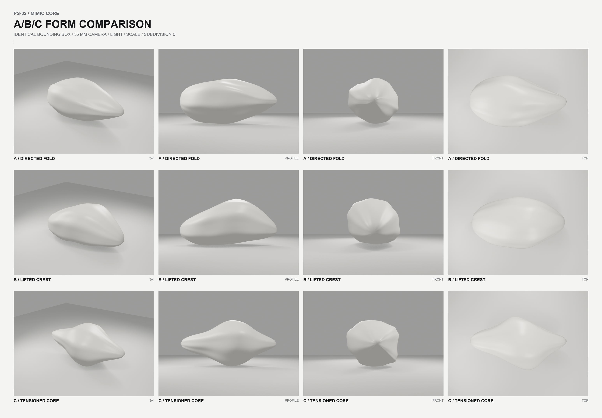
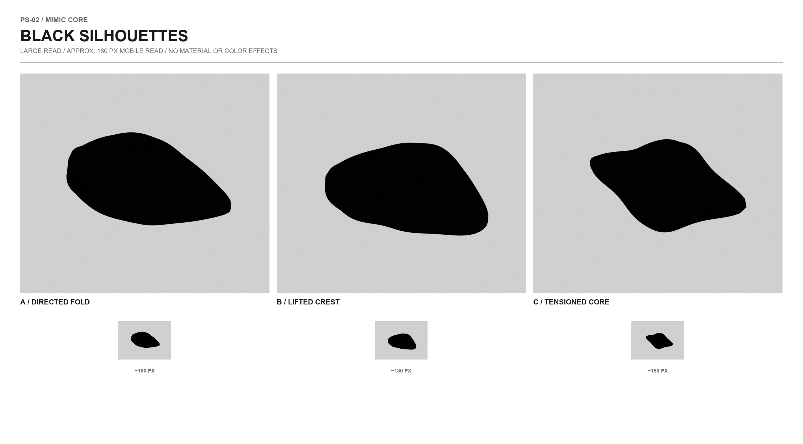
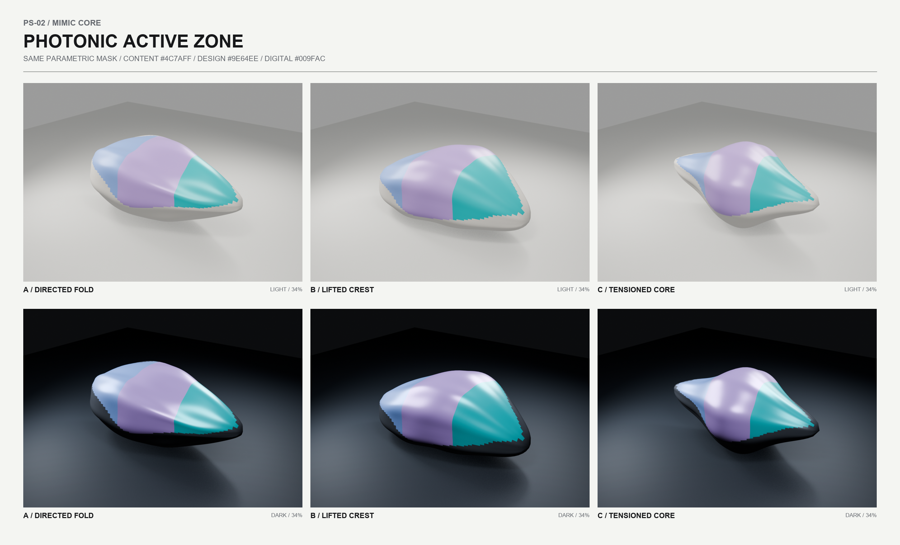
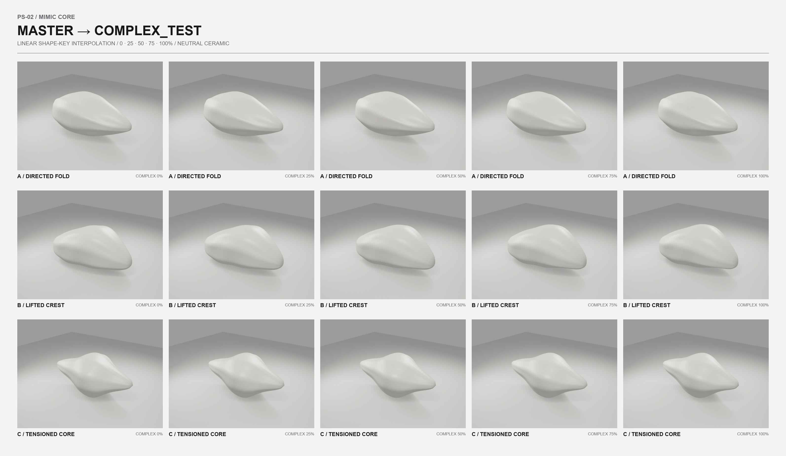
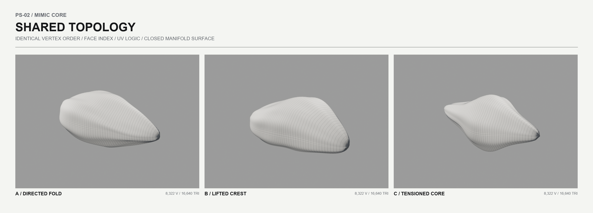
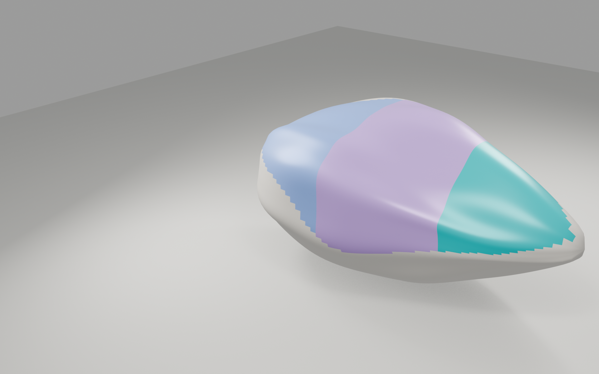
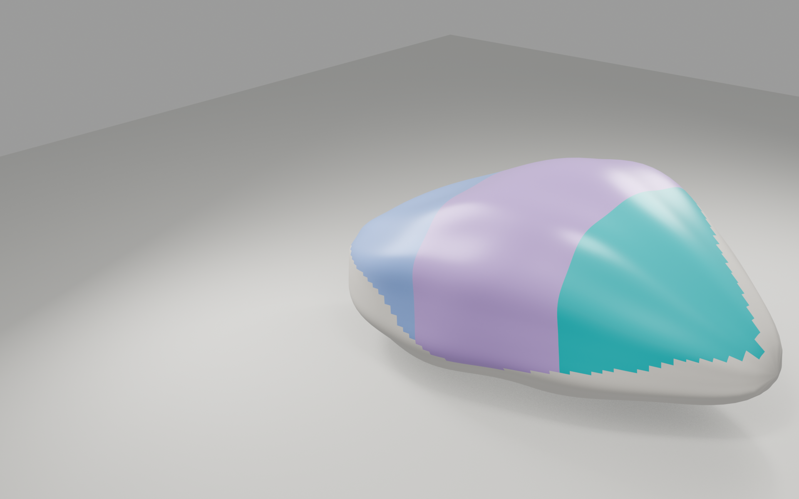
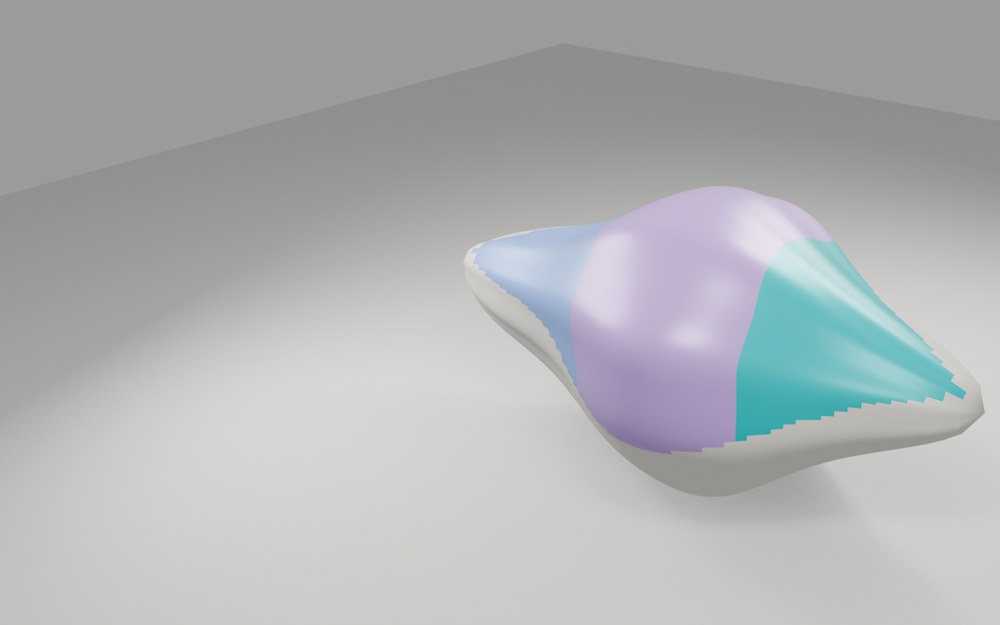

# PS-02 — Mimic Core: техническая проверка и выбор направления

Статус: **три кандидата подготовлены для сравнения; ни один не утверждён как master-модель**.

Дата прогона: 2 августа 2026. Этап изолирован в `design/photonic-skin/ps-02/`; production-страницы, Photonic Skin Lab и публичные ассеты не изменялись.

## Сводная рекомендация

Варианты A и C набрали одинаковый итоговый балл, но решают разные задачи:

- **A / Directed Fold** лучше всего передаёт направленное действие и увереннее читается в малом размере. Главный риск — остаточная ассоциация со стрелкой или аэродинамической деталью.
- **C / Tensioned Core** выглядит наиболее скульптурно и премиально, а внутреннее напряжение лучше поддерживает идею адаптивного объекта. Главный риск — ассоциации с автомобильным формообразованием, животной пластикой или alien-tech при чрезмерном усилении рёбер.
- **B / Lifted Crest** даёт самое спокойное раскрытие и хорош для `BRAND-WIDE`, но слабее остальных фиксирует направление и чаще приближается к камню, волне или blob.

Моя рабочая рекомендация — **вынести C вперёд как кандидата на следующий раунд уточнения**, сохранив A как контроль направленности. Это не окончательный выбор: перед PS-03 пользователь должен выбрать A, B или C либо запросить ещё один ограниченный раунд PS-02.

## Визуальные материалы

### Нейтральное сравнение A/B/C

Одинаковые камера, масштаб, bounding box, свет, фон, разрешение, материал и subdivision. Ряды: 3/4, профиль, фронт, вид сверху.



### Чёрные силуэты

Силуэты показаны крупно и в размере около 180 px, без материала и цветовых эффектов.



### Активная фотонная зона

Один и тот же топологический набор маски, три разрешённых цвета и светлая/тёмная нейтральная основа.



### Проверка `MASTER → COMPLEX_TEST`

Для каждого кандидата показаны 0%, 25%, 50%, 75% и 100%.



### Общая топология

У A, B и C совпадают число и порядок вершин, индексы полигонов и UV-развёртка.



### Hero-кадры без интерфейса







## Среда и воспроизводимость

- Blender: **4.5.3 LTS**.
- Исполняемый файл: `C:\Program Files\Blender Foundation\Blender 4.5\blender.exe`.
- Headless-запуск и реальный Eevee-рендер через Python проверены до построения артефактов.
- Рендер-движок: Eevee; объектив 55 mm; subdivision level 0 для всех кандидатов.
- Фон, World, key/fill/rim-свет и плоскость одинаковы для каждого сравнительного кадра.
- Светлый материал: ivory technical ceramic; тёмный: satin dark titanium. Emission, bloom, зеркальный chrome и случайная hue rotation не используются.

Воспроизведение из корня репозитория:

```powershell
& 'C:\Program Files\Blender Foundation\Blender 4.5\blender.exe' --background --factory-startup --python design/photonic-skin/ps-02/scripts/build_ps02.py
python design/photonic-skin/ps-02/scripts/compose_boards.py
```

Второй скрипт требует Pillow. В текущем окружении использован уже доступный bundled Python с Pillow 12.2; новые npm-зависимости не добавлялись.

## Артефакты

- Управляемый Blender-источник: `blender/ps-02-mimic-core.blend`.
- Воспроизводимая генерация, проверка, GLB-экспорт и панельные рендеры: `scripts/build_ps02.py`.
- Сборка сравнительных досок: `scripts/compose_boards.py`.
- GLB: `exports/mimic-core-a-directed-fold.glb`, `exports/mimic-core-b-lifted-crest.glb`, `exports/mimic-core-c-tensioned-core.glb`.
- Машиночитаемый протокол: `exports/ps02-technical-validation.json`.
- Итоговые PNG: директория `renders/`; исходные панели досок: `renders/_panels/`.

Экспериментальные GLB не помещены в `public/` и не подключены к Lab.

Каждый GLB дополнительно импортирован обратно в чистую Blender-сцену. Во всех трёх экспортных сетках получено одинаково 9 049 runtime-вершин после дублирования по UV/material seams, 16 640 треугольников и три glTF morph target. `MASTER` в GLB является базовой позицией (`Basis`), а именованные `SINGLE_TEST`, `COMPLEX_TEST` и `BRAND_WIDE_TEST` сохранены. В исходном `.blend` все четыре состояния, включая именованный `MASTER`, присутствуют явно.

## Общая топологическая основа

База строится один раз в параметрах `(s, phi)`: два полюса и 52 внутренних кольца по 160 вершин. Между кольцами находятся согласованные quad-полосы, полюса закрыты triangle-fan. A, B и C получают разные координаты из одного параметрического набора, но используют один и тот же список граней. После создания кандидатов не применяются remesh, boolean или иные операции, меняющие соответствие вершин.

| Показатель | Результат |
| --- | ---: |
| Вершины | 8 322 |
| Грани | 8 480 |
| Треугольники runtime-сетки | 16 640 |
| Рёбра | 16 800 |
| Связные компоненты | 1 |
| Loose vertices | 0 |
| Non-manifold edges | 0 |
| Euler characteristic | 2 |
| Bounding box каждого `MASTER` | 6.8 × 3.6 × 3.2 |

Topology hash всех кандидатов: `8883e7698bbd3a6aafef5a4a8a4ea5f04ee96d7ad7cc41cee841a94986e1e462`.

UV-карта `MimicCoreUV` создаётся из тех же параметров. UV hash A/B/C одинаков: `c5eff463ac2b978f0470e1fef6fffc4eb5a01fe06f66262b3effba5518e67683`.

## Shape keys и морфинг

Каждый объект содержит четыре shape key с одинаковым порядком и числом координат:

1. `MASTER` — каноническое состояние кандидата.
2. `SINGLE_TEST` — более сфокусированное и собранное состояние.
3. `COMPLEX_TEST` — сходящиеся крупные поверхностные напряжения.
4. `BRAND_WIDE_TEST` — более спокойное и раскрытое состояние.

Автоматическая проверка выполнена для трёх переходов от `MASTER` на 0%, 25%, 50%, 75% и 100%: 15 состояний на кандидата, 45 состояний суммарно. На каждом состоянии проверялись положительный signed volume, минимальная площадь треугольника, знак dot product нормали относительно `MASTER` и пересечения между несоседними гранями через BVH.

| Кандидат | Состояний | Min signed volume | Min triangle area | Min normal dot | Самопересечения | Итог |
| --- | ---: | ---: | ---: | ---: | ---: | --- |
| A / Directed Fold | 15 | 30.161032 | 0.000379455 | 0.932049 | 0 | PASS |
| B / Lifted Crest | 15 | 31.742740 | 0.000681200 | 0.936811 | 0 | PASS |
| C / Tensioned Core | 15 | 22.462015 | 0.000407146 | 0.920558 | 0 | PASS |

Во всех 45 состояниях отсутствуют разрывы, инверсия normals, схлопывание граней, non-adjacent self-intersections и механические сочленения. Проверка техническая и не заменяет художественную оценку промежуточного силуэта.

## Активная зона 34%

Скрипт создаёт два point-domain атрибута — `_PHOTONIC_MASK` и `_PHOTONIC_SLOT` — и vertex group `PhotonicActive_34`. В маске используется один и тот же набор индексов граней для A, B и C; активны 2 526 граней. Порог подбирается по средней площади общей топологической области с целевым параметром **34% active / 66% neutral**.

После различной деформации одной и той же маски фактическая физическая площадь отличается: A — 31.04%, B — 34.72%, C — 36.61%; среднее — 34.12%. Это ожидаемое следствие требования об идентичности топологической маски, а не разные маски для кандидатов. Перед production потребуется решить, приоритетнее ли строго одинаковая область по UV/индексам или ровно 34% физической площади в каждом морф-состоянии.

Для теста используются только:

- content `#4C7AFF`;
- design `#9E64EE`;
- digital `#009FAC`.

Граница цвета дискретна по полигонам намеренно: это диагностический атрибут формы, не финальный shader.

## Оценка кандидатов

### A / Directed Fold

**Сильные стороны.** Самая ясная ось действия, уверенный профиль и лучшая мобильная читаемость. Крупные продольные напряжения естественно поддерживают `COMPLEX_TEST`.

**Слабые стороны.** Переднее схождение всё ещё может показаться слишком буквальным; плоский характер уступает C по скульптурной глубине.

**Ассоциации.** Сложенная направленная поверхность, контролируемый жест, след действия.

**Риски.** Стрелка, наконечник, аэродинамический обтекатель или автомобильная деталь — особенно в чёрном профиле.

**Пригодность.** `SINGLE`: высокая; `COMPLEX`: очень высокая; `BRAND-WIDE`: средняя.

**До production.** Ещё мягче развести переднее схождение, убрать возможность центрального «лезвия», уточнить крупные микрофасеты без декоративных канавок.

### B / Lifted Crest

**Сильные стороны.** Наиболее спокойное раскрытие вперёд-вверх, мягкий переход между компактным и широким состоянием, высокий технический запас морфинга.

**Слабые стороны.** В топ- и фронтальном видах направленность слабее. Без контекста силуэт может стать слишком общим.

**Ассоциации.** Подъём, раскрытие, керамический ориентир, сдержанный crest.

**Риски.** Камень, blob, волна, лепесток или парус при усилении верхней дуги.

**Пригодность.** `SINGLE`: средняя; `COMPLEX`: средне-высокая; `BRAND-WIDE`: высокая.

**До production.** Чётче разделить широкую исходную часть и переднее схождение, ослабить симметрию купола, удержать crest от буквального природного образа.

### C / Tensioned Core

**Сильные стороны.** Самый собранный, скульптурный и премиальный объём. Внутреннее напряжение читается без распада на детали; хорошо переносит разные состояния.

**Слабые стороны.** Силуэт сложнее A и немного менее мгновенно читается на мобильном размере. Парные напряжения могут показаться отдельными лопастями.

**Ассоциации.** Сжатое поле, напряжённый минерал, адаптивное ядро, форма перед трансформацией.

**Риски.** Автомобильная пластика, животная анатомия, броня или alien-tech, если усилить рёбра и двустороннюю симметрию.

**Пригодность.** `SINGLE`: высокая; `COMPLEX`: высокая; `BRAND-WIDE`: средне-высокая.

**До production.** Упростить вторичный профиль, приглушить парность рёбер, проверить более спокойный фронт и не допустить считывания отдельных механических частей.

## Сравнительная таблица, 100 баллов

Баллы отражают текущие модели и доски, а не обещание production-качества.

| Критерий | Вес | A | B | C |
| --- | ---: | ---: | ---: | ---: |
| Узнаваемая направленность | 15 | 14 | 11 | 12 |
| Целостность геометрической ДНК | 15 | 14 | 14 | 14 |
| Отличимость от blob и 3D-иконки | 15 | 13 | 10 | 14 |
| Премиальность | 15 | 12 | 13 | 14 |
| Потенциал morph targets | 15 | 14 | 15 | 14 |
| Совместимость с hero сайта | 10 | 9 | 8 | 9 |
| Читаемость на мобильном размере | 10 | 9 | 8 | 8 |
| Отсутствие нежелательных ассоциаций | 5 | 3 | 3 | 3 |
| **Итого** | **100** | **88** | **82** | **88** |

## Решения пользователя перед PS-03

1. Выбрать направление A, B или C либо запросить один ограниченный refinement-раунд внутри PS-02.
2. Определить приоритет: максимальная направленность A или более премиальное внутреннее напряжение C; для B — подтвердить, что мягкое вертикальное раскрытие важнее мгновенной оси действия.
3. Указать допустимый уровень ассоциаций: taper у A, crest у B, парные напряжения у C.
4. Подтвердить, должна ли активная зона быть строго общей по UV/индексам или строго занимать 34% физической площади каждой формы.
5. Подтвердить выбранный мобильный силуэт на доске около 180 px.
6. Только после выбора определить границы будущей master-модели и план PS-03.

## Репозиторий и границы этапа

Baseline `git status` до PS-02 уже содержал пользовательские изменения в `package.json`, `package-lock.json`, PS-01 Lab, документации и тестах. Они не изменялись в этом этапе. Новые файлы находятся только под `design/photonic-skin/ps-02/`. Git-коммит и деплой не выполнялись; PS-03 не начат.
