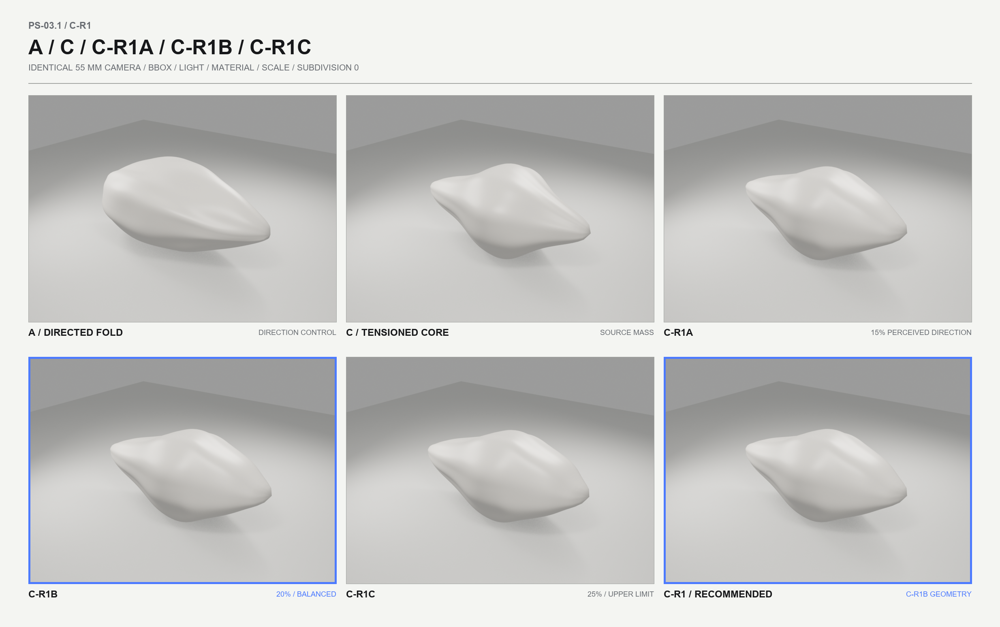
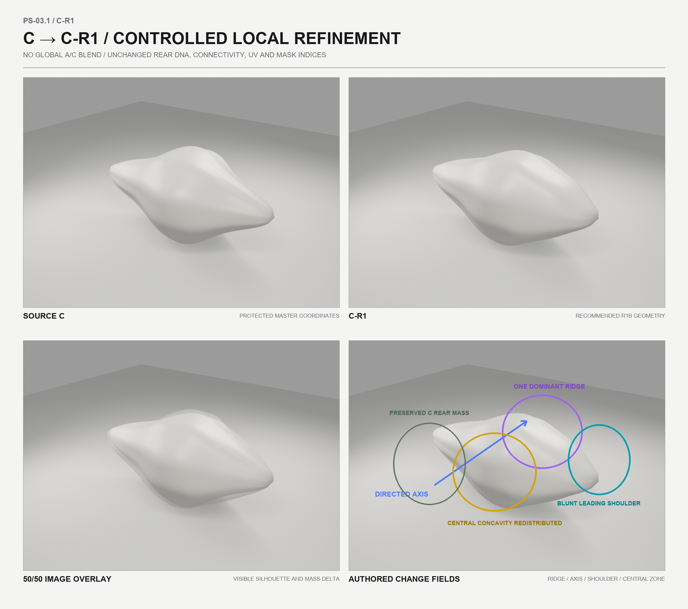
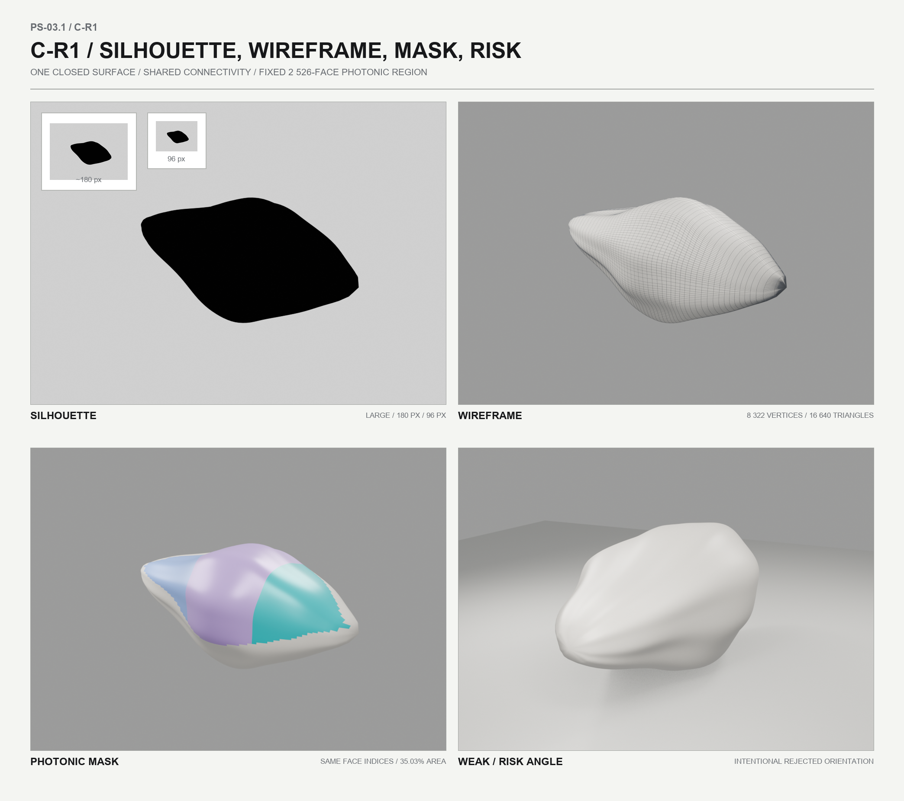
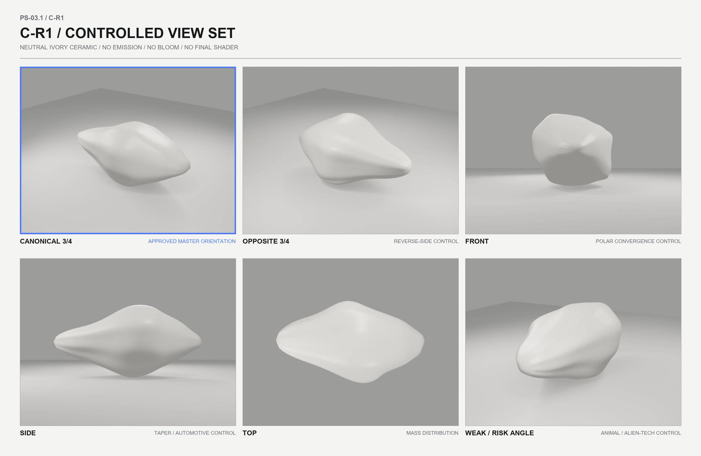
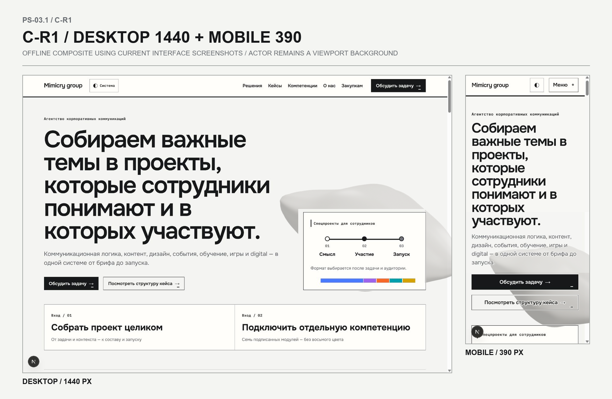

# PS‑03.1 — C‑R1 / Directed Tensioned Core

Дата сборки: 2026‑08‑03  
Статус: производственный baseline `MASTER` подготовлен; PS‑03.2 не запускался.  
Рекомендуемый refinement: **C‑R1B / 20% воспринимаемой направленности**.

Рекомендация не является разрешением на создание двенадцати morph targets. Перед PS‑03.2 требуется отдельное подтверждение пользователя.

## 1. Результат этапа

На защищённой копии кандидата C создана одна финальная базовая форма `C‑R1 / Directed Tensioned Core`. Форма сохраняет плотную скульптурную массу C и получает от A только управляемые признаки направленного действия:

- одну диагональную ось действия;
- один широкий доминирующий ridge;
- перераспределение массы к тупому ведущему плечу;
- более спокойную центральную область без отверстия или отдельной полости;
- композиционно управляемую асимметрию;
- сохранённую заднюю массу C.

Глобальная интерполяция `C × 0,75 + A × 0,25` не использовалась. Все изменения выполнены как локальные coordinate-only deformation fields исходных вершин C. Топология, UV, индексы граней и область фотонной маски не перестраивались.



## 2. Изученный baseline и защита исходников

Основные входы:

- `../../../docs/mimicry_photonic_skin_ps02_5_spec_2026-08-03.md`;
- `../../../docs/mimicry_ps02_5_reference_storyboard_2026-08-03.png`;
- `../ps-02/ps-02-mimic-core-evaluation.md`;
- `../ps-02/blender/ps-02-mimic-core.blend`;
- `../ps-02/exports/mimic-core-c-tensioned-core.glb`;
- `../ps-02/exports/ps02-technical-validation.json`;
- `../ps-02/scripts/build_ps02.py` и `compose_boards.py`;
- контрольные рендеры A, B и C;
- актуальные offline-скриншоты интерфейса из `artifacts/color-grammar-v0.2/`.

Контрольная сумма исходного PS‑02 `.blend` до и после сборки совпала:

```text
e8abe8b9fedea06a082b14c8df1fe2468561d3acfb7bb7f49d93fb8f7c59d942
```

Исходные `.blend`, GLB, скрипты и рендеры PS‑02 не перезаписывались.

### Что является исходником PS‑03.1

- `scripts/build_ps03_1.py` — воспроизводимая геометрия, проверка, рендер, сохранение и экспорт;
- `scripts/compose_ps03_1.py` — воспроизводимая сборка сравнительных досок и offline-композитов;
- `blender/ps-03-1-c-r1-refinement-workbench.blend` — управляемый DCC-workbench с A, C, R1A, R1B, R1C и финальным объектом;
- `blender/c-r1-directed-tensioned-core.blend` — чистый production-source базовой формы с ригом проверки;
- этот документ — протокол решения.

### Что является производным артефактом

- `exports/c-r1-directed-tensioned-core.glb`;
- JSON-протоколы в `exports/`;
- PNG в `renders/` и промежуточные панели в `renders/_panels/`.

## 3. Blender и воспроизведение

Использован **Blender 4.5.3 LTS**, build hash `67807e1800cc`.

Сборка выполняется из корня репозитория:

```powershell
& 'C:\Program Files\Blender Foundation\Blender 4.5\blender.exe' --background --python 'design\photonic-skin\ps-03-1\scripts\build_ps03_1.py'
& 'C:\Users\MSI_NB\.cache\codex-runtimes\codex-primary-runtime\dependencies\python\python.exe' 'design\photonic-skin\ps-03-1\scripts\compose_ps03_1.py'
```

Второй скрипт использует Pillow из локального Codex runtime. Новые npm-зависимости не добавлялись.

## 4. Метод refinement

`build_ps03_1.py` открывает PS‑02 как защищённый вход, считывает C `MASTER`, topology/index order, UV loop data, `_PHOTONIC_MASK`, `_PHOTONIC_SLOT` и список активных граней. После этого новая сцена строится отдельно.

Локальные поля деформации:

1. перераспределяют центральную и ведущую ring-зону без образования полости;
2. создают один широкий ridge вдоль оси `(0.86241817, 0.28078729, 0.42118093)`;
3. вводят направленный mass shear;
4. формируют тупое ведущее плечо вместо наконечника;
5. сохраняют и немного успокаивают заднюю массу C;
6. добавляют слабую композиционную асимметрию;
7. нормализуют результат обратно в bbox `6.8 × 3.6 × 3.2` без изменения connectivity.

A используется как визуальный directional control на доске, но координаты финальной формы не получены глобальным смешиванием A и C.



## 5. Три refinement-варианта

Проценты обозначают воспринимаемую силу направленности, а не долю линейного vertex blend.

| Вариант | Сила поля | RMS от C | Max от C | Площадь маски | Итог проверки |
| --- | ---: | ---: | ---: | ---: | --- |
| C‑R1A / 15% | 0.74 | 0.205924 | 0.395018 | 34.5605% | pass |
| C‑R1B / 20% | 1.00 | 0.224019 | 0.435505 | 35.0319% | pass |
| C‑R1C / 25% | 1.28 | 0.249973 | 0.500396 | 35.5337% | pass |

### Оценка по 100-балльной системе

| Вариант | Направленное действие /20 | Премиальность /20 | Сохранение C /15 | Не стрелка /15 | Нет automotive / animal / alien-tech /15 | Desktop/mobile /10 | Morph basis /5 | Итого |
| --- | ---: | ---: | ---: | ---: | ---: | ---: | ---: | ---: |
| C‑R1A | 14 | 19 | 15 | 15 | 14 | 8 | 5 | **90** |
| C‑R1B | 17 | 19 | 14 | 15 | 13 | 9 | 5 | **92** |
| C‑R1C | 19 | 17 | 12 | 13 | 9 | 9 | 5 | **84** |

#### C‑R1A

- Главная сила: максимально спокойно сохраняет премиальную массу и непрерывность C.
- Главный риск: направленная ось слишком слаба на мобильном размере; вариант воспринимается как аккуратно сглаженный C, а не как новая каноническая территория.
- Возможные ассоциации: минеральный pebble, мягкая раковина.
- Решение: отклонён как финальный, оставлен нижней границей допустимой направленности.

#### C‑R1B

- Главная сила: ridge, масса и тупое ведущее плечо читаются как единое накопленное движение, при этом сохраняется скульптурная плотность C.
- Главный риск: строго фронтальный ракурс даёт мягкую полярную сходимость бликов; почти горизонтальный side может приблизить форму к airfoil/automotive прочтению.
- Основные ассоциации: tensioned mineral, натянутая техническая керамика, направленная складка без предметной буквальности.
- Решение: выбран не как автоматический «средний», а как единственный вариант, одновременно проходящий directional, premium и association-контроль с достаточным запасом.

#### C‑R1C

- Главная сила: максимально ясная направленность и наиболее заметный ridge.
- Главный риск: усиленное ведущее плечо и более жёсткое распределение массы начинают выглядеть спроектированным корпусом.
- Возможные ассоциации: автомобильная форма, шлем, alien-tech оболочка, притуплённый наконечник.
- Решение: отклонён; это верхний диагностический предел влияния A, но не production `MASTER`.

## 6. Техническая база финального C‑R1

| Параметр | Результат |
| --- | --- |
| Авторская сетка | 8 322 вершины, 8 480 faces, 16 640 треугольников, 16 800 edges |
| Поверхность | 1 связный компонент, Euler characteristic 2 |
| Loose vertices | 0 |
| Non-manifold edges | 0 |
| Bbox | `6.8 × 3.6 × 3.2`, min `[-3.4,-1.8,-1.6]`, max `[3.4,1.8,1.6]` |
| Connectivity/index hash | `8883e7698bbd3a6aafef5a4a8a4ea5f04ee96d7ad7cc41cee841a94986e1e462` |
| UV hash | `c5eff463ac2b978f0470e1fef6fffc4eb5a01fe06f66262b3effba5518e67683` |
| Shape keys | только `MASTER` |
| Signed volume | 29.030129, положительный |
| Минимальная площадь треугольника | 0.000521428 |
| Zero-area / degenerate triangles | 0 |
| Минимальный dot нормали с исходной C | 0.856498, инверсий нет |
| Non-adjacent self-intersections | 0 |
| Subdivision | 0, сетка не модифицирована |

Connectivity/index hash совпадает с совместимой сеткой PS‑02. Position hash C‑R1B — `2cd522cd9a1d0e90f10fc072835db1cd54a9ad1072478911713884646fc89bd8`; он намеренно отличается от C, так как координаты деформированы.

### Проверка центральной зоны

Внутренний angular-variation proxy центральной зоны снижен на 52.82% относительно C. Это не буквальная мера глубины впадины, а контроль разброса ведущих ring-координат. В каноническом ракурсе закрытый контур, отверстие, пасть или «глаз» не образуются. Строго фронтальный вид оставлен на view-board как обязательный риск-контроль: мягкая сходимость бликов видна, но геометрической полости нет.

## 7. Фотонная маска

- сохранены те же **2 526 face indices**;
- hash списка граней: `67c2dd582fcbdb25d9905b98357340c7313292bfb20db6fdd5675e88d1f71c58`;
- сохранены point attributes `_PHOTONIC_MASK` и `_PHOTONIC_SLOT`;
- фактическая площадь на C‑R1B: **35.0319%**, допустимый диапазон `32–36%`;
- использованы только `content #4C7AFF`, `design #9E64EE`, `digital #009FAC`;
- нет emission, bloom, chrome или hue rotation.



## 8. Проверка сохранения и GLB reimport

Финальный `.blend` повторно открыт Blender 4.5.3 LTS. В нём подтверждены:

- один actor mesh `MimicCore_C-R1_Directed_Tensioned_Core` и отдельная студийная плоскость рига;
- 8 322 вершины, 8 480 faces и 16 640 треугольников у актора;
- UV `MimicCoreUV`;
- атрибуты `_PHOTONIC_MASK`, `_PHOTONIC_SLOT`;
- единственный shape key `MASTER`;
- topology hash и `maskFaceCount = 2526` в custom properties.

GLB повторно импортирован в чистую сцену. Проверка прошла: один mesh, 16 640 треугольников, точный bbox, UV и оба атрибута маски присутствуют, extras совпадают. Импортированный glTF buffer содержит 8 692 runtime-вершины из-за обязательных split-вершин на UV/normal seams; это сериализационное представление GLB, а не изменение 8 322-вершинной авторской topology. Connectivity/index hash совместимой Blender-сетки сохранён в extras и проверен до экспорта.

Полные машинные протоколы:

- `exports/ps03-1-technical-validation.json`;
- `exports/ps03-1-glb-reimport-validation.json`;
- `exports/ps03-1-composition-metadata.json`.

## 9. Ракурсы и композиция

Контрольные рендеры используют одинаковый 55 mm camera, свет, exposure, bbox, neutral ivory material и subdivision 0.



Канонический Blender camera:

```text
location: [9.0, -12.0, 6.5]
lens: 55 mm
target: [0, 0, 0]
object geometry rotation: [0, 0, 0]
view-axis roll for composition actor: +34°
offline layout roll: -38°
```

Канонический `MASTER` — ракурс 3/4 с широким rear mass слева, тупым leading shoulder справа и ridge, идущим диагонально вперёд. Opposite 3/4 допустим для проверки, но не рекомендуется как основной. Side и weak/risk angle не следует использовать в hero без дополнительной композиционной компенсации.

### Desktop 1440

- viewport: `1440 × 1000`;
- actor rect: `[803, 199, 726, 682]`;
- центр: `81vw / 54vh`;
- projected size: `50.42vw × 68.2vh`;
- выход справа: `12.26%` ширины актора, снизу: `0%`;
- safe text zone: `x 0–57.3vw / y 8.6–76.3vh`;
- UI и CTA восстановлены поверх актора; отдельная карточка/3D-frame не создавались.

### Mobile 390

- viewport: `390 × 844`;
- actor rect: `[32, 414, 520, 488]`;
- центр: `75vw / 78vh`;
- projected size: `133.33vw × 57.82vh`;
- выход справа: `31.15%`, снизу: `11.89%`;
- заголовок защищён нейтральным graduated scrim, CTA ink/outline/fill остаются выше актора;
- ridge остаётся диагональной границей массы, а видимая часть не распадается на независимые фрагменты.

Композиции собраны offline из актуальных скриншотов интерфейса; production-код не изменялся.



## 10. Файлы результата

```text
design/photonic-skin/ps-03-1/
├─ blender/
│  ├─ ps-03-1-c-r1-refinement-workbench.blend
│  └─ c-r1-directed-tensioned-core.blend
├─ scripts/
│  ├─ build_ps03_1.py
│  └─ compose_ps03_1.py
├─ exports/
│  ├─ c-r1-directed-tensioned-core.glb
│  ├─ ps03-1-technical-validation.json
│  ├─ ps03-1-glb-reimport-validation.json
│  └─ ps03-1-composition-metadata.json
├─ renders/
│  ├─ ps03-1_variant_comparison_board.png
│  ├─ ps03-1_c-to-c-r1_board.png
│  ├─ ps03-1_c-r1_view_board.png
│  ├─ ps03-1_c-r1_diagnostics_board.png
│  ├─ ps03-1_composition_board.png
│  ├─ ps03-1_c-r1_canonical.png
│  ├─ ps03-1_desktop_composition_1440.png
│  └─ ps03-1_mobile_composition_390.png
└─ ps-03-1-c-r1-evaluation.md
```

## 11. Рекомендация и остаточные риски

Рекомендуется принять **C‑R1B** как базовую геометрию `C‑R1 / Directed Tensioned Core` для будущей системы относительных targets. Она убедительнее R1A удерживает территорию «Направленное действие» и заметно безопаснее R1C по automotive/alien-tech ассоциациям.

Остаточные риски:

1. прямой front сохраняет мягкую полярную сходимость бликов — его следует считать контрольным, а не hero-ракурсом;
2. строго горизонтальный side может читаться как airfoil или автомобильный профиль;
3. слабый rear-oblique ракурс усиливает shell/animal/alien-tech ассоциации;
4. mobile crop требует сохранять каноническую диагональ ridge и не уводить актор глубже вправо или ниже;
5. будущие morph targets не должны усиливать тупое leading shoulder до наконечника.

## 12. Решения пользователя перед PS‑03.2

Перед отдельным запуском PS‑03.2 нужно подтвердить:

1. принять ли C‑R1B как окончательный `MASTER` либо нужен один микро-refinement R1B.1;
2. принять ли канонический 3/4 и зафиксированные desktop/mobile crop-зоны;
3. допустима ли текущая мягкая полярная сходимость во front-контроле;
4. зафиксировать ли side и weak/rear-oblique как запрещённые hero-ориентации;
5. принять ли фиксированную маску 2 526 граней с площадью 35.0319%;
6. отдельно разрешить PS‑03.2 и создание `BRAND_WIDE`, `7 × SINGLE`, `3 × COMPLEX`, `TRANSITION_TENSION` как относительных targets от C‑R1 `MASTER`.

До такого подтверждения PS‑03.2 не запускается.
