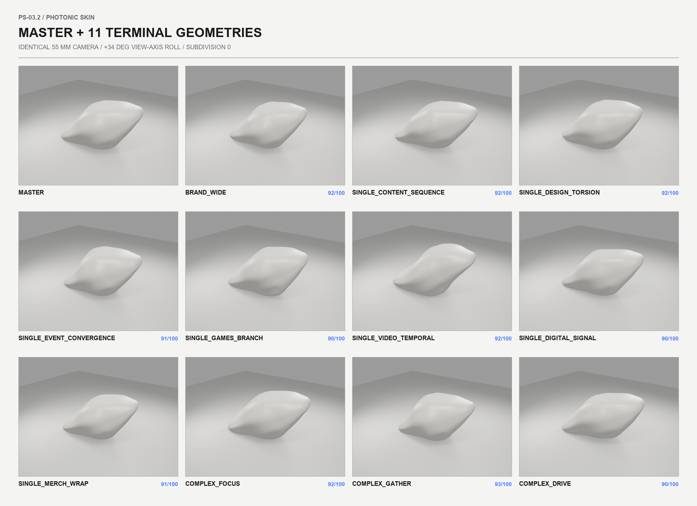
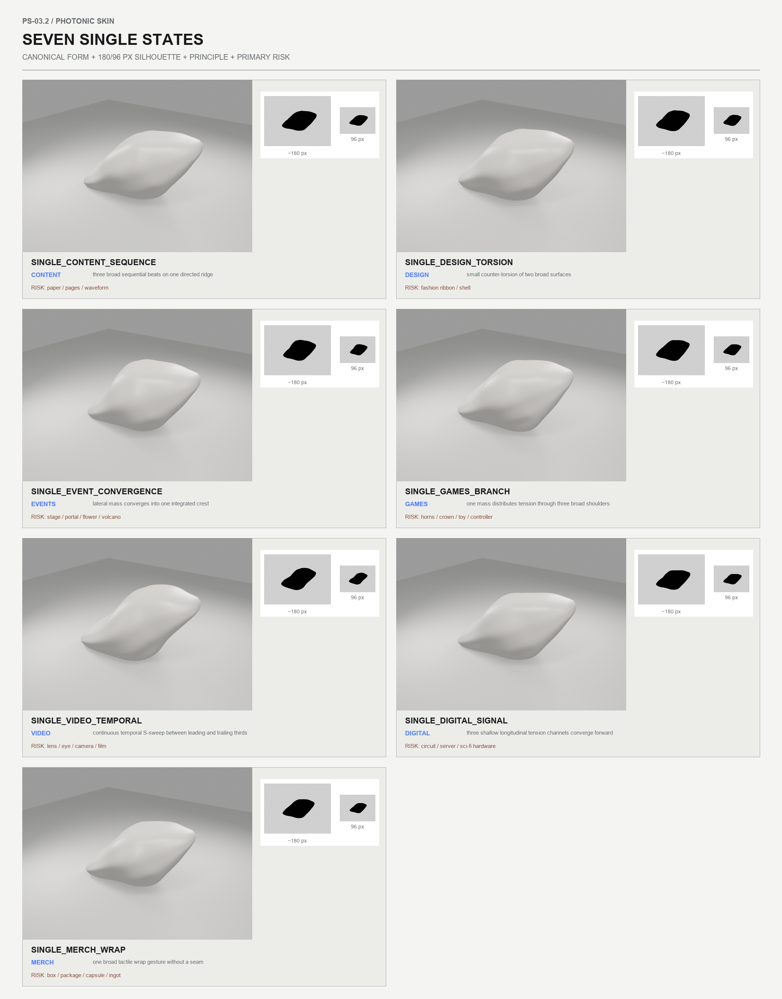
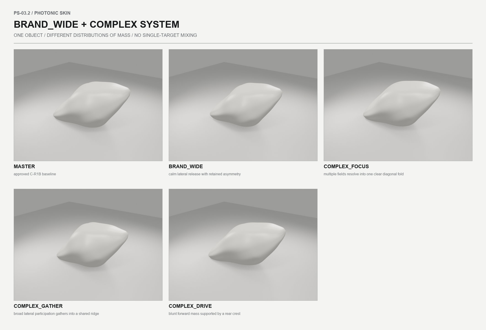
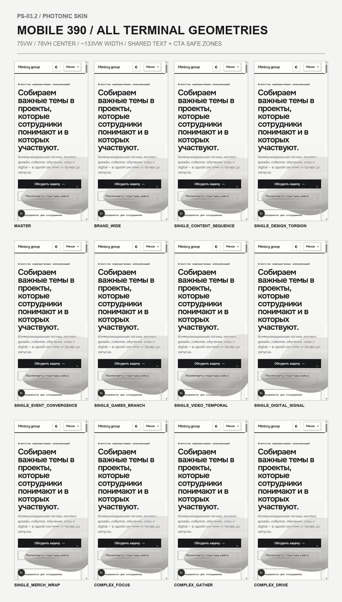
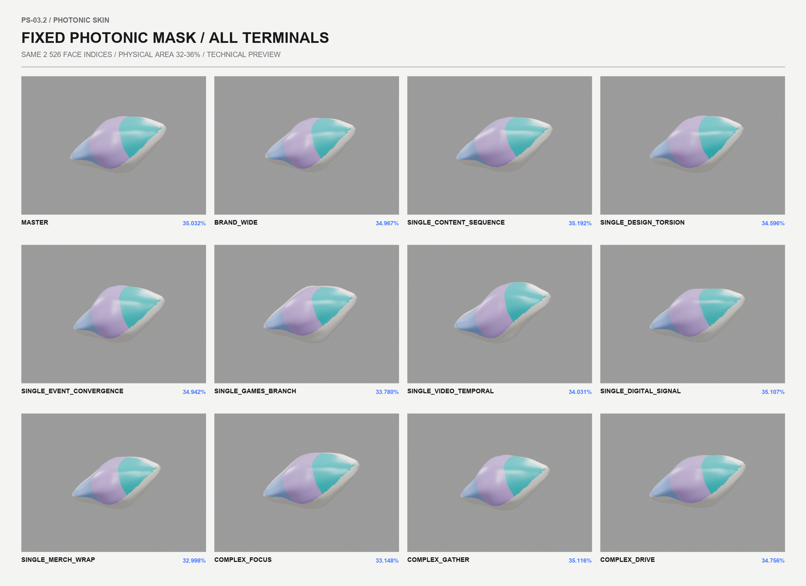
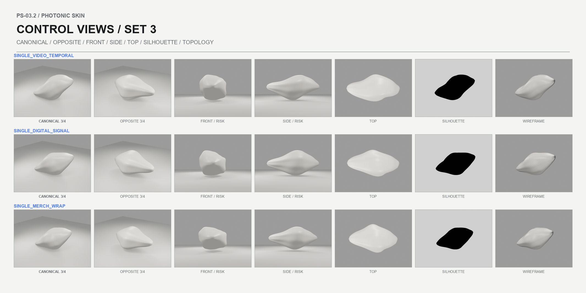
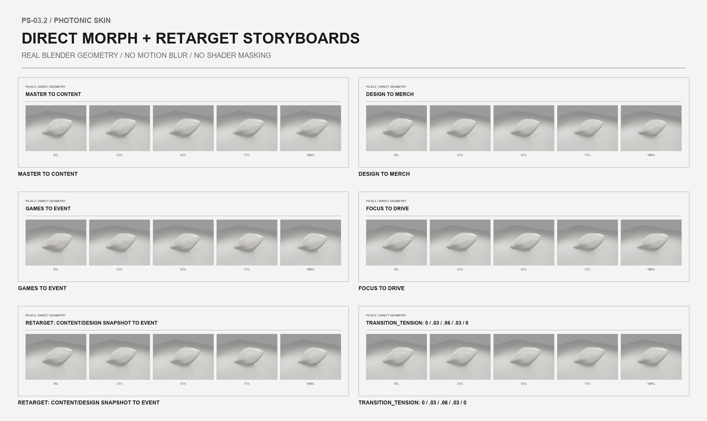

# PS-03.2 — финальная система morph targets Photonic Skin

## 1. Краткий вывод

На утверждённой базовой форме `C-R1B / Directed Tensioned Core` создана единая production-система из `MASTER`, 11 terminal semantic targets и одного additive target `TRANSITION_TENSION`. Все формы являются relative shape keys одного mesh, прошли endpoint-, pairwise-, retarget-, additive-, Blender reimport- и Three.js runtime-проверки. Production-код сайта не изменялся, GLB к сайту не подключался.

Все 11 terminal targets получили 90–93/100 при пороге 85. Это техническая и авторская оценка этапа, а не финальное визуальное утверждение пользователем.



## 2. Подтверждённый baseline C-R1B

- Blender: `4.5.3 LTS`.
- `MASTER`: 8 322 вершины, 8 480 faces, 16 800 edges, 16 640 треугольников.
- Одна связная замкнутая manifold-поверхность; Euler characteristic `2`.
- Bounding box Blender: `6.8 × 3.6 × 3.2`.
- Connectivity/index hash: `8883e7698bbd3a6aafef5a4a8a4ea5f04ee96d7ad7cc41cee841a94986e1e462`.
- UV hash: `c5eff463ac2b978f0470e1fef6fffc4eb5a01fe06f66262b3effba5518e67683`.
- Утверждённый position hash: `2cd522cd9a1d0e90f10fc072835db1cd54a9ad1072478911713884646fc89bd8`.
- Position hash после штатной float32-перезагрузки Blender: `54af439e6a4ce68f87fcfa20f8ef3d9c124aa62b416d8c29569fd37a18c55469`.
- Directed axis: `[0.86241817, 0.28078729, 0.42118093]`.
- Маска: те же 2 526 face indices, hash `67c2dd582fcbdb25d9905b98357340c7313292bfb20db6fdd5675e88d1f71c58`.
- Камера: `[9, -12, 6.5]`, `55 mm`, target `[0, 0, 0]`, geometry rotation `[0, 0, 0]`, roll по оси вида `+34°`.

Утверждённые файлы PS-03.1, спецификация и storyboard PS-02.5, исходный PS-02 `.blend` и его validation повторно захешированы после сборки. `previous_stage_sources_unchanged = true`.

## 3. Метод создания shape keys

Авторинг воспроизводим скриптом `scripts/build_ps03_2.py`. Скрипт читает координаты утверждённого `MASTER`, topology, loop UV, `_PHOTONIC_MASK`, `_PHOTONIC_SLOT` и фиксированный список граней маски. Затем он создаёт локальные coordinate-only deformation fields на общей параметризации сетки `(s, phi)`.

Для каждой формы используются крупные и средние поля распределения массы: ridge, crest, torsion, convergence, sweep, wrap или compression. После локальной пластики выполняется детерминированный coordinate-only fit к заданному заполнению canonical envelope. Remesh, subdivision, decimate, перестройка UV, изменение face/vertex order и отдельные детали не используются.

Первая автоматическая версия была отклонена на визуальном просмотре как недостаточно различимая. Во втором проходе усилены смысловые деформации всех семи SINGLE и трёх COMPLEX. После полного pairwise-теста `COMPLEX_FOCUS` и `COMPLEX_DRIVE` получили 1% запаса по поперечной оси (`0.89` вместо пограничных `0.88`), а delta `TRANSITION_TENSION` была ограничена по экстремумам всех terminal-форм, чтобы additive-наложение не покидало canonical envelope.

## 4. Карта всех targets

Стабильный порядок в Blender и GLB:

1. `BRAND_WIDE`
2. `SINGLE_CONTENT_SEQUENCE`
3. `SINGLE_DESIGN_TORSION`
4. `SINGLE_EVENT_CONVERGENCE`
5. `SINGLE_GAMES_BRANCH`
6. `SINGLE_VIDEO_TEMPORAL`
7. `SINGLE_DIGITAL_SIGNAL`
8. `SINGLE_MERCH_WRAP`
9. `COMPLEX_FOCUS`
10. `COMPLEX_GATHER`
11. `COMPLEX_DRIVE`
12. `TRANSITION_TENSION`

`MASTER` является basis и не экспортируется тринадцатым target. Все keys relative к `MASTER`.

## 5. BRAND_WIDE

`BRAND_WIDE` расширяет и успокаивает объём, снижает диагональное напряжение, но сохраняет асимметрию и направленную ось. Главная сила — фоновая устойчивость без конкуренции с контентом. Главный риск — pebble/cushion/blob при слишком плоском свете. Результат: `92/100`, endpoint `pass`.

## 6. Семь SINGLE



| Target | Геометрический принцип | Главная сила | Остаточный риск | Балл |
| --- | --- | --- | --- | ---: |
| `SINGLE_CONTENT_SEQUENCE` | три широких такта вдоль единого ridge | последовательность без буквальной ленты | такты тоньше читаются в малом статичном кадре | 92 |
| `SINGLE_DESIGN_TORSION` | спокойная противоположная torsion верхней и нижней поверхности | S-асимметрия при сохранённой центральной массе | fashion-object/ракушка в слабом ракурсе | 92 |
| `SINGLE_EVENT_CONVERGENCE` | боковые массы сходятся к широкому поднятому crest | ясное вовлечение и подъём | сцена/лепесток/портал во front | 91 |
| `SINGLE_GAMES_BRANCH` | один ridge распределяет напряжение в три широких плеча | ветвление остаётся одной массой | корона/рога при неверном mobile crop | 90 |
| `SINGLE_VIDEO_TEMPORAL` | вытянутый пространственный S-sweep | наиболее читаемое временное смещение | линза/камера во front | 92 |
| `SINGLE_DIGITAL_SIGNAL` | три неглубоких продольных tension channels | сигнал выражен пластикой поверхности | hardware/circuit при жёстком shader | 90 |
| `SINGLE_MERCH_WRAP` | одна широкая тактильная wrap-деформация без шва | материальность и плотность | капсула/слиток/упаковка при metallic shader | 91 |

## 7. Три COMPLEX



- `COMPLEX_FOCUS`: несколько полей разрешаются в одну диагональную складку; компактная направленность без стрелки. Риск — eye/lens/tip в запрещённых ракурсах. `92/100`.
- `COMPLEX_GATHER`: широкое боковое участие собирается в общий ridge; самая сильная коллективная и пространственная форма. Риск — stage/flower/bowl во front. `93/100`.
- `COMPLEX_DRIVE`: тупая передняя масса поддерживается rear crest; наиболее выраженный импульс без наконечника. Риск — automotive/airfoil при горизонтальном side. `90/100`.

## 8. TRANSITION_TENSION

`TRANSITION_TENSION` — additive delta, а не terminal state. Он локально организует ведущий ridge, слегка уплотняет поперечное сечение и сохраняет общий объём. Runtime-диапазон — `0–0.06`; полный вес `1.0` используется только для диагностики.

RMS от `MASTER` — `0.034350`, max displacement — `0.094162`. Endpoint и все 72 наложения прошли. На обязательных 24 runtime-комбинациях (`0.04`, `0.06`) максимальное изменение объёма — `0.03067%`, mask area — `32.957–35.165%`, минимальное заполнение оси — `88%`.

При диагностическом `1.0` у `COMPLEX_FOCUS` и `COMPLEX_DRIVE` поперечное заполнение кратковременно снижается до `87.255%` и `87.000%`. Это не runtime-режим; обе формы остаются внутри максимального envelope, без инверсий, пересечений и коллапса. Значения сохранены в протоколе, а не скрыты порогом.

## 9. Сравнительная оценка форм

| Target | Смысл /20 | ДНК /20 | Premium /15 | Отличимость /15 | Безопасность /15 | Morph /10 | Mobile+tech /5 | Итог |
| --- | ---: | ---: | ---: | ---: | ---: | ---: | ---: | ---: |
| `BRAND_WIDE` | 18 | 19 | 14 | 13 | 14 | 9 | 5 | 92 |
| `SINGLE_CONTENT_SEQUENCE` | 18 | 19 | 14 | 14 | 13 | 9 | 5 | 92 |
| `SINGLE_DESIGN_TORSION` | 18 | 19 | 14 | 14 | 13 | 9 | 5 | 92 |
| `SINGLE_EVENT_CONVERGENCE` | 18 | 19 | 14 | 14 | 12 | 9 | 5 | 91 |
| `SINGLE_GAMES_BRANCH` | 18 | 18 | 13 | 15 | 12 | 9 | 5 | 90 |
| `SINGLE_VIDEO_TEMPORAL` | 18 | 19 | 14 | 14 | 13 | 9 | 5 | 92 |
| `SINGLE_DIGITAL_SIGNAL` | 18 | 18 | 13 | 15 | 12 | 9 | 5 | 90 |
| `SINGLE_MERCH_WRAP` | 18 | 19 | 14 | 14 | 12 | 9 | 5 | 91 |
| `COMPLEX_FOCUS` | 19 | 19 | 14 | 14 | 12 | 9 | 5 | 92 |
| `COMPLEX_GATHER` | 19 | 19 | 14 | 14 | 13 | 9 | 5 | 93 |
| `COMPLEX_DRIVE` | 19 | 18 | 13 | 14 | 12 | 9 | 5 | 90 |

Ни один target не имеет критической ассоциации, автоматически обнуляющей оценку. Числовые оценки требуют визуального подтверждения пользователем.

## 10. Endpoint-валидация

`MASTER`, 11 terminal targets и `TRANSITION_TENSION` прошли:

- topology/count/hash/UV/mask identity;
- finite coordinates, positive signed volume;
- zero degenerate/zero-area triangles;
- zero inverted/folded faces;
- zero non-adjacent self-intersections;
- canonical envelope и axis fill terminal-форм;
- одна connected component, zero loose/boundary/non-manifold edges.

Минимальный endpoint normal dot к `MASTER` — `0.836797` (`SINGLE_MERCH_WRAP`), минимальный face-area ratio — `0.603394` (`COMPLEX_FOCUS`). Оба существенно выше reject-порогов. Полные position hashes, bbox, volume, silhouette и mask metrics находятся в `exports/ps03-2-target-manifest.json` и `exports/ps03-2-technical-validation.json`.

## 11. Pairwise-валидация 66 переходов

Проверены все `C(12,2) = 66` уникальных прямых переходов без сброса через `MASTER`. Для каждой пары рассчитано 11 равномерных значений `t`. Для 16 опасных пар добавлено по 45 значений. Всего протокол хранит 1 446 проверенных samples.

Итог: `66/66 pass`; self-intersections `0`; mask range `32.9982–35.1925%`; minimum axis fill `88%`; minimum normal dot `0.836797`; minimum face-area ratio `0.603394`.

## 12. Опасные пары и refinement-исправления

Расширенная выборка включила все обязательные пары и автоматический top-10. Максимальные danger scores получили:

- `MERCH ↔ FOCUS` — `1.608405`;
- `MERCH ↔ DRIVE` — `1.536177`;
- `VIDEO ↔ MERCH` — `1.474401`;
- `VIDEO ↔ GATHER` — `1.323599`;
- `MASTER ↔ MERCH` — `1.318550`.

Кроме них расширенно проверены `CONTENT ↔ GAMES`, `DESIGN ↔ MERCH`, `EVENT ↔ GATHER`, `VIDEO ↔ DRIVE`, `DIGITAL ↔ FOCUS`, `GAMES ↔ EVENT`, `BRAND_WIDE ↔ DRIVE`. После усиления смысловых деформаций и 1% fill-запаса Focus/Drive дополнительные corrective morphs не потребовались.

## 13. Retarget-проверка

Проверены четыре цепочки:

- `CONTENT → DESIGN → EVENT`;
- `GAMES → DIGITAL → VIDEO`;
- `FOCUS → GATHER → DRIVE`;
- `BRAND_WIDE → MERCH → MASTER`.

Переключение выполнено на `25%`, `50%`, `75%`, текущий weight snapshot не сбрасывался. Проверено 12 переключений и 132 samples. Coordinate/normal jump в точке retarget — `0`; максимальный RMS одного шага — `0.0219628`; intersections `0`. Итог: `pass`.

## 14. Проверка additive target

`TRANSITION_TENSION` наложен на все 12 terminal geometries при `0`, `0.04`, `0.06`, `0.25`, `0.50`, `1.0`: всего 72 комбинации. Обязательные 24 runtime-комбинации прошли полный terminal-контракт; диагностические значения прошли mesh-integrity и maximum-envelope контракт. Итог: `pass`.

## 15. Mobile 390



Для всех 12 terminal geometries использован viewport `390 × 844`, общий центр около `75vw / 78vh`, projected width `123.85–133.33vw`, правый crop `29.81–31.21%`. Заголовок и CTA сохраняют safe zone; ни один target не требует отдельной mobile-геометрии. Leading shoulder и смысловой ridge не исчезают одновременно.

## 16. Фотонная маска



Во всех формах сохранены те же 2 526 face indices и тот же face-index hash. `MASTER` — `35.0319%`; terminal min — `32.9982%`; max — `35.1925%`; mean — `34.4721%`. Диапазон terminal targets `32–36%` и желательное среднее `34% ±0.75 п.п.` соблюдены. Маска переносится деформацией поверхности и не перекладывается на другие faces.

## 17. Blender reimport

Финальный GLB импортирован в чистую Blender-сцену. Подтверждены один actor mesh, 16 640 треугольников, UV, `_PHOTONIC_MASK`, `_PHOTONIC_SLOT`, 12 targets в правильном порядке и совпадение one-hot bounds с production `.blend`. Итог: `pass`.

## 18. Three.js runtime validation

Изолированный Node-скрипт загрузил GLB через реальный `GLTFLoader` Three.js r185. Подтверждены:

- один indexed mesh;
- 8 692 runtime-вершины после UV/normal splits;
- `POSITION / NORMAL / TANGENT / TEXCOORD_0`;
- `_photonic_mask` и `_photonic_slot`;
- `morphTargetsRelative = true`;
- `morphTargetDictionary`, `morphTargetInfluences` и стабильный порядок 12 targets;
- 12 one-hot states, 66 direct pairs, четыре retarget-цепочки и additive weights;
- отсутствие `NaN` и выходов за runtime envelope.

В glTF Y-up authored envelope `6.8 × 3.6 × 3.2` читается Three.js как runtime XYZ `6.8 × 3.2 × 3.6`. Итог: `pass`.

## 19. Структура финального GLB

```text
Scene
└─ MimicCoreRoot
   └─ MimicCoreMesh
      ├─ base geometry = MASTER
      ├─ one indexed manifold surface
      ├─ POSITION / NORMAL / TANGENT / TEXCOORD_0
      ├─ 12 relative morph targets
      ├─ neutral placeholder PBR material
      └─ extras: schema/hash/bbox/axis/mask/target metadata
```

Камер, lights, floor, animation clips, route states, desktop/mobile transforms и production shader в GLB нет.

## 20. Производительность и размер файла

- GLB: `3 111 620 bytes` (`2.97 MiB`).
- SHA-256: `7647d4d0cac606a0860991e8c7441e7d7d395675c56cfcc8277640e6c1d73ed8`.
- Authoring vertices: `8 322`; runtime vertices: `8 692`; triangles: `16 640`.
- Morph payload: 12 relative POSITION/NORMAL targets; runtime применяет weights к одному загруженному mesh.
- Compression, KTX2, Meshopt, production loader и persistent Canvas намеренно не добавлялись на PS-03.2.

## 21. Остаточные визуальные риски

- `CONTENT` и `DIGITAL` различаются ритмом ridge/channels, но в маленьком нейтральном статичном canonical-кадре их различие тоньше, чем у `VIDEO`, `MERCH` или `GATHER`.
- `GAMES` нельзя поворачивать так, чтобы два плеча симметрично выглядели рогами.
- `EVENT` и `GATHER` во front могут дать ассоциацию со сценой/лепестком; front остаётся контрольным, не hero-ракурсом.
- `VIDEO` во front может напоминать объектив, `MERCH` при metallic shader — слиток/капсулу, `DRIVE` в side — airfoil/automotive.
- Горизонтальный side и rear-oblique не должны входить в будущий idle range.
- Финальный shader PS-04 должен усиливать непрерывность поверхности, а не маскировать отличия геометрии.



## 22. Полный список артефактов

Blender:

- `blender/ps-03-2-morph-authoring-workbench.blend`
- `blender/photonic-skin-c-r1-morph-system.blend`

Скрипты:

- `scripts/build_ps03_2.py`
- `scripts/validate_ps03_2.py`
- `scripts/compose_ps03_2.py`
- `scripts/validate_ps03_2_runtime.mjs`

Экспорт и протоколы:

- `exports/photonic-skin-c-r1-morph-system.glb`
- `exports/ps03-2-target-manifest.json`
- `exports/ps03-2-technical-validation.json`
- `exports/ps03-2-pairwise-validation.json`
- `exports/ps03-2-retarget-validation.json`
- `exports/ps03-2-additive-validation.json`
- `exports/ps03-2-glb-reimport-validation.json`
- `exports/ps03-2-three-runtime-validation.json`
- `exports/ps03-2-composition-metadata.json`

Главные доски:

- `renders/ps03-2_full_system_board.png`
- `renders/ps03-2_single_states_board.png`
- `renders/ps03-2_complex_brand_board.png`
- `renders/ps03-2_control_views_1.png` … `ps03-2_control_views_4.png`
- `renders/ps03-2_mobile_390_board.png`
- `renders/ps03-2_photonic_mask_board.png`
- `renders/ps03-2_transition_storyboards.png`
- шесть отдельных transition storyboards и 12 отдельных mobile-композитов.



## 23. Что должен визуально подтвердить пользователь

1. Достаточна ли различимость всех 11 terminal states при сохранении одной ДНК.
2. Читаются ли `CONTENT` как последовательность и `DIGITAL` как сходящиеся channels, а не как почти одинаковые формы.
3. Не дают ли `GAMES`, `EVENT`, `VIDEO`, `MERCH`, `FOCUS`, `GATHER`, `DRIVE` нежелательных ассоциаций в показанных контрольных и mobile-ракурсах.
4. Приемлемы ли общий canonical 3/4, единый mobile crop и текущая степень выхода за viewport.
5. Приемлемы ли terminal mask range `32.9982–35.1925%` и диагностическое поперечное заполнение Focus/Drive при `TRANSITION_TENSION = 1.0`.
6. Можно ли формально закрыть PS-03 и отдельно открыть PS-04 для материала/shader.

## 24. Статус готовности PS-03

Производственная часть PS‑03 завершена и подготовлена к финальному визуальному утверждению.

PS-03 не объявляется утверждённым пользователем до его явного решения. PS-04, production integration, shader, motion orchestration, commit и deploy не запускались.

### Воспроизведение в PowerShell

```powershell
& 'C:\Program Files\Blender Foundation\Blender 4.5\blender.exe' --background --python '.\design\photonic-skin\ps-03-2\scripts\build_ps03_2.py'
& 'C:\Users\MSI_NB\.cache\codex-runtimes\codex-primary-runtime\dependencies\python\python.exe' '.\design\photonic-skin\ps-03-2\scripts\compose_ps03_2.py'
& 'C:\Program Files\Blender Foundation\Blender 4.5\blender.exe' --background --python '.\design\photonic-skin\ps-03-2\scripts\validate_ps03_2.py'
& 'C:\Users\MSI_NB\.cache\codex-runtimes\codex-primary-runtime\dependencies\node\bin\node.exe' '.\design\photonic-skin\ps-03-2\scripts\validate_ps03_2_runtime.mjs'
```
