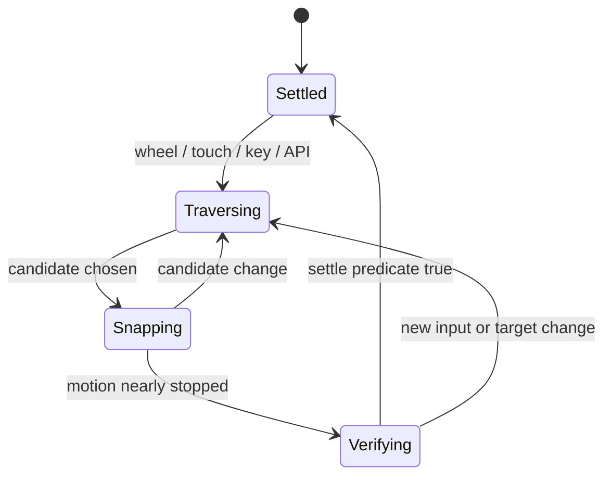
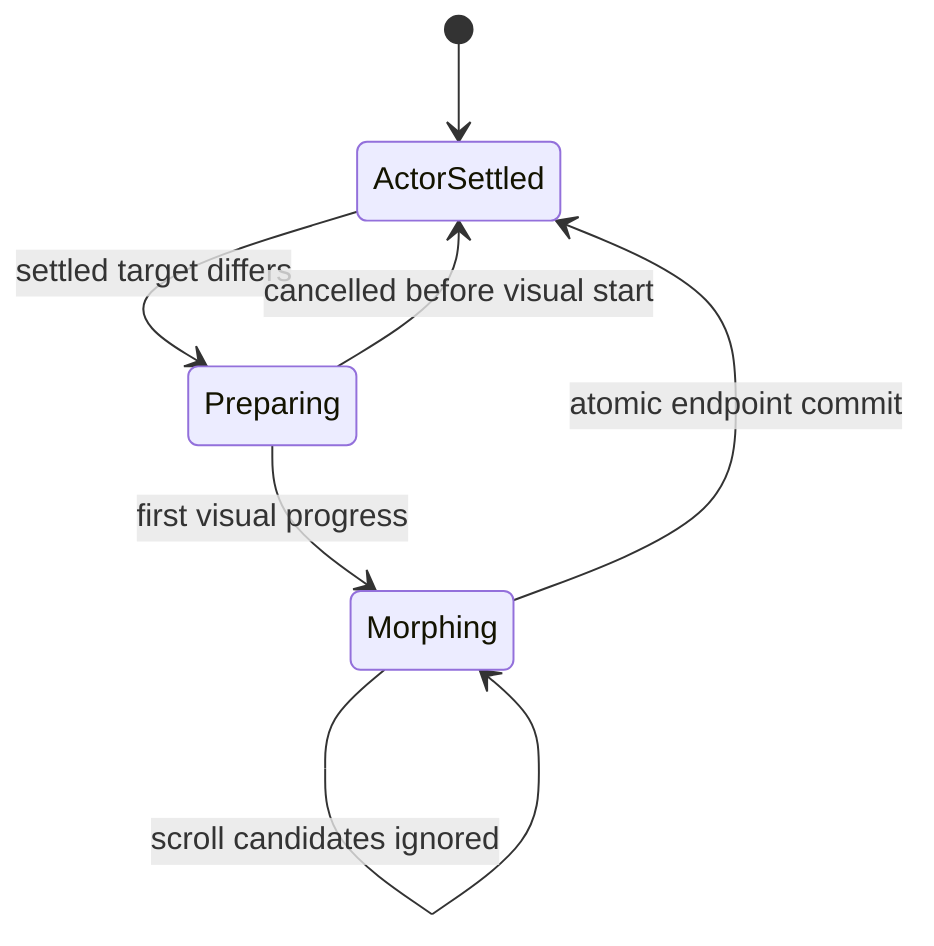

# PS-04.M6.2 — трансформация только после Magnetized Settle

Дата исследования: 2026-09-02  
Статус: **RESEARCH COMPLETE / RECOMMENDED IMPLEMENTATION CONTRACT**  
Основание: HUMAN PASS PS-04.M6.1 и разрешение владельца перейти к PS-04.M6.2.

Документ определяет рекомендуемую архитектуру scroll-driven трансформаций Mimic. Он не меняет production `/`, не является deploy approval и не разрешает начинать следующие M6-подэтапы.

---

## 1. Решение в одном абзаце

Рекомендуется архитектура:

```text
SETTLE-GATED REQUESTS
+ FINISH CURRENT VISIBLE MORPH
+ ONE-SLOT LATEST-SETTLED QUEUE
```

Промежуточный экран во время scroll является только `candidate`, но не actor target. Новый semantic request создаётся только после подтверждённого `magnetized settle`. Если визуальная трансформация уже началась, она спокойно завершается до своего endpoint. Последний действительно settled экран хранится в очереди из одного элемента и запускается после окончания текущего morph. Если пользователь снова начал scroll до запуска очереди, устаревшая очередь аннулируется.

Иными словами:

```text
быстрый пролёт экранов → Mimic не переключает предметные состояния;
устойчивый settle → один запрос к финальному экрану;
уже видимый morph → завершить;
новый settled target → запустить после завершения текущего;
никакого backlog промежуточных экранов.
```

---

## 2. Что именно считается проблемой

Текущий runtime уже умеет:

- один authoritative `ActorTransitionCoordinator`;
- один `PhotonicMotionSession.tick(dt)`;
- atomic settle;
- stale-revision rejection;
- source LUT/slot hold в compile gap;
- latest-target retarget;
- отсутствие MASTER flash, palette lead, center dwell и third geometry на проверенных M5.6 путях.

Однако политика `latest-wins` вызывается слишком рано, если `magnetic destination`, пересекаемый node или programmatic destination принимается за уже committed actor screen. При rapid scroll это создаёт серию live-retarget requests и может:

- оставить Mimic в трудно читаемом промежуточном состоянии;
- запустить дорогой `compileLiveRetarget`;
- заставить actor реагировать на экраны, которые пользователь не успел воспринять;
- нарушить смысл магнетизма: объект меняется до окончательной фиксации интерфейса.

M6.2 должен изменить **request policy**, не геометрию, палитру или frozen choreography.

---

## 3. Рассмотренные варианты

| Вариант | Плюсы | Риски | Решение |
|---|---|---|---|
| Retarget на каждый active/candidate node | Быстрая реакция | Rapid live compilation, hybrid states, реакция на непрочитанные экраны | Отклонить |
| Заморозить morph на текущем промежуточном кадре | Не движется во время scroll | Пользователь видит неопределённый hybrid; restore и palette authority сложнее | Отклонить |
| Откатывать morph к последнему settled endpoint | Всегда известная форма | Видимый reverse/rollback во время scroll; лишнее движение | Отклонить |
| Мгновенно fast-forward текущий morph | Быстро освобождает очередь | Скачок или неестественное ускорение; ломает M5.1 choreography | Отклонить |
| Всегда останавливать scroll на каждом screen | Исключает пропуск | Ломает быстрый просмотр страницы и пользовательский контроль | Отклонить |
| Завершить видимый morph и держать только последний settled target | Endpoint integrity, нет hybrid-freeze, нет rapid backlog | Возможна короткая задержка перед новым morph | **Рекомендовать** |

Короткая задержка приемлемее, чем трансформация к каждому пролетевшему экрану. Её уменьшают settle-gate и prewarm: большинство быстропройденных экранов вообще не успевают запустить morph.

---

## 4. Две независимые state machine

Scroll и Mimic нельзя описывать одной переменной `activeNodeId`.

### 4.1. Scroll / magnetism



### 4.2. Actor



Очередь latest-settled target существует рядом с actor machine, но не создаёт второй running transition.

---

## 5. Обязательное разделение node IDs

| Поле | Смысл | Может менять Mimic |
|---|---|---:|
| `observedNodeId` | Node, наиболее заметный прямо сейчас | Нет |
| `snapCandidateNodeId` | Вероятная конечная точка текущего scroll | Нет |
| `magneticDestinationNodeId` | Цель текущего magnetic scroll | Нет |
| `magnetizedSettledNodeId` | Node, реально достигший settle predicate | **Да** |
| `actorCommittedNodeId` | Node последнего принятого actor request | Только через coordinator |
| `queuedActorNodeId` | Последний settled target, ожидающий текущий morph | После повторной проверки revision |

Ключевое изменение:

```text
committedActorNodeId() больше не должен считать
pending programmatic / restore / magnetic destination
уже подтверждённым actor node.
```

Они остаются candidate/hint до реального settle.

Header, graph progress и DOM могут отражать `observedNodeId` или candidate раньше Mimic. Это нормально: navigation feedback и semantic actor commit имеют разные обязанности.

---

## 6. Что такое Magnetized Settle

Один `scrollend` или один IntersectionObserver callback недостаточен. Settle — составной проверяемый факт.

### 6.1. Обязательный predicate

```ts
magnetizedSettled =
  candidateNodeId !== null
  && candidateNodeId === magneticDestinationNodeId
  && candidateStableForMs >= SETTLE_STABLE_MS
  && distanceToAnchorPx <= positionEpsilonPx(viewportHeight)
  && abs(scrollVelocityVhPerSecond) <= SETTLE_VELOCITY_EPSILON
  && gestureActive === false
  && inputQuietForMs >= INPUT_QUIET_MS
  && layoutRevisionStable === true
  && snapAnimationPending === false
```

После выполнения создаётся монотонный `magneticSettleRevision`.

### 6.2. Начальные calibration tokens

```ts
MAGNETISM_DURATION_MS = 340        // сохранить существующий baseline
SETTLE_STABLE_MS = 96
INPUT_QUIET_MS = 80
SETTLE_VELOCITY_EPSILON = 0.02     // viewport heights / second
SETTLE_POSITION_EPSILON_PX = clamp(viewportHeight * 0.002, 1.5, 3)
LAYOUT_STABLE_FRAMES = 2
ACTOR_START_BUDGET_MS = 150        // после settle и programReady
ACTOR_QUEUE_CAPACITY = 1
```

Это стартовые значения для evidence-driven calibration, не разрешение подгонять их по одному ролику. Изменение token должно быть versioned и одинаково проверяться на mouse wheel, trackpad, touch, keyboard и programmatic navigation.

### 6.3. Почему time-based, а не «два кадра без движения»

Два кадра означают разное время на 60/120/144 Hz. Непрерывное окно в миллисекундах сохраняет одинаковую семантику на разных дисплеях. `LAYOUT_STABLE_FRAMES` используется только как дополнительная защита после resize/layout, а не как основной dwell.

---

## 7. Browser events: progressive enhancement, не authority

### `scrollend`

Использовать как сильный сигнал, что browser закончил gesture и больше не имеет pending scroll updates. После него всё равно проверить distance, velocity, candidate и layout revision.

Нельзя полагаться только на него:

- на старых browser/device он может отсутствовать;
- если scroll position не изменилась, событие не обязано возникнуть;
- restore или instant programmatic placement может сразу оказаться в правильной точке.

### `scrollsnapchange` / `scrollsnapchanging`

Если доступны:

- `scrollsnapchanging` обновляет candidate/prewarm hint;
- `scrollsnapchange` подтверждает browser-selected snap target перед `scrollend`;
- ни одно из них само не создаёт actor request.

Эти события остаются progressive enhancement: в 2026 году `scrollsnapchange` всё ещё имеет ограниченную browser availability.

### IntersectionObserver

Использовать только для:

- ranking видимых screens;
- graph progress;
- prewarm hints.

Не использовать как settle authority: API отдаёт visibility/position асинхронно и не доказывает завершение gesture или magnetic animation.

### Fallback detector

Fallback работает в существующем scroll-controller rAF:

1. измеряет `scrollTop` и time-based velocity;
2. отслеживает последний wheel/touch/pointer/keyboard input;
3. вычисляет distance до magnetic anchor;
4. сбрасывает stable window при новом input, target или layout revision;
5. публикует settle только после непрерывного прохождения predicate.

Не создавать отдельный `setTimeout`-debounce и второй clock.

---

## 8. Политика уже начатой трансформации

Нужно различать `preparing` и реально видимый morph.

### 8.1. Transition ещё не стал видимым

Если:

```text
programReady = false
geometryProgress = 0
paletteProgress = 0
siteProgress = 0
visualStarted = false
```

и пользователь снова начал scroll, pending request можно отменить. Source endpoint визуально не изменился. Поздний результат compile игнорируется по revision.

### 8.2. Transition уже видим

После первого принятого visual progress:

```text
visualStarted = true
```

transition становится non-interruptible для scroll-driven requests:

- он доигрывается до своего target;
- palette/site/geometry остаются на одной revision;
- atomic settle выполняется обычным `commitTargetAsSettled()`;
- scroll не замораживает промежуточный кадр;
- scroll не запускает reverse или fast-forward;
- intermediate candidate nodes не создают requests.

Явный debug override может сохранять старый retarget для лабораторного сравнения, но не входит в default M6.2 path.

---

## 9. One-slot latest-settled queue

```ts
type QueuedActorTarget = {
  nodeId: string
  semanticContractKey: string
  magneticSettleRevision: number
  queuedAt: number
}
```

Правила:

1. Queue capacity = 1.
2. Записывается только `magnetizedSettledNodeId`, не candidate.
3. Новый settled target заменяет предыдущий queued target.
4. Crossed nodes никогда не образуют очередь.
5. При новом scroll queue становится provisional/invalid.
6. После current actor settle queued target запускается только если:
   - scroll снова `Settled`;
   - его `magneticSettleRevision` всё ещё текущая;
   - `magnetizedSettledNodeId === queued.nodeId`;
   - semantic contract отличается от actor endpoint.
7. Иначе queue удаляется без request.
8. Same semantic contract = no-op, даже если node ID другой.

### Псевдокод

```ts
function onScrollActivity() {
  invalidateQueuedActorTarget()

  if (actor.status === 'preparing' && !actor.visualStarted) {
    cancelPendingActorRequest()
  }
}

function onMagneticSettle(commit: MagneticSettleCommit) {
  const target = resolveActorContract(commit.nodeId)

  if (target.key === actor.endpointKey) return

  if (actor.status === 'settled') {
    beginActorTransition(target, commit.revision)
    return
  }

  queuedActorTarget = {
    nodeId: commit.nodeId,
    semanticContractKey: target.key,
    magneticSettleRevision: commit.revision,
    queuedAt: performance.now(),
  }
}

function onActorSettled() {
  commitTargetAsSettled()

  if (!isQueuedTargetStillAuthoritative()) {
    queuedActorTarget = null
    return
  }

  beginQueuedTransition()
}
```

---

## 10. Prewarm без speculative morph

Candidate может использоваться для загрузки, но не для visual commit.

Рекомендуемая последовательность:

```text
candidate stable briefly
→ resolve likely semantic target
→ prewarm exact future pair
→ wait for magnetized settle
→ begin only when programReady or hold source in compile gap
```

Future source определяется так:

- actor settled → текущий endpoint;
- actor morphing → уже committed target текущего morph;
- actor preparing, но visual start ещё не произошёл → current settled source.

Gates:

- prewarm не меняет coordinator revision;
- stale candidate result можно оставить в bounded cache, но нельзя commit;
- route rapid-scroll path не вызывает `compileLiveRetarget`;
- один candidate не создаёт второй actor/material/program;
- current source LUT/slot удерживаются до `programReady`.

Главный performance-результат M6.2: rapid scroll превращается из множества live-retarget compiles в максимум один exact transition после финального settle.

---

## 11. Поведение по сценариям

### Медленный переход на соседний экран

```text
scroll begins
→ old actor holds/finishes
→ magnetic snap completes
→ settle predicate 96 ms
→ one actor request
→ ordinary transition
```

### Быстрый пролёт через несколько экранов

```text
A → B → C → D candidates
→ 0 requests for B/C
→ settle on D
→ exactly one request to D
```

### Scroll начался во время видимого morph A→B

```text
A→B continues
→ crossed screens ignored
→ C settles and enters one-slot queue
→ A→B atomically settles
→ if C still settled: B→C begins
→ otherwise queue is discarded
```

### Scroll начался во время compile gap A→B

```text
visualStarted = false
→ cancel pending A→B
→ actor remains exact A
→ final settled screen later creates one new request
```

### Пользователь settled на C, но уехал до окончания A→B

```text
C queue invalidated on new scroll
→ A→B finishes
→ actor holds B while scrolling
→ only next real settle may request another target
```

### Возврат на screen с тем же semantic contract

Node может измениться, но actor request не создаётся. Framing/slot также остаются частью semantic contract key: если они отличаются, создаётся обычная unified transaction без fake geometry change.

---

## 12. Граница со взаимодействиями внутри screen

Magnetized gate применяется к route/screen changes от:

- wheel/trackpad;
- touch scroll;
- scrollbar drag;
- keyboard navigation;
- graph click;
- anchor/programmatic scroll;
- Back/Forward scroll restore.

Он не должен задерживать подтверждённые semantic actions внутри уже settled screen:

- выбор competency на `03.2`;
- подтверждение draft → confirmed;
- открытие `03.3A/B`, которое не создаёт geometry request;
- explicit theme/reduced-mode changes;
- debug controls в review route.

In-screen action может публиковать actor request только если его host node всё ещё `magnetizedSettledNodeId`. Иначе action игнорируется или откладывается на UI-уровне, но не обходит route gate.

M6.1 contract сохраняется:

- `03.2` следует draft;
- `03.3/A/B` следует confirmed;
- task влияет только на brief;
- exact GATHER/DRIVE coverage не меняется.

---

## 13. Footer, restore, resize и context loss

### Footer

- actor exit/no-draw начинается только после Footer magnetized settle;
- при быстром пролёте мимо промежуточных screens actor не исчезает;
- reverse из Footer запускает actor return только после settle целевого screen.

### Initial load / reload

`scrollend` может не возникнуть, если browser сразу восстановил правильную позицию. После hydration/layout:

- определить nearest valid node;
- дождаться `LAYOUT_STABLE_FRAMES` и settle predicate;
- reconcile actor без fake intermediate request;
- Hero initial boot не должен ждать лишний route morph, если actor уже на Hero endpoint.

### Back/Forward и programmatic restore

Pending restore target остаётся candidate. Actor меняется после фактической позиции и settle, а не при получении navigation intent.

### Resize / DPR

- увеличивает `layoutRevision`;
- сбрасывает settle verification window;
- не меняет semantic actor state;
- после стабилизации same contract даёт no-op.

### WebGL context restore

- сохраняет actor endpoint или running transition revision;
- не превращает candidate в committed target;
- после restore scroll gate отдельно reconciles current magnetized node;
- один Canvas и один actor сохраняются.

---

## 14. Reduced motion

`prefers-reduced-motion` означает минимизацию несущественного движения, но не отменяет semantic correctness.

Правила:

- тот же settle predicate;
- scroll/navigation по возможности instant или без декоративного smooth travel;
- crossed candidates не создают actor requests;
- после settle target geometry публикуется атомарно;
- frozen palette crossfade до 160 ms сохраняется;
- queue capacity остаётся 1;
- running reduced transition фактически завершается атомарно, поэтому backlog не возникает;
- DOM остаётся полным источником task/competency/brief смысла.

---

## 15. Runtime invariants

M6.2 не меняет:

- M5.1 `PALETTE_DELAY_FRACTION = 0.06`;
- C2 curves и transition phase edges;
- M5.6 R001 closure;
- `commitTargetAsSettled()` ordering;
- M5.5 payload и M6.1 delta buffers;
- Event A-R2 и Video combo-40-r1;
- persistent identity, N=16384, stride=40, LOD;
- camera/FOV/framing `OWNER_SELECTED_124_111_111`;
- one Canvas / one actor / one InstancedMesh / one material / one program / one draw;
- Footer settled no-draw contract.

M6.2 меняет только:

- границу candidate → committed settle;
- route actor-request scheduling;
- cancellation до visual start;
- one-slot latest-settled queue;
- candidate-only prewarm и telemetry.

---

## 16. HUD и telemetry

Review HUD обязан показывать отдельно:

```text
scrollPhase
observedNodeId
snapCandidateNodeId
magneticDestinationNodeId
magnetizedSettledNodeId
magneticSettleRevision
distanceToAnchorPx
scrollVelocityVhPerSecond
gestureActive
inputQuietForMs
candidateStableForMs
layoutRevision
actorStatus
actorVisualStarted
actorCommittedNodeId
actorEndpointKey
queuedActorNodeId
queuedSettleRevision
actorRequestCount
cancelledBeforeVisualStartCount
ignoredCandidateCount
compileLiveRetargetCount
```

HUD не должен влиять на controller и отсутствует в clean route.

---

## 17. Обязательная test matrix

### Deterministic controller tests

- candidate не создаёт actor request;
- magnetic destination не создаёт actor request;
- settle predicate требует всех условий;
- любое новое input сбрасывает stable window;
- stale settle revision отклоняется;
- same contract no-op;
- queue capacity никогда не превышает 1;
- newest settled target заменяет старый queued target;
- queue invalidated при новом scroll;
- preparing без visual progress отменяется безопасно;
- running visual morph не прерывается scroll-driven request;
- после actor settle запускается только всё ещё authoritative queue;
- in-screen action работает на settled host и не проходит на unsettled host;
- resize/layout change не создаёт semantic transition;
- reduced mode atomic.

### Browser scenarios

1. Slow wheel adjacent forward/reverse.
2. Trackpad-like small deltas and jitter.
3. Rapid flick через 3, 5 и 10 screens.
4. Rapid forward/reverse до final settle.
5. Scroll during `preparing`.
6. Scroll during early/mid/late visible morph.
7. New settle while morphing, затем удержание.
8. New settle while morphing, затем повторный scroll до actor settle.
9. Scrollbar drag.
10. Keyboard arrows/PageDown/PageUp/Home/End.
11. Graph click и anchor jump.
12. Back/Forward restore.
13. `03.1 → 03.2 → 03.3` builder route.
14. `03.2` repeated competency edits on settled screen.
15. Footer down/up.
16. Mobile 390×844 touch emulation; отдельно раскрыть, если physical device не проверен.
17. Light/Dark.
18. Reduced motion.
19. Resize/DPR.
20. WebGL context loss/restore.

### Hard assertions

```text
requestsToCrossedNodes = 0
maxActorQueueDepth = 1
routeCompileLiveRetargetCount = 0
staleQueuedTransitionStarts = 0
runningMorphInterruptedByScroll = 0
thirdGeometry = false
MASTER flash = 0
palette lead = 0
center dwell = 0
empty actor frame = 0
latest magnetized settled target wins
```

Rapid-20 должен показать максимум один новый actor transition после финального settle, не двадцать fully settled transitions.

### Performance

- natural-rAF, не screenshot cadence;
- отдельно cold и warm;
- request/start latency от `magneticSettleCommitted`;
- long tasks и compile counts;
- cache entries/bytes до и после rapid suite;
- no unbounded cache growth;
- one program/material/draw;
- сравнение с M5.6 rapid capture.

---

## 18. Evidence и review routes

Рекомендуемая структура:

```text
design/photonic-skin/ps-04-m6-2/
├── reports/
│   ├── approval-report.md
│   ├── settle-contract.json
│   ├── settle-signal-support.json
│   ├── actor-request-trace.json
│   ├── rapid-scroll-regression.json
│   ├── queue-validation.json
│   ├── transition-regression.json
│   ├── reduced-motion.json
│   ├── performance.json
│   ├── browser-smoke.json
│   └── production-isolation.json
├── renders/
│   ├── boards/
│   └── browser/video/
├── scripts/
└── tests/
```

Routes:

```text
/visual-lab/photonic-skin-ps04-m6/magnetized-settle
/visual-lab/photonic-skin-ps04-m6/magnetized-settle/review
```

Clean route — без HUD. Review route — с controller telemetry и возможностью воспроизводить slow/rapid/programmatic/reduced scenarios.

Production `/` остаётся M6.0 binding и не запрашивает M6.1/M6.2 lab runtime.

---

## 19. Human review checklist

1. Начинается ли трансформация только после полного magnetic settle?
2. Остаётся ли Mimic в прежнем предметном состоянии при быстром пролёте?
3. Если morph уже видим, завершается ли он спокойно, без freeze/rollback/snap?
4. Получает ли финальный settled screen один последующий morph?
5. Не проигрываются ли после остановки промежуточные screens как очередь?
6. Нет ли заметно чрезмерной задержки после settle?
7. Не реагирует ли Mimic на лёгкий scroll jitter?
8. Одинаково ли работают wheel, trackpad, touch, keyboard и graph click?
9. Не возвращаются ли MASTER flash, palette lead или center dwell?
10. Не исчезает ли actor на compile gap?
11. Корректен ли builder `03.1 → 03.2 → 03.3`?
12. Работают ли explicit competency clicks на уже settled `03.2`?
13. Footer скрывает actor только после своего settle?
14. Reduced motion остаётся атомарным?
15. Production `/` и frozen payload остались неизменны?

---

## 20. Process boundary

Перед M6.2 необходимо:

1. Записать HUMAN PASS M6.1 и `approvedFor = PS-04.M6.2`.
2. Проверить M6.1 hashes/tests.
3. Создать один checkpoint commit M6.1 без дубликата.
4. Использовать новый фактический HEAD как baseline M6.2.

M6.2 оставить uncommitted. Не выполнять push/deploy. Не менять production `/`. Не начинать следующий M6-подэтап.

Допустимый machine status:

```text
PS-04.M6.2 — MACHINE PASS /
HUMAN MAGNETIZED-SETTLE MOTION REVIEW REQUIRED
```

Human PASS M6.2 разрешает только переход к следующему отдельно утверждённому этапу.

---

## 21. Источники browser-исследования

- [CSSOM View: scrollend](https://drafts.csswg.org/cssom-view/#eventdef-document-scrollend)
- [MDN: Document scrollend](https://developer.mozilla.org/en-US/docs/Web/API/Document/scrollend_event)
- [CSS Scroll Snap Level 2: Snap Events](https://www.w3.org/TR/css-scroll-snap-2/#snap-events)
- [MDN: scrollsnapchange](https://developer.mozilla.org/en-US/docs/Web/API/Element/scrollsnapchange_event)
- [W3C Intersection Observer](https://www.w3.org/TR/intersection-observer/)
- [MDN: scroll-snap-stop](https://developer.mozilla.org/en-US/docs/Web/CSS/Reference/Properties/scroll-snap-stop)
- [Media Queries Level 5: prefers-reduced-motion](https://www.w3.org/TR/mediaqueries-5/#prefers-reduced-motion)

Вывод из стандартов: browser events полезны как сигналы, но authoritative commit должен принадлежать проектному controller и подтверждаться фактической позицией, скоростью, окончанием gesture и стабильностью layout.

---

## 22. Финальная формула

```text
candidate ≠ committed target

scrolling:
  keep current endpoint or finish current visible morph

magnetized settle:
  publish exactly one latest target

current morph still running:
  queue only that latest settled target

user scrolls again:
  invalidate queued target

actor settles and screen is still settled:
  begin the queued transition
```

Это сохраняет смысл экранов, пользовательский контроль и целостность Mimic одновременно.
