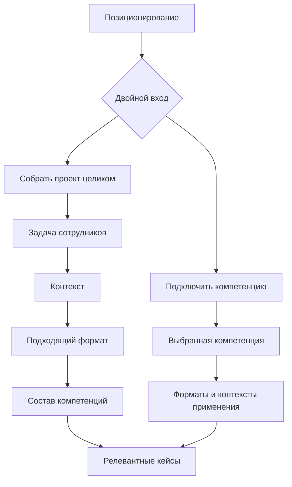

# Mimicry group: цветовая и визуальная система v0.1

**Дата:** 1 августа 2026 года  
**Статус:** рабочая система для прототипирования и проверки; не финальный брендбук  
**Основание:** утверждённые позиционирование, информационная архитектура, территория «Направленное действие», новая продуктовая структура с двойным входом и исследование цветовых семей от 01.08.2026

---

## 0. Решение в одном абзаце

Основным объектом постоянного цветового кодирования становятся **семь компетенций**: контент, дизайн, event, игры, видео, digital и мерч. **Задачи сотрудников, клиентские контексты и форматы остаются нейтральными**, потому что они описывают потребность и способ входа, а не стабильную производственную сущность. Комплексный проект не получает отдельный «восьмой» цвет: его цветовая сигнатура собирается из цветов реально подключённых компетенций. Бренд Mimicry в общем состоянии выражается нейтральной редакционной системой и одной управляемой спектральной траекторией. Цвет всегда дублируется подписью и монохромным мотивом.

Это означает, что исходная гипотеза принята, но с четырьмя ограничениями:

1. все семь цветов не заливают экран, а живут в одном сигнальном носителе;
2. плавно смешиваются максимум два-три цвета; четыре и более показываются сегментами;
3. после выбора состава проектная композиция **перестаёт бесконечно переливаться** и только один раз «собирается»;
4. цвет не используется как единственный способ навигации, выбора или объяснения состава.

---

# 1. Зафиксированная продуктовая структура

## 1.1. Позиционирование

> **Mimicry group — агентство корпоративных коммуникаций, создающее спецпроекты для сотрудников.**

Brand essence: **«От важной темы — к общему действию»**.

`Смысл → участие → запуск` — **способ работы над любым проектом**, а не каталог услуг и не три самостоятельных цветных раздела.

## 1.2. Объединённая структура с двойным входом

### Ветка 1. «Собрать проект целиком»

1. **Задача сотрудников:** что должно произойти с людьми — понять, включиться, попробовать/освоить, объединиться, почувствовать принадлежность, сделать следующий шаг.
2. **Контекст:** где возникла задача — изменения, событие, обучение, HR-brand-активация.
3. **Формат:** какую целостную форму может принять решение — кампания, корпоративное событие, бизнес-игра/квест, welcome-pack, digital-активация, видео- или интерактивный спецпроект.
4. **Состав компетенций:** какие дисциплины нужны именно для выбранной сборки.
5. **Кейсы:** доказательства для похожей задачи, контекста, формата и состава.

### Ветка 2. «Подключить отдельную компетенцию»

1. Клиент сразу выбирает контент, дизайн, event, игры, видео, digital или мерч.
2. Видит применимые форматы и контексты, а не изолированный прайс-лист.
3. Видит кейсы с этой компетенцией и её ролью в результате.
4. Может добавить вторую компетенцию и перейти в режим комплексной сборки.

Обе ветки используют одни и те же сущности. Меняется порядок входа, но не продуктовая модель.

---

# 2. Что действительно следует кодировать цветом

## 2.1. Матрица цветовых ролей

| Сущность | Собственный постоянный цвет | Фактическое поведение | Решение |
|---|---:|---|---|
| Бренд Mimicry | Нет отдельного оттенка | Нейтральная база + композиция полного спектра в одном носителе | **Композитный master-state** |
| Двойной вход | Нет | Две нейтральные карточки; цвет только предварительно показывает сборку или одну компетенцию | **Нейтрально** |
| Задачи сотрудников | Нет | Глагол, подпись, направленная линия, порядок | **Нейтрально** |
| Контексты | Нет | Подписанные фильтры и metadata | **Нейтрально** |
| Форматы | Нет | Нейтральная карточка + производная полоска ожидаемого/выбранного состава | **Производно** |
| Компетенции | Да | Постоянная семья + подпись + монохромный мотив | **Главный цветовой код** |
| Комплексный проект | Нет нового цвета | Композиция выбранных компетенций | **Производная сигнатура** |
| Кейсы | Нет нового цвета | Lead-компетенция + вторичные цветные теги/сегменты | **Производно** |
| Статусы UI | Отдельная семантическая система | Success, warning, error, info + иконка/текст | **Не смешивать с компетенциями** |
| Хамелеон | Нет собственной новой палитры | Наследует master-, single- или project-state | **Живой носитель системы** |

## 2.2. Почему компетенция — наиболее устойчивый объект

- Она существует в обеих ветках: как прямой вход и как элемент комплексной сборки.
- Она повторно используется в разных контекстах и форматах, не меняя собственной сути.
- Состав компетенций — реальное свойство проекта, поэтому цвет сообщает проверяемую структуру, а не декоративную тему страницы.
- Эта логика поддерживает позиционирование «собираем нужные форматы вокруг важной темы».
- Кейс можно связать с фактическим составом, не назначая ему произвольный рубрикатор.

## 2.3. Ограничение решения

Семь цветов сложнее запомнить, чем четыре. Поэтому цвет здесь — **ускоритель распознавания после знакомства**, а не самостоятельный язык. Первый контакт всегда содержит название компетенции; для монохрома и нарушений цветового зрения добавляется shape-code.

---

# 3. Сравнение альтернатив

| Критерий | A. Цвет = 4 контекста | B. Цвет = 7 компетенций → композиция | C. Один бренд-акцент |
|---|---:|---:|---:|
| Понятность при первом визите | **5** | 4 при подписях / 2 без подписей | 4 |
| Работа в двойном входе | 2 | **5** | 4 |
| Показывает состав проекта | 2 | **5** | 1 |
| Стабильность сущности | 3 | **5** | 5 |
| Масштабирование на новые форматы | 3 | **5** | **5** |
| Светлая/тёмная тема | 4 | 4 при role tokens | **5** |
| Доступность | 4 | 3 без shape-code / 4 с shape-code | **5** |
| Риск «агентства обо всём» | средний | высокий без ограничений / **низкий–средний с ними** | низкий |
| Выразительность хамелеона | 4 | **5** | 2 |
| Соответствие междисциплинарной сборке | 3 | **5** | 2 |

### Решение

Выбирается **B в контролируемой гибридной реализации**:

- master-brand и весь интерфейс — нейтральные;
- компетенции — цветные;
- задачи/контексты/форматы — текстовые и геометрические;
- project/case/chameleon — производные от состава;
- color + label + motif работают одновременно.

Предыдущее исследование четырёх ситуаций не отменяется: оно остаётся источником общих данных об ассоциациях и категорийных конвенциях. Но прежний вывод `teal / orange / violet / magenta = четыре ситуации` **не переносится в финальную навигационную систему**, потому что после введения двойного входа ситуация перестала быть единственным устойчивым объектом.

---

# 4. Исследовательское основание решения

## 4.1. Что подтверждают источники

1. **Значение цвета контекстно.** Академический обзор Elliot & Maier показывает, что цвет может влиять на восприятие и поведение, но литература зависит от контекста, а перенос в реальные интерфейсы требует осторожности. Систематический обзор 2025 года отдельно различает устойчивые цвето-эмоциональные ассоциации и фактически вызванные эмоции. Поэтому нельзя доказывать «digital должен быть бирюзовым» только общей психологией цвета.  
   Источники: [Annual Review of Psychology, 2014](https://www.annualreviews.org/content/journals/10.1146/annurev-psych-010213-115035), [Behavior Research Methods / Springer, 2025](https://link.springer.com/article/10.3758/s13423-024-02615-z).
2. **Компетенции — номинальные категории.** Для дискретных неупорядоченных сущностей применяются qualitative/categorical palettes; цвета должны максимально различать соседние категории и не подразумевать величину.  
   Источники: [IBM Carbon — categorical palettes](https://carbondesignsystem.com/data-visualization/color-palettes/), [ColorBrewer — qualitative schemes](https://colorbrewer2.org/learnmore/schemes_full.html).
3. **Цветовое значение надо дублировать.** WCAG 2.2 запрещает использовать цвет как единственный способ передать информацию, действие или различие. Поэтому название и motif обязательны, а не факультативны.  
   Источник: [W3C Understanding Use of Color](https://www.w3.org/WAI/WCAG22/Understanding/use-of-color.html).
4. **Роль цвета нужно отделить от конкретного значения.** Material 3 и USWDS строят системы через role-based tokens; это позволяет сохранять идентичность при смене темы и не назначать один HEX всем задачам.  
   Источники: [Material 3 — color roles](https://m3.material.io/styles/color/roles), [USWDS — using color](https://designsystem.digital.gov/design-tokens/color/overview/).
5. **Для читаемости важна светлота, а не только hue.** WCAG требует минимум 4.5:1 для обычного текста и 3:1 для необходимых нетекстовых частей интерфейса. Поэтому у каждой компетенции есть отдельные `core`, `text` и `surface` роли.  
   Источники: [W3C Contrast Minimum](https://www.w3.org/WAI/WCAG22/Understanding/contrast-minimum), [W3C Non-text Contrast](https://www.w3.org/WAI/WCAG22/Understanding/non-text-contrast.html).
6. **Необязательное движение должно отключаться.** Для auto/interaction motion нужен reduced-motion, а заметное долгое движение требует возможности остановить его.  
   Источники: [W3C Animation from Interactions](https://www.w3.org/WAI/WCAG22/Understanding/animation-from-interactions.html), [MDN prefers-reduced-motion](https://developer.mozilla.org/en-US/docs/Web/CSS/Reference/At-rules/%40media/prefers-reduced-motion).

## 4.2. Что остаётся дизайнерской гипотезой

- конкретное соответствие семи цветовых семей семи компетенциям;
- способность аудитории быстро запомнить карту;
- корпоративность chartreuse-зелёного и magenta;
- различимость `design violet ↔ video magenta` и `games green ↔ digital teal`;
- восприятие составного градиента как «сборки», а не как generic digital-gradient.

Эти пункты нужно проверять на реальных экранах с названиями и содержанием, а не на изолированных swatches.

---

# 5. Хроматическое ядро v0.1

## 5.1. Карта компетенций

| Компетенция | Семья | Core — крупный акцент | Strong — текст/граница на светлом | Accent — тёмная тема | Soft — светлая поверхность | Dark soft | Монохромный мотив | Логика и риск |
|---|---|---:|---:|---:|---:|---:|---|---|
| Контент | кобальт | `#4E68FF` | `#3049C9` | `#91A3FF` | `#E8ECFF` | `#202744` | параллельные редакционные строки | ясность/структура; риск generic blue |
| Дизайн | холодный фиолетовый | `#8A5CF6` | `#6533C4` | `#B99BFF` | `#F0E8FF` | `#2C2142` | crop-corner / рамка | creative-конвенция; риск SaaS |
| Event | оранжевый | `#F56A2A` | `#B84410` | `#FFAA7E` | `#FFE8DC` | `#3A241A` | сходящиеся линии / общий узел | участие и высокая энергия; риск «праздника ради праздника» |
| Игры | chartreuse-green | `#75A900` | `#527600` | `#A8D65A` | `#EDF6D8` | `#273313` | ветвящийся маршрут | механика и выбор; CVD-риск с teal |
| Видео | magenta | `#DF3E85` | `#A82663` | `#F08EB9` | `#FCE5F0` | `#3B1D2B` | последовательность кадров | движение без красного error-кода; риск близости к violet |
| Digital | teal/cyan | `#0097A7` | `#006D79` | `#64CBD3` | `#DDF4F6` | `#173438` | связанная матрица узлов | технологичность без второго синего; CVD-риск с green |
| Мерч | охра/жёлтый | `#D6A300` | `#785D00` | `#FFD15A` | `#FFF2C2` | `#352D13` | контур/сгиб/физическая развёртка | материальность и тепло; core не годится для мелкого текста |

### Уровень уверенности

- Event / orange: **средне-высокий**.
- Content / cobalt, Design / violet, Digital / teal: **средний**.
- Games / green, Video / magenta, Merch / ochre: **средне-низкий** до пользовательского теста.

## 5.2. Проверенный текстовый контраст

Расчёт выполнен по формуле WCAG 2.x для текущих пар.

| Компетенция | Strong ↔ `#FFFDF8` | Dark accent ↔ `#11110F` | Статус |
|---|---:|---:|---|
| Контент | 7.07:1 | 8.00:1 | AA/AAA для обычного текста |
| Дизайн | 7.32:1 | 8.28:1 | AA/AAA |
| Event | 5.33:1 | 10.17:1 | AA |
| Игры | 5.23:1 | 11.19:1 | AA |
| Видео | 6.62:1 | 8.35:1 | AA |
| Digital | 5.96:1 | 9.92:1 | AA |
| Мерч | 6.14:1 | 13.07:1 | AA |

`Core` используется как декоративный/крупный акцент, а не как цвет мелкого текста. В частности, event, games, digital и merch core не проходят 4.5:1 на белом; это намеренно решено отдельным `Strong`.

## 5.3. Нейтральная master-base

| Роль | Светлая | Тёмная | Применение |
|---|---:|---:|---|
| Canvas | `#F4F1E8` | `#11110F` | общий фон |
| Surface | `#FFFDF8` | `#1A1916` | карточки, формы, документы |
| Surface muted | `#EBE7DC` | `#24221E` | вторичная поверхность |
| Ink | `#151515` | `#F4F1E8` | основной текст, primary CTA |
| Ink muted | `#5C5A55` | `#B8B3A8` | вторичный текст |
| Rule | `#C9C4B8` | `#454139` | делители и пассивные границы |

Контраст `Ink ↔ Canvas`: 16.17:1 в светлой теме и 16.74:1 в тёмной.

## 5.4. Семантические статусы

Статусы остаются отдельным словарём: success `#216E4E`, warning `#8A5A00`, error `#B42318`, info `#175CD3` в светлой теме; для тёмной заданы отдельные светлые значения. Они всегда сопровождаются иконкой, заголовком и текстом. Компетентностный цвет никогда не сообщает «успешно», «ошибка» или «предупреждение».

## 5.5. Матрица конфликтов компетенций

| Пара | Риск | Где проявится | Обязательный компенсатор |
|---|---|---|---|
| Design violet ↔ Video magenta | высокий | градиенты, маленькие chips, часть CVD-сценариев | холодный crop-motif против последовательности кадров; разные lightness; не делать общий purple-pink blend |
| Games green ↔ Digital teal | высокий | deuteranopia/protanopia, тёмная тема | ветвящийся маршрут против матрицы узлов; подписи; разный lightness rank |
| Event orange ↔ Merch ochre | средне-высокий | CVD и приглушённые печатные версии | общий узел против контура/сгиба; event темнее и теплее, merch светлее и желтее |
| Content cobalt ↔ Design violet | средний | холодные тёмные оттенки | редакционные линии против crop-corner; не уводить violet в синий |
| Content cobalt ↔ Digital teal | средний | CVD, тонкие линии | параллельные строки против node-grid; не использовать оба без легенды |
| Остальные пары | низкий–средний | главным образом 4+ composition | подпись, фиксированный порядок, сегменты вместо смешения |

Первичная приблизительная CVD-симуляция подтвердила, что именно эти пары требуют второго кода. Это не заменяет проверку специализированным симулятором и тест с людьми; палитра v0.1 намеренно не считается доступной только на основании различия hue.

---

# 6. Буквальная визуальная модель экранов

## Состояние 0. Главная до выбора

- Canvas, типографика, header, CTA и карточки нейтральны.
- Один маршрут/лента занимает не более 8–12% площади первого экрана.
- Внутри маршрута медленно проходят семь цветов в хроматическом порядке: `event → merch → games → digital → content → design → video`.
- Этот порядок выбран для чистого перехода оттенков и **не является процессом работы**.
- Хамелеон, если присутствует, остаётся нейтральным; меняется только узкая зона спины/хвоста.

## Состояние 1. Выбор двойного входа

### «Собрать проект целиком»

- нейтральная карточка;
- внутри — семь тонких подписанных сегментов, сходящихся в один маршрут;
- на hover/focus сегменты сближаются на 4–8 px, но карточка не заливается радугой.

### «Подключить компетенцию»

- нейтральная карточка;
- семь подписанных competence-chips;
- hover/focus окрашивает только выбранный chip, motif и короткую линию.

## Состояние 2. Задача сотрудников

- полностью нейтральное состояние;
- выбор выражается глаголом, типографической иерархией, номером и направлением линии;
- цвет не назначается словам «понять», «включиться» или «освоить»;
- допустим предварительный маленький прогноз состава, но он помечается как «может понадобиться».

## Состояние 3. Контекст

- изменения, события, обучение и HR-brand остаются подписанными фильтрами;
- ранее исследованные ситуационные цвета не используются как новая параллельная легенда;
- если уже есть проектный состав, его сигнатура остаётся в progress-summary, но не окрашивает сам контекст.

## Состояние 4. Формат

- карточка формата нейтральна;
- в нижнем крае — полоса предполагаемого состава и текст `контент + дизайн + digital`;
- после выбора формат не «забирает» эти цвета себе: они продолжают означать компетенции.

## Состояние 5. Состав проекта

- 0 выбранных: master-spectrum;
- 1: один сплошной акцент;
- 2: управляемый двухцветный переход или два сегмента;
- 3: максимум три стопа, каждый подписан;
- 4–7: только сегментированная полоса/лента; без непрерывной радуги;
- при наличии lead/support ролей lead может занимать 45–55% полосы; без ролей сегменты равны.

После выбора допускается одна анимация «сборки» 600–800 ms. Затем композиция статична.

## Состояние 6. Страница одной компетенции

- один акцентный цвет;
- один motif;
- нейтральные заголовок, CTA, описание, формы и кейсовые карточки;
- релевантные форматы показывают возможные вторичные компетенции маленькими подписанными сегментами.

## Состояние 7. Общие страницы

«О компании», «Закупкам», «Контакты», формы, документы, политики и длинные статьи остаются нейтральными. Полный спектр допускается только как тонкая footer-signature или маленькая master-mark.

---

# 7. Градиенты и анимация

## 7.1. Что именно анимируется

Не hue и не сами цвета, а **положение и вес фиксированных цветовых зон**. Hue-rotation запрещён: он разрушает постоянную идентичность компетенции.

## 7.2. Master-state

- один декоративный носитель на viewport;
- цикл 24–32 секунды; в прототипе — 28 секунд;
- амплитуда background-position ограничена;
- без пульсации яркости, вспышек и масштабирования страницы;
- доступна явная кнопка `Движение: вкл./выкл.`;
- при уходе вкладки в background анимацию желательно приостанавливать.

## 7.3. Выбранный состав

- непрерывного ambient-motion нет;
- только однократный переход 600–800 ms;
- соседние/родственные цвета можно смешивать в perceptual color space;
- для далеко расположенных hue предпочтительнее сегмент или короткий нейтральный шов, чем грязный серый центр;
- градиент не размещается за body-copy, формой или CTA.

## 7.4. Лимиты

- максимум один крупный градиентный объект на viewport;
- максимум три цвета в плавном градиенте;
- суммарная цветная площадь — ориентир 8–12%, допустимый максимум 18% на отдельном имиджевом hero;
- семь цветов одновременно — только master-state или индекс компетенций;
- ни один экран не получает семь равных цветных карточек и спектральный фон одновременно.

---

# 8. Кейсы

## 8.1. Информационная модель

У кейса должны храниться:

- `leadCompetence` — одна ведущая компетенция;
- `supportCompetences[]` — фактически участвовавшие дисциплины;
- `context` — изменения / событие / обучение / HR-brand;
- `format`;
- `employeeTask`;
- доказательства: роль Mimicry, deliverables, масштаб, непосредственный результат, статус права публикации.

## 8.2. Визуальное правило

- lead-цвет используется в короткой линии, motif и active-state;
- secondary-компетенции — небольшие подписанные chips/сегменты;
- hero/photo, заголовок, результат и цифры остаются нейтральными;
- если состав неизвестен, кейс остаётся нейтральным; нельзя придумывать цвет по фотографии или клиентскому логотипу;
- мультиконтекстный кейс не получает несколько ситуационных цветов.

## 8.3. Карточка

Цветная полоса — 4–8 px или не более 5% высоты карточки. Hover не заливает карточку; допускается удлинение lead-линии и scale изображения максимум 1.01–1.015.

---

# 9. Хамелеон

## 9.1. Постоянные элементы

- силуэт и пропорции;
- лицо, глаза и характер;
- нейтральный контур;
- базовая пластика и уровень детализации;
- одно постоянное место brand-mark, если оно будет введено.

## 9.2. Изменяемая зона

- 25–40% заметной поверхности: спина, гребень и/или хвост;
- нейтральная часть не менее 60%;
- один competence-state — один цвет;
- complex-state — lead занимает большую часть зоны, supports образуют полосы;
- master-state — все семь цветов проходят только по одной полосе, а не перекрашивают персонажа целиком.

## 9.3. Малый размер

- до 48 px — только lead-цвет + нейтральный контур;
- дополнительные компетенции передаются `+N` рядом с маскотом, а не микроградиентом;
- motif и подпись остаются в интерфейсе рядом;
- силуэт обязан распознаваться в монохроме.

## 9.4. Что не делать

- семь разных поз, пропорций и лиц, создающих семь отдельных маскотов;
- полностью кислотная заливка;
- одежда/предмет как единственный признак компетенции;
- детские игровые атрибуты для Games;
- бесконечная смена hue всего тела.

---

# 10. Статическая версия, reduced motion и печать

## Static web

- master-spectrum фиксируется в канонической позиции на 50%;
- один цвет остаётся сплошным;
- два-три остаются статическим градиентом;
- четыре и более — статические сегменты;
- никакой информации не исчезает при остановке движения.

## `prefers-reduced-motion: reduce`

- ambient и one-time composition animation отключаются;
- transition durations становятся 0–80 ms;
- parallax, scale, route-draw и background-position motion отсутствуют;
- пользовательский toggle синхронизируется с системным preference, но остаётся доступен.

## Печать и grayscale

- master-spectrum заменяется семью тонкими сегментами с подписями;
- competence-colors дублируются мотивами;
- на чёрно-белой печати используется разная геометрия/штриховка, а не близкие серые заливки;
- логотип всегда остаётся одноцветным.

---

# 11. Антихаос: что остаётся нейтральным

## Всегда нейтрально

- логотип и wordmark;
- Canvas и основные поверхности;
- глобальная навигация;
- основной и вторичный текст;
- primary CTA;
- формы, ошибки и success-сообщения;
- таблицы, документы, FAQ и procurement;
- числа и доказательства кейса;
- фотографии и видео без цветной wash-заливки;
- `смысл → участие → запуск` как описание процесса.

## Может получать competence-color

- короткая route-line;
- активный competence-tab;
- motif;
- небольшая tint-поверхность competence-card;
- composition rail;
- меняемая зона хамелеона;
- фрагмент схемы, где есть явная легенда.

## Запреты

1. Не назначать цвет задачам, контекстам и форматам поверх competence-системы.
2. Не окрашивать primary CTA цветом текущей компетенции; CTA остаётся Ink/Canvas.
3. Не использовать competence-color как status-color.
4. Не ставить больше одного крупного цветового носителя в viewport.
5. Не применять градиент к длинному тексту или за ним.
6. Не использовать прозрачность как единственное различие selected/disabled.
7. Не показывать семь цветов без подписей.
8. Не строить разные страницы как семь самостоятельных бренд-миров.

---

# 12. Доступность и проверка

## Обязательные требования

- WCAG 2.2 AA;
- текст 4.5:1, крупный текст 3:1;
- необходимые границы/controls/focus 3:1;
- два контрастных focus-ring слоя: Canvas + Ink;
- цвет + подпись + motif;
- keyboard и focus order;
- motion toggle и `prefers-reduced-motion`;
- никакой flashing-анимации;
- реальные проверки при 200% zoom, Windows High Contrast и grayscale.

## Приоритетный пользовательский тест

1. Семь подписанных competence-cards: запоминаемость после короткого знакомства.
2. Те же cards без цвета: проверка motif.
3. Пары риска: `Design ↔ Video`, `Games ↔ Digital`, `Event ↔ Merch`.
4. Светлая и тёмная тема.
5. Single / 2-color / 3-color / 4+ segmented project-state.
6. Оценки: корпоративность, современность, креативность, детскость, «агентство обо всём».
7. Понимают ли пользователи, что составной цвет означает подключённые дисциплины.
8. Снижает ли подпись и motif ошибки у пользователей с CVD.

### Критерии допуска к v0.2

- ни одна пара не путается систематически после 30–60 секунд знакомства;
- минимум 80% участников правильно объясняют принцип project-composition после одного примера;
- chromatic coverage не ухудшает чтение заголовка и CTA;
- dark theme сохраняет ту же карту;
- reduced-motion версия остаётся столь же понятной;
- ни одна competence-page не воспринимается как отдельный бренд.

---

# 13. Отношение к предыдущей визуальной спецификации

Сохраняются:

- территория «Направленное действие»;
- строгая редакционная сетка;
- Onest как основной интерфейсный шрифт и ограниченный IBM Plex Mono для IDs/data;
- документальная фотография;
- problem-led кейсы и приоритет доказательств;
- квадратная/почти квадратная геометрия карточек;
- нейтральные CTA;
- доступность и ограниченное motion.

Пересматриваются только:

- прежняя пара `indigo + lime` как единственная хроматическая система;
- запрет на любые градиенты — теперь разрешён один функциональный composition-gradient;
- цвет ситуаций как основной navigation-code;
- окраска хамелеона по ситуации.

Позиционирование, информационная архитектура и логика маршрутов не меняются.

---

# 14. Реализованные артефакты этапа

1. `mimicry-color-tokens-v0.1.css` — светлая/тёмная темы, семь competence-families, semantic aliases, статусы и reduced motion.
2. `mimicry-color-system-lab-v0.1.html` — интерактивный demonstrator: theme toggle, motion toggle, семь компетенций, project composer, single/project/case states, chameleon color mask и антихаос-правила.
3. Этот документ — решение по объектам кодирования и спецификация v0.1.

## Следующий практический шаг

Перенести токены и четыре демонстрационных состояния в отдельный `/visual-lab/color-system` внутри существующего Next.js-каркаса, затем проверить реальные страницы: главную с двойным входом, competence page, complex project/format page и case page. До этой проверки не раскатывать палитру на весь сайт.
