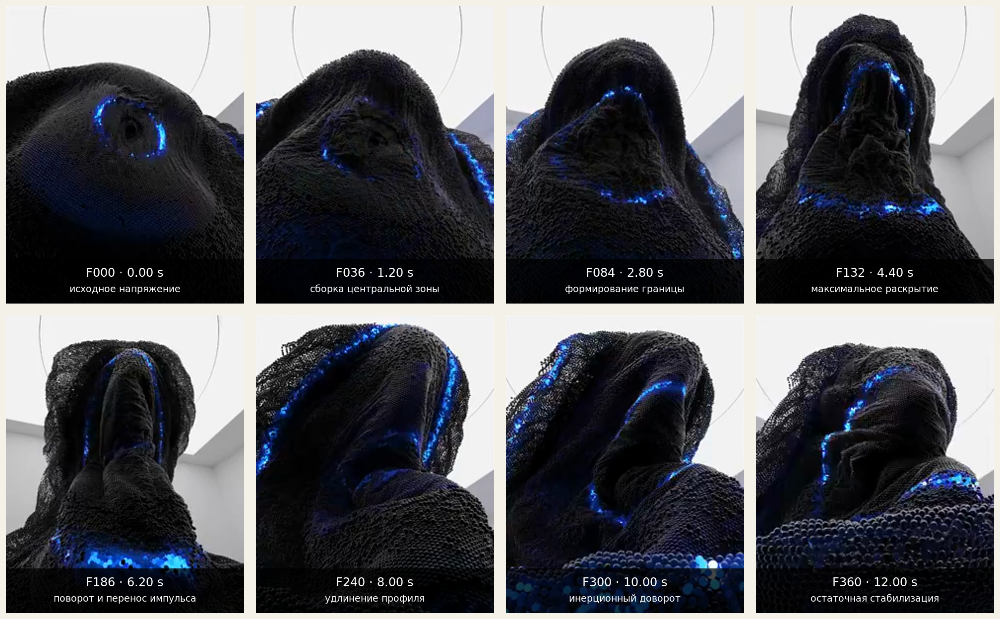
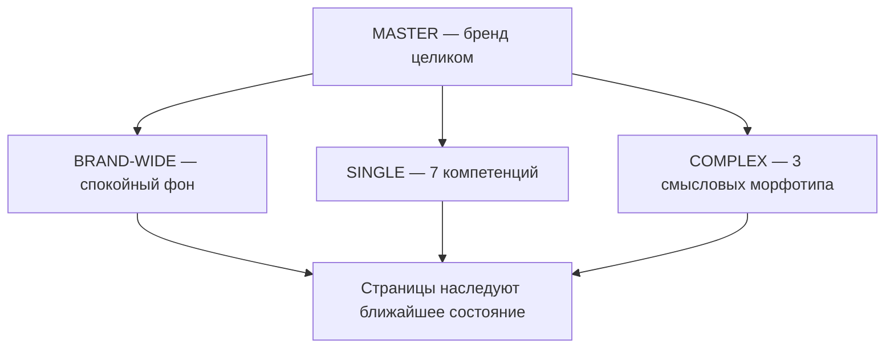
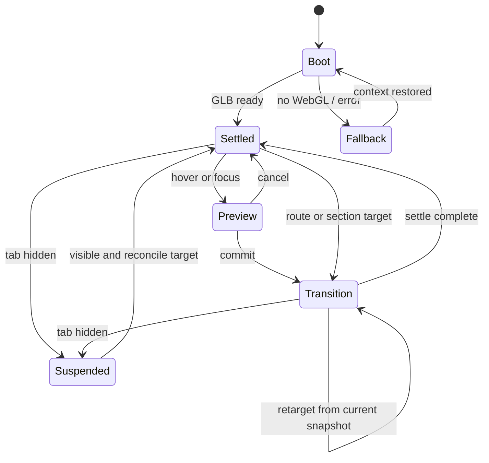

# Mimicry group — PS‑02.5

## Система смысловых форм, статичного поведения и переходов Photonic Skin

Дата: 3 августа 2026 года  
Статус: исследовательская спецификация; решение для подтверждения перед PS‑03  
Объект: один сквозной `Mimic Core`, а не набор независимых моделей  
Production-код, Photonic Skin Lab, Blender-модели и GLB на этом этапе не изменялись

### Как читать документ

- **Факт проекта** — уже зафиксированное решение или измерение PS‑02.
- **Внешний факт** — вывод из опубликованного источника; рядом дана ссылка.
- **Рекомендация PS‑02.5** — проектное решение, которое следует подтвердить перед PS‑03.
- **Гипотеза для проверки** — решение, которое необходимо проверить в Blender, WebGL-прототипе или пользовательском тесте.

---

## 1. Краткий вывод

**Рекомендация PS‑02.5:** строить систему на **ограниченном гибридном refinement**, но не на смешении A и C пополам.

Основа — **C / Tensioned Core**: она даёт премиальную массу, скульптурность и внутреннее напряжение. Из **A / Directed Fold** нужно перенести только три свойства:

1. одну читаемую направленную ось;
2. последовательное, а не равномерное развитие деформации вдоль этой оси;
3. более ясный мобильный силуэт.

Итоговая формула формы:

```text
масса и пластика C
+ 15–25% направленности A
− центральная полость
− наконечник и стрелочная буквальность
= Mimic Core PS‑03 candidate
```

Итоговая motion-грамматика — **Directed Photonic Release**:

```text
ориентация и anticipation
→ направленное поверхностное натяжение
→ запуск приглушённого фотонного импульса
→ morph, идущий вслед за импульсом
→ инерция не более 1,8% амплитуды
→ стабилизация
→ спокойный маятниковый idle
```

Предложенную пользователем последовательность следует сохранить, но **фотонная волна и основной morph должны частично перекрываться**. Если выполнить их строго друг за другом, переход станет заставкой длиной 1,4–1,8 секунды и начнёт тормозить навигацию.

Система не требует отдельной формы для каждой страницы или сочетания компетенций. Для PS‑03 достаточно:

- базовой геометрии `MASTER`;
- 7 `SINGLE` targets;
- 3 смысловых `COMPLEX` targets;
- `BRAND_WIDE`;
- одного малoамплитудного additive target `TRANSITION_TENSION`.

Итого: **12 morph targets относительно базовой формы `MASTER`**.

Главное разделение ответственности:

```text
смысл состояния → геометрия
состав компетенций → палитра
направление взаимодействия → ход трансформации
```

---

## 2. Что изменилось после PS‑02

### 2.1. Изменения проектного понимания

1. **C недостаточно оценивать как один красивый объект.** Теперь он должен выдержать 7 компетенций, 3 комплексных морфотипа, общефирменное состояние, мобильное кадрирование и ретаргетинг незавершённого morph.
2. **A остаётся контрольным носителем направленности**, но не должен становиться стрелкой, наконечником или аэродинамической деталью.
3. **B не рекомендуется как master**, но его спокойствие и раскрытый сбалансированный профиль полезны как контроль для `BRAND_WIDE`.
4. Семь компетенций получают **семь связанных абстрактных форм**, а не буквальные предметные метафоры.
5. `COMPLEX` не строится смешением `SINGLE` targets. Количество и идентичность компетенций меняют цвет, но не число выступов, лепестков или частей.
6. Точная физическая площадь цветной поверхности 34% перестаёт быть жёсткой runtime-целью. Жёстким инвариантом становится **одна и та же топологическая область и одна маска**.
7. Переход теперь проектируется не как ролик, а как **отменяемая навигационная система**, способная продолжаться из любого промежуточного состояния.

### 2.2. Кабинетное исследование: внешние примеры

| Пример | Что в нём полезно | Что нельзя переносить | Принцип для Mimicry |
|---|---|---|---|
| [BBC Two — Design Bridge & Partners](https://www.designbridge.com/work/bbc-two) и [motion guidelines FutureDeluxe](https://futuredeluxe.com/work/bbc-2) | Одна центральная кривая остаётся «клеем» для очень разных выражений; система допускает развитие разными авторами | Саму кривую «2», калейдоскоп материалов и телевизионную интенсивность idents | Один инвариант — направленный гребень/ось — должен сохраняться во всех morph-состояниях |
| [Optus — FutureDeluxe](https://futuredeluxe.com/work/optus) | Студия сначала определила принципы поведения знака в motion, затем создавала конкретные idents для разных экранов | Знак `Yes`, глянцевую жидкость, океанические ассоциации и эмоциональный австралийский контекст | Сначала фиксируется motion-грамматика, затем формы; не наоборот |
| [IBM Software Toolkits — Tendril](https://tendril.studio/work/ibm-software/) | Тактильная 3D-система проектируется как масштабируемый язык для глобальных кампаний, а не как один рендер | IBM-синий, буквальную технологичность, стеклянные UI-объекты и hardware-эстетику | Премиальность должна повторяться через материальность, свет и пропорции во всех состояниях |
| [IBM z17 — Tendril](https://tendril.studio/work/ibm-z17/) | Материальный контраст и точный свет способны сообщать надёжность без визуального шума | Чёрный hardware, серверные и automotive-ассоциации | Нейтральная масса должна доминировать над цветом; цвет раскрывает конструкцию, а не заменяет её |
| [Screens of the Future — Universal Everything](https://www.universaleverything.com/art/screens-of-the-future) | Один цифровой материал может менять форму и функцию, сохраняя ощущение непрерывного вещества | «Цифровую жизнь», произвольное жидкое перетекание и демонстрационную футуристичность | Изменение формы должно выглядеть как перестройка одного материала, а не замена объекта |
| [Presence — Universal Everything](https://www.universaleverything.com/art/presence) | Разные материалы сохраняют узнаваемость через общий характер движения | Человеческую пластику, «дыхание», костюмы и ощущение живого тела | ДНК объекта может сохраняться не только силуэтом, но и одинаковой динамикой напряжения |
| [Lusion WebGL Scroll Sync](https://github.com/lusionltd/WebGL-Scroll-Sync) и [демо](https://webgl-scroll-sync.lusion.co/) | Показана реальная проблема рассинхронизации DOM-scroll и WebGL между кадрами | Scroll-jacking, привязку к каждому пикселю и демонстрационную механику сайта | Canvas должен быть persistent, а объект — следовать дискретным semantic states с фильтрованным прогрессом |
| [Фотонные кристаллы в коже хамелеона](https://www.nature.com/articles/ncomms7368) | Цветовой сдвиг связан с перестройкой решётки нанокристаллов, а не с нанесением новой «краски» | Биологическую кожу, буквальную чешую и натуралистическое поведение | Цвет должен быть локальным структурным откликом одной поверхности |

### 2.3. Технические факты, влияющие на систему

- **glTF 2.0** хранит morph targets и анимирует их веса, но не задаёт runtime-поведение переходов; цвет материала также не является стандартным анимируемым свойством glTF. Следовательно, morph-веса и shader-параметры должны синхронизироваться на уровне приложения. [Khronos glTF 2.0 Specification](https://registry.khronos.org/glTF/specs/2.0/glTF-2.0.html)
- React Three Fiber 9 соответствует React 19; `useFrame` предоставляет `delta`, что позволяет делать движение независимым от частоты кадров. [React Three Fiber repository](https://github.com/pmndrs/react-three-fiber), [hooks documentation](https://r3f.docs.pmnd.rs/api/hooks)
- R3F рекомендует использовать `delta`, не создавать объекты в цикле и адаптировать качество/DPR. [Performance pitfalls](https://r3f.docs.pmnd.rs/advanced/pitfalls), [Scaling performance](https://r3f.docs.pmnd.rs/advanced/scaling-performance)
- Layouts App Router сохраняют состояние и не размонтируются при обычной client-side навигации; root layout подходит для persistent Canvas. [Next.js layouts and pages](https://nextjs.org/docs/app/getting-started/layouts-and-pages)
- WebGL-реализация должна учитывать системные лимиты, уменьшенный back buffer, раннее освобождение ресурсов и потерю контекста. [MDN WebGL best practices](https://developer.mozilla.org/en-US/docs/Web/API/WebGL_API/WebGL_best_practices)
- Анимация, основанная на `requestAnimationFrame`, должна использовать время кадра; в скрытых вкладках вызовы обычно останавливаются. [MDN requestAnimationFrame](https://developer.mozilla.org/en-US/docs/Web/API/Window/requestAnimationFrame)
- `visibilitychange` — явный сигнал для паузы сцены, а `webglcontextlost/restored` требует fallback и повторной инициализации GPU-ресурсов. [Page Visibility API](https://developer.mozilla.org/en-US/docs/Web/API/Page_Visibility_API), [context lost](https://developer.mozilla.org/en-US/docs/Web/API/HTMLCanvasElement/webglcontextlost_event), [context restored](https://developer.mozilla.org/en-US/docs/Web/API/HTMLCanvasElement/webglcontextrestored_event)
- Carbon разделяет быстрый productive motion и более медленный expressive motion, но отдельно требует, чтобы полноэкранные переходы сохраняли непрерывный элемент и оставались ненавязчивыми. [IBM Carbon Motion](https://carbondesignsystem.com/elements/motion/overview/)

---

## 3. Покадровый разбор видео-референса

### 3.1. Факты файла

- длительность: `12,167 s`;
- частота: `30 fps`;
- видеокадров: `362`;
- разрешение: `240 × 300 px`;
- камера визуально почти неподвижна относительно светлого окружения; основное изменение создают деформация и глобальный поворот объекта;
- синий свет в основном следует границе активной деформации.



### 3.2. Фазы движения

| Время / кадры | Крупный объём | Локальная поверхность | Свет | Камера / кадр | Вывод |
|---|---|---|---|---|---|
| `0,00–1,10 s` / F000–F033 | Низкий собранный объём; заметна малая центральная впадина | Поверхность стягивается к центру | Слабый синий контур маркирует напряжённую область | Почти статична | Работает как anticipation, но впадина уже создаёт биологический риск |
| `1,10–2,60 s` / F033–F078 | Центральная область поднимается; масса собирается вверх | Формируется треугольная граница, края натягиваются | Импульс становится читаемее по периметру | Кадр стабилен | Полезна последовательная сборка объёма до morph |
| `2,60–4,40 s` / F078–F132 | Проём резко увеличивается по вертикали | Край раскрывается, внутренние складки вытягиваются | Свет усиливает именно границу, а не всё тело | Минимальное изменение | Универсален принцип «граница сначала объясняет, где произойдёт изменение» |
| `4,40–5,90 s` / F132–F177 | Достигается максимальное раскрытие | Центральная часть вытягивается как язык/внутренняя ткань | Яркая линия охватывает основание | Почти статична | Для Mimicry неприемлемы пасть, полость и внутренний органический слой |
| `5,90–7,40 s` / F177–F222 | Объект начинает доворот и меняет основной профиль | Натяжение переносится с фронта на боковую поверхность | Световой импульс переходит на новую границу | Вероятнее поворачивается объект, а не камера | Полезно: глобальная ориентация догоняет morph, а не меняется первой |
| `7,40–9,20 s` / F222–F276 | Силуэт удлиняется и наклоняется | Внутренние складки вытягиваются вдоль нового направления | Синий контур ведёт взгляд по оси | Фон остаётся устойчивым | Полезна связь светового пути с направлением деформации |
| `9,20–10,90 s` / F276–F327 | Основная форма почти достигнута | Продолжаются малые локальные перестройки | Яркость концентрируется на опорных границах | Продолжается медленный доворот | Это фаза инерции; её следует сократить в веб-переходе |
| `10,90–12,17 s` / F327–F361 | Новый профиль фиксируется | Остаточные складки успокаиваются | Свет стабилизируется, но не исчезает | Движение ослабевает | Полезен короткий settle перед возвратом к idle |

### 3.3. Деконструкция механики

**Универсальная механика:**

```text
локальное обозначение зоны
→ сборка напряжения
→ развитие деформации от этой зоны
→ изменение общего профиля
→ остаточная инерция
→ стабилизация
```

**Чужая стилистика:**

```text
полость + распахивание + внутренняя ткань
+ чёрная сетка + яркий синий неон
= пасть / органический хоррор / alien-tech
```

---

## 4. Что из референса можно перенести

1. **Anticipation длительностью 90–140 ms** перед большим route-morph.
2. **Натяжение поверхности вдоль одной оси**, а не равномерное «размягчение» всего объёма.
3. **Фотонный импульс как причинный сигнал**, показывающий направление будущего изменения.
4. **Пространственно последовательный morph:** вершины не обязаны двигаться синхронно; локальная задержка вдоль оси может составлять 80–120 ms.
5. **Изменение глобального профиля после начала локального движения**, а не мгновенная смена силуэта.
6. **Инерция малой амплитуды**, которая подтверждает материальность.
7. **Короткий settle**, после которого включается отдельный idle, а не бесконечно продолжается переход.

Адаптация для Photonic Skin:

- импульс идёт по **внешнему гребню/направленной складке**;
- поверхность не раскрывается внутрь;
- morph сохраняет один замкнутый объём;
- свет не превышает яркость интерфейсного акцента и не становится emissive-неоном;
- импульс использует только цвета исходного и целевого semantic states, не вводя новый переходный hue.

---

## 5. Что необходимо исключить

- центральную полость глубже `3%` короткой стороны bounding box;
- кольцевое раскрытие, которое образует рот или апертуру;
- одновременное разведение двух краёв как губ;
- внутреннюю «ткань», язык, мембрану или вторую независимую поверхность;
- чёрную сетчатую кожу и hex/scale-паттерн;
- яркий синий неон как универсальный переходный цвет;
- полную темноту вокруг объекта;
- деформацию, похожую на вдох/выдох;
- эластичную желеобразную задержку более `180 ms`;
- overshoot более `2%` геометрической амплитуды;
- вращение камеры вокруг объекта;
- разрыв, отделение лоскутов и механические сочленения.

---

## 6. Карта всех состояний объекта

### 6.1. Правило наследования



### 6.2. Таблица состояний

| Semantic state | Геометрия | Палитра | Motion preset | Наследуют |
|---|---|---|---|---|
| `MASTER` | Базовый Mimic Core | Все 7 цветов, структурные острова | `master-idle` | Главная hero |
| `MASTER_DUAL_ENTRY` | `MASTER 0.85 + BRAND_WIDE 0.15`, без нового target | Все 7, интенсивность 72% от hero | `support-idle` | Блок двойного входа до выбора |
| `SINGLE(content)` | `SINGLE_CONTENT_SEQUENCE` | Только `#4C7AFF` | `single-content` | Контент и single-case |
| `SINGLE(design)` | `SINGLE_DESIGN_TORSION` | Только `#9E64EE` | `single-design` | Дизайн и single-case |
| `SINGLE(event)` | `SINGLE_EVENT_CONVERGENCE` | Только `#F86927` | `single-event` | Event и single-case |
| `SINGLE(games)` | `SINGLE_GAMES_BRANCH` | Только `#76A713` | `single-games` | Игры и single-case |
| `SINGLE(video)` | `SINGLE_VIDEO_TEMPORAL` | Только `#E34992` | `single-video` | Видео и single-case |
| `SINGLE(digital)` | `SINGLE_DIGITAL_SIGNAL` | Только `#009FAC` | `single-digital` | Digital и single-case |
| `SINGLE(merch)` | `SINGLE_MERCH_WRAP` | Только `#D5A200` | `single-merch` | Мерч и single-case |
| `COMPLEX(focus,S)` | `COMPLEX_FOCUS` | Только выбранное множество `S` | `complex-focus` | Проекты, где главное — сфокусировать и объяснить |
| `COMPLEX(gather,S)` | `COMPLEX_GATHER` | Только `S` | `complex-gather` | Проекты, где главное — собрать участие |
| `COMPLEX(drive,S)` | `COMPLEX_DRIVE` | Только `S` | `complex-drive` | Проекты, где главное — довести до запуска/действия |
| `BRAND_WIDE` | `BRAND_WIDE` | Все 7, пониженная видимая площадь | `brand-idle` | О компании, контакты, закупкам, реестр кейсов |
| `PREVIEW(target)` | Не более 12% target influence | Preview-палитра до 35% интенсивности | `preview` | Hover, focus, предварительный выбор |
| `FALLBACK` | Предрендер финального semantic state | Та же палитра | `static` | Нет WebGL, context lost, слабое устройство |

`focus / gather / drive` — **внутренние морфологические намерения**, а не возвращение старых четырёх «Решений» и не новая навигационная таксономия.

---

## 7. Форма `MASTER`

### 7.1. Каноническая форма

**Смысл:** собранный потенциал, который ещё не получил конкретную задачу, но уже содержит направленность к действию.

**Силуэт:** компактный асимметричный tensioned volume с одной диагональной спиной/гребнем. Нет носа, хвоста, отверстия и симметричной «раковины».

**Направленная ось:** в object space — вектор примерно `(0.86, 0.28, 0.42)`. В кадре desktop он читается снизу-слева вверх-вправо, но leading shoulder остаётся округлым.

**Пластика:**

- 70–75% массы и внутреннего напряжения C;
- 15–25% диагонального shear и направленного fold A;
- 5–10% более спокойного распределения веса, характерного для B;
- никакого буквального усреднения трёх моделей.

### 7.2. Положение в кадре

- Desktop 1440: центр проекции `x = 72vw`, `y = 53vh`; ширина объекта `52vw`, высота `86vh`; правое кадрирование `18–24%` видимого силуэта.
- Mobile 390: центр `x = 70vw`, `y = 71vh`; ширина `132vw`, высота `62vh`; правое кадрирование `32–42%`, нижнее `14–22%`.
- Ведущий гребень не пересекает H1 и основной CTA.

### 7.3. Семь цветов

Активная топологическая зона остаётся общей, но делится не на линейную радугу, а на **семь закреплённых полей влияния**:

- передняя прохладная группа: Контент, Дизайн, Digital;
- верхняя переходная точка: Игры;
- задняя тёплая группа: Event, Видео, Мерч.

Между цветовыми полями остаются нейтральные коридоры. Цвета не меняются местами и не прокручиваются по кругу. Движутся только внутренние границы и интенсивность внутри каждого поля.

### 7.4. Idle

- маятниковое, а не круговое вращение;
- наиболее заметна ось Y, но полный показ оборота запрещён;
- scale pulse `±0,22%` и additive micro-morph `TRANSITION_TENSION 0–0,006 influence` работают в разных фазах;
- полный локальный color drift занимает `48 s`;
- регулярного «дыхательного» ритма нет: используются несовпадающие циклы 19/27/31/29 секунд.

### 7.5. Первая загрузка

1. Текст и статический poster frame появляются без ожидания 3D.
2. После готовности GLB live-объект заменяет poster за `240 ms` без morph.
3. Один стартовый settle: поворот не более `2,5°`, рост photonic gain с 70% до 100% за `420 ms`.
4. Ни форма, ни семь цветов не устраивают демонстрационный «showreel».
5. В пределах одной сессии повторная загрузка route не запускает entrance снова.

### 7.6. Переход к двойному входу

При входе блока в центральные `45%` viewport:

- форма смешивается с `BRAND_WIDE` на 15%;
- scale уменьшается до `0,92`;
- объект уходит глубже, photonic gain снижается до 72%;
- hover/focus «Собрать проект» даёт 12% preview `COMPLEX_GATHER`;
- hover/focus конкретной компетенции даёт 12% её `SINGLE` target и локальный preview цвета;
- до выбора конкретной компетенции ветка `SINGLE` не получает случайную форму.

---

## 8. Форма `COMPLEX`

### 8.1. Главное решение

```text
тип и смысл комплексного проекта → один из 3 complex morph targets
состав компетенций → цветовые поля
количество компетенций → только плотность цветовой композиции
```

Геометрия **не зависит напрямую** от количества компетенций и не суммирует семь `SINGLE` shapes.

### 8.2. Три морфотипа

| Morph target | Смысл | Силуэт | Риск и ограничение |
|---|---|---|---|
| `COMPLEX_FOCUS` | Разные входы собираются в один ясный смысл | Более узкий leading shoulder, одна сходящаяся диагональная складка | Не становиться стрелкой, линзой или глазом |
| `COMPLEX_GATHER` | Несколько потоков участия образуют общий центр | Больше латеральной ширины; боковые поверхности мягко сходятся к поднятому гребню | Не создавать сцену, портал, цветок или отверстие |
| `COMPLEX_DRIVE` | Собранная система получает импульс к запуску | Удлинённый, но тупой передний объём; rear crest поддерживает вектор | Не становиться ракетой, автомобилем или аэродеталью |

Если смысл проекта ещё не определён, используется `COMPLEX_GATHER` с influence `0,35`, а не новая форма.

### 8.3. До и после выбора компетенций

| Состояние выбора | Геометрия | Цвет |
|---|---|---|
| Ничего не выбрано | `MASTER → COMPLEX_GATHER 35%` | Все 7 цветов на 38% hero-интенсивности; объект показывает потенциал, а не готовый состав |
| Выбрана 1 компетенция внутри конструктора | Геометрия всё ещё complex, не `SINGLE` | Один цвет; интерфейс явно сообщает, что это состав будущего комплексного проекта |
| Выбраны 2 | Геометрия не меняется | Два устойчивых поля, каждое занимает около 41% окрашенной части active mask; 18% остаётся нейтральным швом |
| Выбраны 3 | Геометрия не меняется | Около 27% окрашенной части на цвет; 19% нейтрально |
| Выбраны 4 | Геометрия не меняется | Около 20% на цвет; 20% нейтрально |
| Выбраны 5–7 | Геометрия не усложняется | Поля становятся уже; общая насыщенная площадь не растёт, photonic gain уменьшается на 8–12% |

Проценты выше относятся к **внутренней площади активной маски**, а не ко всей поверхности.

### 8.4. Добавление и удаление цвета

- У каждой компетенции есть постоянный anchor field; существующие цвета не пересортировываются.
- Добавление: новый field проявляется за `260 ms`, соседние поля уступают ему пространство за `320 ms`.
- Удаление: field уходит в нейтральную материю за `220 ms`; соседи расширяются за `300 ms`.
- Геометрия не реагирует на каждое добавление компетенции.
- Если выбор изменил главный смысл проекта и требуется другой complex morph, geometry transition запускается только после подтверждения формата/сценария, а не после каждого чекбокса.

### 8.5. Страница конкретного проекта

- Использует один из трёх complex morphs, назначенный контентной моделью проекта.
- Палитра строится только из фактически указанных компетенций.
- При неизвестном составе используется спокойный `BRAND_WIDE`, а не выдуманная разноцветная комбинация.
- Форма не меняется между секциями «задача / процесс / результат», если смысловой центр проекта остаётся тем же; меняются framing и photonic emphasis.

---

## 9. Семь форм `SINGLE`

### Общая ДНК

Все targets обязаны сохранять:

- один непрерывный объём;
- общий bounding box `6.8 × 3.6 × 3.2` с допустимым заполнением 88–100%;
- одну направленную ось;
- один rounded leading shoulder;
- отсутствие отверстий и отдельных частей;
- общий масштаб микрорельефа;
- узнаваемый 3/4 hero-ракурс и один проверенный mobile-ракурс.

### 9.1. Контент — `SINGLE_CONTENT_SEQUENCE`

| Принцип-кандидат | Оценка | Решение |
|---|---|---|
| Narrative ribbon — одна лента разворачивается по поверхности | Понятно, но легко превращается в бумагу | Отклонить |
| Layered pages — несколько тонких слоёв | Слишком буквальная книга/документ | Отклонить |
| **Directed sequence — ритм из трёх неглубоких складок вдоль одной смысловой оси** | Выражает последовательность, не изображая носитель | **Выбрать** |

1. **Смысл:** мысль становится последовательным сообщением.
2. **Деформация:** спина C вытягивается; вдоль неё формируются три неглубоких, нераздельных такта.
3. **Силуэт:** вытянутый гребень с ясным началом и раскрытым тупым завершением.
4. **Напряжение:** от trailing-lower к leading-upper.
5. **Фотонная зона:** проходит по гребню и по одному краю каждого ритмического такта.
6. **Цвет:** только `#4C7AFF`.
7. **Idle-вращение:** Y `±3,2°`, X `±1,0°`, Z `±0,5°`.
8. **Пульсация формы:** additive micro-morph `TRANSITION_TENSION 0–0,005`, смещённый вдоль последовательности.
9. **Движение цвета:** один слабый импульс проходит всю ось за `36 s`; hue не меняется.
10. **Из MASTER:** leading ridge организуется раньше trailing mass.
11. **В другую компетенцию:** складки сначала теряют ритм до 35%, затем возникает новая структура; в MASTER не возвращается.
12. **Mobile:** видны два из трёх тактов; leading shoulder остаётся в кадре.
13. **Риски:** бумага, книга, speech waveform; запрещены тонкие листовые края.

### 9.2. Дизайн — `SINGLE_DESIGN_TORSION`

| Принцип-кандидат | Оценка | Решение |
|---|---|---|
| Modular facets — локальная перестройка плоскостей | Риск software/parametric demo | Резерв |
| Balanced counterform — две уравновешенные массы | Может стать логотипом из двух частей | Отклонить |
| **Controlled torsion — две широкие поверхности одного тела создают точный управляемый поворот** | Показывает придание формы без буквального инструмента | **Выбрать** |

1. **Смысл:** содержание получает выверенную визуальную форму.
2. **Деформация:** центральная масса сохраняется, верхняя и нижняя поверхности получают противоположный малый torsion.
3. **Силуэт:** спокойная S-асимметрия без ленточной тонкости.
4. **Напряжение:** диагональное, с контролируемым противовесом.
5. **Фотонная зона:** по границе двух направлений torsion, но без разреза.
6. **Цвет:** только `#9E64EE`.
7. **Idle-вращение:** Z `±1,2°`, Y `±2,6°`, X `±0,8°`.
8. **Пульсация формы:** additive influence `TRANSITION_TENSION 0–0,006`, преимущественно torsion, не uniform scale.
9. **Движение цвета:** локальное смещение границы `±1,2%` UV за `44 s`.
10. **Из MASTER:** сначала выравнивается leading shoulder, затем развивается counter-twist.
11. **В другую компетенцию:** torsion уменьшается без обратного «раскручивания» на полный оборот.
12. **Mobile:** показывается фронтальная широкая плоскость и один контр-поворот.
13. **Риски:** fashion ribbon, раковина, декоративная абстракция; запрещена тонкая лента.

### 9.3. Event — `SINGLE_EVENT_CONVERGENCE`

| Принцип-кандидат | Оценка | Решение |
|---|---|---|
| Spatial loop | Сильный центр, но почти неизбежно отверстие/сцена | Отклонить |
| Resonant wave | Хорошо для энергии, слабо для совместного присутствия | Резерв |
| **Convergent crest — боковые поверхности собираются к одному поднятому гребню** | Передаёт сбор людей без портала | **Выбрать** |

1. **Смысл:** люди, пространство и действие сходятся в одном моменте.
2. **Деформация:** латеральные массы расширяются и мягко поднимают центральный crest.
3. **Силуэт:** широкий снизу, собранный сверху; без арки и проёма.
4. **Напряжение:** с двух боков к верхней направленной точке.
5. **Фотонная зона:** два боковых пути сходятся на crest, оставаясь частью одной маски.
6. **Цвет:** только `#F86927`.
7. **Idle-вращение:** X `±1,6°`, Y `±3,4°`, Z `±0,4°`.
8. **Пульсация формы:** additive influence `TRANSITION_TENSION 0–0,005`; crest меняет высоту, ширина основания почти неизменна.
9. **Движение цвета:** два приглушённых front-а сходятся раз в `42 s`, без вспышки в центре.
10. **Из MASTER:** масса сначала расширяется латерально, затем поднимается crest.
11. **В другую компетенцию:** crest опускается, но объём не «закрывается» как рот.
12. **Mobile:** сохраняется широкий низ и один crest; объект не центрируется как сцена.
13. **Риски:** сцена, прожектор, портал, цветок, вулкан.

### 9.4. Игры — `SINGLE_GAMES_BRANCH`

| Принцип-кандидат | Оценка | Решение |
|---|---|---|
| Interlock | Хорошо передаёт правила, но требует отдельных частей | Отклонить |
| Tension loop | Считывается как цикл, но создаёт отверстие | Отклонить |
| **Branching tension — единая сила делится на три мягких направления и снова собирается** | Выражает выбор и обратную связь без джойстика | **Выбрать** |

1. **Смысл:** участие, выбор и последствия внутри одной системы правил.
2. **Деформация:** один ridge временно распределяет напряжение на три широких плеча; они не отделяются.
3. **Силуэт:** лёгкая трёхчастная вариативность в верхней кромке, единое основание.
4. **Напряжение:** центральное ветвление с возвратом к ведущей оси.
5. **Фотонная зона:** Y-образное поле без тонких линий и «дорожек платы».
6. **Цвет:** только `#76A713`.
7. **Idle-вращение:** Y `±2,8°`, X `±1,0°`, Z `±0,7°`; фазовый сдвиг подчёркивает разные плечи.
8. **Пульсация формы:** additive influence `TRANSITION_TENSION 0–0,007`, поочерёдно между плечами, без прыжка.
9. **Движение цвета:** интенсивность переходит между тремя полями за `39 s`.
10. **Из MASTER:** branching появляется после короткого центрального tension.
11. **В другую компетенцию:** три плеча сходятся в текущую промежуточную массу и сразу продолжают новый morph.
12. **Mobile:** читаются центральное и одно боковое плечо; нельзя кадрировать так, чтобы получились «рога».
13. **Риски:** корона, рога, игрушка, пазл, game-controller, дорожки платы.

### 9.5. Видео — `SINGLE_VIDEO_TEMPORAL`

| Принцип-кандидат | Оценка | Решение |
|---|---|---|
| Aperture | Быстро считывается, но становится камерой/глазом | Отклонить |
| Focus plane | Премиально, но слишком статично | Резерв |
| **Temporal sweep — вытянутый S-профиль, где одна фаза формы переходит в следующую** | Передаёт время, монтаж и направленное внимание | **Выбрать** |

1. **Смысл:** внимание развивается во времени и удерживается последовательностью кадров.
2. **Деформация:** core удлиняется, ведущая и trailing-зоны получают разный временной сдвиг.
3. **Силуэт:** плавный S-sweep без окружности и линзы.
4. **Напряжение:** продольное, с усилением на leading third.
5. **Фотонная зона:** широкая временная полоса следует S-профилю.
6. **Цвет:** только `#E34992`.
7. **Idle-вращение:** Y `±3,6°`, X `±0,8°`, Z `±0,5°`.
8. **Пульсация формы:** additive influence `TRANSITION_TENSION 0–0,004`; временной сдвиг между передней и задней третью 2,8 s внутри длинного цикла.
9. **Движение цвета:** один мягкий sweep за `34 s`, без scanline.
10. **Из MASTER:** photonic cue появляется на leading third, затем morph идёт назад по профилю.
11. **В другую компетенцию:** временной sweep сокращается до текущей точки и от неё запускается новая ось.
12. **Mobile:** сохраняется leading S и magenta-поле; круглый торец не показывается фронтально.
13. **Риски:** камера, линза, глаз, киноплёнка, сканер.

### 9.6. Digital — `SINGLE_DIGITAL_SIGNAL`

| Принцип-кандидат | Оценка | Решение |
|---|---|---|
| Node field | Считывается как сеть, но превращает кожу в точки | Отклонить |
| Responsive matrix | Слишком software/hardware | Отклонить |
| **Signal channels — 2–3 широких продольных канала напряжения сходятся в один выход** | Передаёт связность и интерактивный отклик без устройства | **Выбрать** |

1. **Смысл:** система принимает вход, обрабатывает и возвращает связный отклик.
2. **Деформация:** в массе появляются широкие неглубокие каналы, не отдельные трубки.
3. **Силуэт:** более точный и собранный, но сохраняет органическую асимметрию.
4. **Напряжение:** параллельное, затем сходящееся к leading shoulder.
5. **Фотонная зона:** распределяется вдоль каналов, но не превращается в circuit traces.
6. **Цвет:** только `#009FAC`.
7. **Idle-вращение:** Y `±2,4°`, X `±0,7°`, Z `±0,6°`.
8. **Пульсация формы:** additive influence `TRANSITION_TENSION 0–0,004`; каналы меняют глубину не более 0,3% bbox.
9. **Движение цвета:** несинхронные сигналы с общей длительностью `32 s`, без мигания.
10. **Из MASTER:** сначала упорядочивается directed axis, затем выделяются каналы.
11. **В другую компетенцию:** каналы становятся мелкими и растворяются в продолжающемся morph.
12. **Mobile:** показываются два широких канала; мелкий рельеф не является смысловым носителем.
13. **Риски:** circuit board, сервер, смартфон, sci-fi hardware, data tunnel.

### 9.7. Мерч — `SINGLE_MERCH_WRAP`

| Принцип-кандидат | Оценка | Решение |
|---|---|---|
| Tactile capsule | Сильная материальность, но продуктовая капсула | Резерв |
| Imprint plane | Хорошо для нанесения, но слишком плоско | Отклонить |
| **Tensioned wrap — внешняя поверхность оборачивает и фиксирует внутреннюю массу без отдельной оболочки** | Передаёт физический носитель и заботу о сборке | **Выбрать** |

1. **Смысл:** идея становится собранным физическим носителем.
2. **Деформация:** широкая поверхность огибает core и образует один мягкий overlap без шва-разрыва.
3. **Силуэт:** плотный, тактильный, немного более низкий и устойчивый.
4. **Напряжение:** окружное с выходом на directed leading edge.
5. **Фотонная зона:** следует линии wrap и одному широкому imprint field.
6. **Цвет:** только `#D5A200`.
7. **Idle-вращение:** Y `±2,0°`, X `±1,2°`, Z `±0,4°`.
8. **Пульсация формы:** additive influence `TRANSITION_TENSION 0–0,003`; запрещена циклическая «упаковка/распаковка».
9. **Движение цвета:** локальный glint проходит wrap за `48 s`, без золотого metallic-хрома.
10. **Из MASTER:** core уплотняется, затем outer surface мягко принимает wrap-профиль.
11. **В другую компетенцию:** wrap ослабляется только на 30%, затем сразу перестраивается в новый target.
12. **Mobile:** основной overlap располагается в верхней видимой трети, не образуя коробку.
13. **Риски:** коробка, пакет, капсула, чемодан, золотой слиток.

---

## 10. Форма `BRAND-WIDE`

`BRAND-WIDE` — не уменьшенный `MASTER` и не отдельная метафора «контактов».

| Параметр | `MASTER` | `BRAND-WIDE` |
|---|---|---|
| Роль | Заявление бренда | Поддерживающий фон |
| Направленность | Явная диагональная | Сбалансированная, но не симметричная |
| Силуэт | Более собранный и напряжённый | Более широкий, спокойный, закрытый |
| Размер | 52vw desktop | 40–46vw desktop |
| Цветовая видимость | 100% preset | 55–62% preset |
| Color drift | 48 s | 72 s |
| Rotation Y | ±3,8° | ±2,4° |
| Контраст | Hero-level | На 20–28% ниже |

Применение:

- «О компании» — спокойный 3/4, видна внутренняя конструкция света, но нет среза или отверстия;
- «Контакты» — объект чуть ближе к центру, направленная ось визуально ведёт к CTA;
- «Закупкам» — более низкий contrast, устойчивое горизонтальное основание;
- общие CTA — framing меняется, morph остаётся `BRAND_WIDE`.

Все семь цветов присутствуют как низкоинтенсивные anchor fields. В одном ракурсе допускается отчётливо видеть только 3–4 поля; остальные не исчезают из состояния, а уходят на менее освещённую сторону.

---

## 11. Правила для кейсов и служебных экранов

### 11.1. Наследование

| Экран | Правило |
|---|---|
| Кейс с одной компетенцией | Наследует соответствующий `SINGLE`; цвет только этой компетенции |
| Кейс с несколькими компетенциями | Наследует `COMPLEX(focus/gather/drive)` по смыслу результата; палитра только фактического состава |
| Кейс без подтверждённого состава | `BRAND_WIDE`; состав не угадывается |
| Реестр кейсов | `BRAND_WIDE`; focus/keyboard preview карточки меняет только цвет до 35% и target influence до 8% |
| 404 | `BRAND_WIDE`, actor смещён на 6vw за обычную позицию и показывает спокойный полный спектр; уникальный target не создаётся |
| Загрузка | Статический poster целевого состояния; индикатор прогресса находится в DOM, не в 3D |
| Нет WebGL | Предрендер `AVIF/WebP` для semantic state; текст и интерфейс полностью работоспособны |
| Context lost | Live Canvas скрывается, последний подтверждённый poster становится видимым; после restore ресурсы создаются заново |
| Экран без специального morph | Наследует ближайший route-level state; если наследование не определено — `BRAND_WIDE` |

### 11.2. Что не наследуется

- случайный hover не становится постоянным route state;
- цвет карточки не меняет геометрию, пока пользователь не выбрал/открыл соответствующий маршрут;
- служебные страницы не получают уникальные ручные shape keys;
- 404 не изображается «сломавшимся» Mimic Core.

---

## 12. Три альтернативные motion-грамматики

### A. Directed Tension

Поверхность заранее стягивается вдоль направленной оси. Leading shoulder начинает движение первым, остальная масса догоняет.

- **Сила:** максимально соответствует «Направленному действию» и читается без цвета.
- **Риск:** стрелка, аэродинамика, product reveal.
- **Нежелательные ассоциации:** наконечник, ракета, автомобильный кузов.
- **Сложность:** средняя; требуется per-vertex phase вдоль оси или authored additive target.
- **Пригодность:** `MASTER` — высокая; `SINGLE` — высокая; `COMPLEX` — высокая; `BRAND-WIDE` — средняя.

### B. Photonic Wave

Фотонный импульс проходит по активной маске; вершины начинают morph с локальной задержкой вслед за ним.

- **Сила:** наиболее собственная связь формы и фотонной кожи.
- **Риск:** без цвета грамматика теряет половину смысла; легко получить неон и scan-effect.
- **Нежелательные ассоциации:** alien-tech, data scan, силовое поле.
- **Сложность:** выше средней; нужно синхронизировать mask flow, morph phase и material uniforms.
- **Пригодность:** `MASTER` — высокая; `SINGLE` — высокая; `COMPLEX` — очень высокая; `BRAND-WIDE` — низкая/средняя.

### C. Tension and Release

Объект немного собирается внутрь, затем раскрывается в target и делает короткий inertial settle.

- **Сила:** премиальная материальность и понятная причинность.
- **Риск:** дыхание, мышца, сердце, мягкая биология.
- **Нежелательные ассоциации:** живая плоть, лёгкие, желе, morphing toy.
- **Сложность:** средняя; хорошо реализуется весами morph targets.
- **Пригодность:** `MASTER` — средняя; `SINGLE` — высокая; `COMPLEX` — высокая; `BRAND-WIDE` — высокая при малой амплитуде.

### D. Directed Photonic Release — рекомендуемый гибрид

Directed Tension задаёт конструкцию; Photonic Wave даёт короткий причинный сигнал; Tension and Release добавляет только `≤1,8%` инерции.

- **Сила:** соединяет направленность, собственную фотонную метафору и премиальную материальность.
- **Риск:** при слишком длинной волне переход становится заставкой.
- **Нежелательные ассоциации:** контролируются запретом полости, emissive-неона и большого overshoot.
- **Сложность:** выше средней, но остаётся совместимой с одним GLB и одним shader.
- **Пригодность:** высокая для всех четырёх semantic state families.

---

## 13. Сравнительная оценка

| Критерий | Вес | A Directed Tension | B Photonic Wave | C Tension & Release | D Hybrid |
|---|---:|---:|---:|---:|---:|
| Соответствие «Направленному действию» | 15 | 15 | 12 | 10 | 15 |
| Премиальность | 15 | 13 | 13 | 14 | 15 |
| Отличимость Mimicry | 15 | 12 | 14 | 11 | 15 |
| Целостность между экранами | 15 | 14 | 13 | 14 | 15 |
| Выразительность без цвета | 10 | 9 | 6 | 9 | 9 |
| Совместимость с A и C | 10 | 10 | 8 | 9 | 10 |
| Удобство и ненавязчивость | 10 | 8 | 7 | 8 | 9 |
| Техническая реализуемость | 5 | 5 | 4 | 5 | 4 |
| Mobile и accessibility | 5 | 4 | 4 | 5 | 4 |
| **Итого** | **100** | **90** | **81** | **85** | **96** |

Интерпретация:

- A — лучший контроль направления, но недостаточно собственная сама по себе.
- B — сильный фирменный эффект, но слишком зависит от света и цвета.
- C — лучший чистый материальный переход, но несёт биологический риск.
- D — сильнее как система, если wave остаётся коротким, а release — почти незаметным.

---

## 14. Рекомендуемая motion-грамматика

### Directed Photonic Release

Ключевые правила:

1. **Камера не движется.** Меняются actor orientation, scale и position в пределах композиционных токенов.
2. **Anticipation не означает глобальное сжатие.** Оно представляет собой `4–6%` влияния `TRANSITION_TENSION` и поворот к target orientation не более `1,2°`.
3. **Импульс не является новой восьмой окраской.** Он строится из source/target competency colors и нейтрального отражения.
4. **Geometry morph начинается через 80–100 ms после запуска импульса**, но не ждёт его завершения.
5. **Target palette начинается на 40 ms позже geometry**, зато стабилизируется примерно на 70 ms раньше формы.
6. **Инерция воздействует на форму, но не на камеру и не на scale.**
7. **Retarget не отменяет текущую скорость в ноль.** Текущее состояние становится новым source snapshot.
8. **Ни один переход не блокирует route navigation.**

---

## 15. Точные idle motion-токены

Все углы измеряются относительно канонической ориентации конкретного state. Вращение — маятниковое, не 360°.

| Параметр | Desktop | Mobile | Reduced motion |
|---|---:|---:|---:|
| Rotation X | диапазон `±0,8–2,2°`; **рек. `±1,4°`**, 19 s | `±0,4–1,0°`; **`±0,8°`**, 23 s | `0°` |
| Rotation Y | `±2,5–5,5°`; **`±3,8°`**, 27 s | `±1,2–2,6°`; **`±2,0°`**, 31 s | `0°` |
| Rotation Z | `±0,4–1,4°`; **`±0,8°`**, 31 s | `±0,2–0,7°`; **`±0,4°`**, 37 s | `0°` |
| Phase X/Y/Z | `0° / 115° / 235°` | `0° / 137° / 251°` | — |
| Morph amplitude | `0–0,010`; **`0–0,006`** additive influence | `0–0,005`; **`0–0,003`** | `0` |
| Scale pulse | `±0,15–0,35%`; **`±0,22%`**, 29 s | `±0,08–0,18%`; **`±0,12%`**, 37 s | `0` |
| Color drift | `1,2–2,0%` mask-arc/s; **`1,6%/s`** | `0,4–1,0%/s`; **`0,7%/s`** | `0` |
| Boundary drift | `±0,8–1,5%`; **`±1,2%`** geodesic width, 52 s | **`±0,6%`**, 64 s | `0` |
| Roughness drift | `±0,010–0,020`; **`±0,015`**, 37 s | **`±0,008`**, 47 s | `0` |
| Reflection intensity | **`±4%`**, 41 s | **`±2%`**, 53 s | фиксировано |
| Базовый цикл | Несовпадающие 19/27/31/29 s | 23/31/37/37 s | отсутствует |

Конечный смысловой morph остаётся нормализованным и не выходит выше `1`. Idle не колеблет его вокруг конечного значения: движется только отдельный additive target `TRANSITION_TENSION` в положительном диапазоне, указанном в таблице.

### Дополнительные ограничения

- Формула осей — сумма двух синусов с амплитудой второго не более 18%; это убирает механическую периодичность.
- Mean orientation не дрейфует. Возврат к ней занимает `900–1400 ms` после preview.
- Cursor-parallax для Photonic Skin **не используется**. Реакция идёт от semantic hover/focus событий интерфейса. Слежение за курсором остаётся отличительной механикой Living Mimic.
- Scale и morph не достигают максимумов одновременно; разность фаз не менее `90°`.
- На mobile idle рендерится не выше 30 fps, но все значения интегрируются по времени.

---

## 16. Точная временная шкала перехода

### 16.1. Основной route transition — desktop, 980 ms

| Время | Геометрия | Цвет | Rotation / framing | Камера |
|---:|---|---|---|---|
| `0–80 ms` | Текущее состояние фиксируется как source snapshot | Source palette стабильна | Idle velocity мягко гасится на 35% | Неподвижна |
| `80–150 ms` | `TRANSITION_TENSION` растёт до `0,04–0,06` | На ведущем участке появляется слабый impulse | Поворот к target до `1,2°` | Неподвижна |
| `150–220 ms` | Начинается локальный morph leading zone | Impulse идёт по маске; target palette ещё ≤10% | Начинается actor framing shift | Неподвижна |
| `220–650 ms` | Основной morph: 10% → 88%; spatial lag 80–120 ms | Target palette: 10% → 100%; нейтральные швы сохраняются | Orientation достигает 85%; position shift ≤`2vh` | Неподвижна |
| `650–720 ms` | Геометрия достигает target 100% | Palette уже стабильна | Orientation 100% | Неподвижна |
| `720–820 ms` | Overshoot `≤1,8%`, затем возврат | Без вспышки | Scale не overshoot-ит | Неподвижна |
| `820–920 ms` | `TRANSITION_TENSION → 0`; micro residual `≤0,3%` | Roughness и reflection settle | Mean orientation фиксируется | Неподвижна |
| `920–980 ms` | Состояние становится `SETTLED` | Включается state idle phase | Idle стартует с нулевой скорости | Неподвижна |

Easing:

- anticipation: `cubic-bezier(0.4, 0.14, 1, 1)`;
- main morph: `cubic-bezier(0.4, 0.14, 0.3, 1)`;
- target color entrance: `cubic-bezier(0, 0, 0.3, 1)`;
- settle: критически близкий damped response, `ζ = 0,86`, `ωn = 16 rad/s`;
- mobile route duration: `780 ms`, фазы масштабируются, overshoot снижается до `0,8%`.

### 16.2. Три типа переходов

| Тип | Триггер | Задержка | Длительность | Anticipation | Отмена / retarget |
|---|---|---:|---:|---|---|
| Scroll между секциями | Новая секция пересекает 45% viewport; progress между anchor points | `0 ms` | Пользовательская; фильтр 90% response `210 ms` desktop / `165 ms` mobile | Только при уверенном входе и не более `60 ms` | При быстром scroll перескок к последнему target за `280–360 ms`, без overshoot |
| Route/page | `pointerdown`, Enter/Space или подтверждённая навигация | `0 ms`; не ждёт завершения route render | `980 ms` desktop / `780 ms` mobile | Да, `70 ms` | Снимок текущих weights/uniforms становится новым source; MASTER не вставляется |
| Hover/focus preview | `focus-visible` сразу; hover после устойчивого наведения | focus `0 ms`, hover `80 ms` | in `260 ms`, out `180 ms` | Нет | target influence ≤12%; click продолжает из текущего preview |

### 16.3. Scroll-правила

- Progress фильтруется формулой `a = 1 - exp(-λ × dt)`, где `λ = 11 s⁻¹` desktop и `14 s⁻¹` mobile.
- При скорости scroll выше `2,2 viewport/s` промежуточные states не проигрываются полностью; выбирается последний устойчивый target.
- Обратный переход использует тот же путь с обратным знаком directed phase.
- Если target меняется до settle, текущие weights, velocity, rotation и shader uniforms не сбрасываются.
- Ни одно значение не увеличивается «на фиксированную величину за кадр».

### 16.4. Preview

- Geometry: максимум 12% target influence; для реестра кейсов — максимум 8%.
- Color: максимум 35% target intensity.
- Rotation bias: не более `1°`.
- Position/scale/camera: не меняются.
- Keyboard focus получает тот же preview, что hover.
- На touch preview не имитируется: выбор сразу становится подтверждённым UI-state.

---

## 17. Система цветовой динамики

### 17.1. Постоянная структура

1. Набор индексов, UV и топологическая область маски постоянны.
2. Внутри active mask существуют семь постоянных competency anchor fields.
3. Цвета не переставляются между anchors при добавлении/удалении компетенции.
4. Границы полей могут двигаться не более чем на `±1,2%` геодезической ширины desktop и `±0,6%` mobile.
5. Цветовые поля разделяются нейтральной материей, а не смешиваются друг с другом по hue.

### 17.2. По состояниям

| State | Цветовая композиция |
|---|---|
| `MASTER` | Все 7 anchors активны. Внутри 34%-маски около 23–27% остаётся нейтральным; каждый цвет занимает около 10–11% внутренней площади маски |
| `SINGLE` | Активен один core-color. Он покрывает 74–82% внутренней площади маски; остальное — нейтральные seams и вариация roughness того же hue |
| `COMPLEX` | Активны только выбранные anchors; пустые anchors нейтральны, а соседние выбранные поля расширяются максимум в 1,45 раза |
| `BRAND-WIDE` | Все 7 anchors существуют, но photonic gain 55–62%; одновременно отчётливо видимы 3–4 поля |

### 17.3. Очерёдность цвета и геометрии

- **Сигнал** цвета опережает main morph на 80–100 ms.
- **Новая палитра** начинает проявляться на 40 ms позже начала geometry morph.
- Palette settle завершается примерно на 70 ms раньше geometry settle.

Так пользователь сначала видит причинный импульс, но не получает резкой смены всех цветов до того, как форма начала отвечать.

### 17.4. Light и dark

Core HEX не меняются. Темы меняют только оптическую подачу:

| Параметр | Light | Dark |
|---|---:|---:|
| Neutral base roughness | `0,50` | `0,44` |
| Roughness modulation | `±0,015` | `±0,012` |
| Clearcoat | `0,06–0,10` | `0,08–0,12` |
| Emissive contribution | `0–0,02` | `0–0,05`, только active mask |
| Photonic gain | `1,00` | `0,92`, но выше rim contrast |
| Полнообъектная iridescence | запрещена | запрещена |

Цвет определяется fixed sRGB core values и конвертируется в linear working space renderer. Тема не получает отдельные «похожие» hue.

---

## 18. Решение по маске 34%

### 18.1. Сравнение

| Критерий | Постоянные UV/индексы, площадь немного меняется | Ровно 34% физической площади в каждой форме |
|---|---|---|
| Визуальная целостность | Высокая: цвет остаётся на той же «коже» | Средняя: граница должна переползать между faces/UV |
| Качество morph | Предсказуемое | Риск скачка/ползущего края во время morph |
| Shader/runtime | Простая постоянная mask texture | Нужна динамическая area normalization и переразметка threshold |
| GLB-стабильность | Максимальная | Ниже; target-specific metadata или masks |
| Производительность | Одна mask lookup | Дополнительные вычисления/данные |
| Авторинг | Один набор faces и один bake | Контроль площади для каждого target и каждой комбинации |
| Новые targets | Масштабируются | Каждый target требует нового area solve |

### 18.2. Однозначная рекомендация

**Сохранять одинаковые UV, indices и топологическую область фотонной маски. Не поддерживать ровно 34,00% физической площади во всех формах.**

Контрольные допуски для PS‑03:

- nominal physical area: `34%`;
- рабочий диапазон каждого final target: `32–36%`;
- жёсткий reject: ниже `31%` или выше `37%`;
- среднее по всем targets желательно `34% ±0,75 п.п.`;
- perceived brightness нормализуется shader-параметром, а не изменением границы маски.

PS‑02 уже показал среднюю физическую площадь `34,12%` при одинаковой топологии — это достаточная точность. Попытка добиться ровно 34% создаст больше визуальных и технических дефектов, чем решит.

Рекомендуемый runtime asset для маски: одна небольшая UV texture, где каналы содержат:

```text
R — membership/falloff active mask
G — направленная geodesic phase
B — distance-to-boundary
A — стабильный competency-field seed
```

Она не меняется между morph targets.

---

## 19. Desktop/mobile-композиция фонового объекта

### 19.1. Общие правила

- Один persistent Canvas занимает viewport и не является самостоятельным визуальным фреймом.
- Canvas визуально фиксирован; semantic state меняет actor transform. Параллакс относительно текста не используется.
- `pointer-events: none`, `aria-hidden="true"`; вся интерактивность принадлежит DOM.
- Объект может выходить за viewport и кадрироваться, но не должен терять leading shoulder и главный ridge одновременно.
- Под ключевым текстом не допускается активный цветовой edge или яркий specular highlight.

### 19.2. Токены композиции

| Параметр | Desktop 1440 | Mobile 390 |
|---|---:|---:|
| Safe text zone | `x: 6–52vw`, `y: 12–76vh` | `x: 6–94vw`, `y: 10–46vh` |
| Object projected width | `48–58vw`, рек. `52vw` | `115–145vw`, рек. `132vw` |
| Object projected height | `78–92vh`, рек. `86vh` | `52–70vh`, рек. `62vh` |
| Object center | `72vw / 53vh` | `70vw / 71vh` |
| Right crop | `18–28%` | `32–45%` |
| Bottom crop | `4–14%` | `14–28%` |
| Max semantic shift | `8vw / 6vh` | `12vw / 8vh` |
| Max transition rotation | `4°` | `2,5°` |

### 19.3. Контраст

- Реальный текст поверх финального composited background должен сохранять минимум `4,5:1` для body и `3:1` для крупного текста.
- В safe zone локальная разница luminance, создаваемая объектом, ограничивается `ΔL ≤ 0,08`.
- Если объект входит под текст, photonic gain там уменьшается до `≤18%`, а нейтральный CSS-scrim усиливается; это не карточка и не фрейм.
- В dark theme запрещён яркий rim непосредственно за белым текстом.

### 19.4. Фото, кейсы, карточки

- На секциях с документальной фотографией объект уходит глубже: scale `0,82–0,90`, contrast `60–72%` от hero.
- Actor не накладывает цвет на фотографии и не меняет их hue.
- За плотными реестрами/таблицами используется `BRAND_WIDE` или inherited state с photonic gain `≤45%`.
- Открытие menu/modal: transition приостанавливается, actor dim до `12–18%`, idle останавливается через `200 ms`; modal scrim остаётся DOM-слоем.

---

## 20. Reduced-motion

### 20.1. Однозначное правило

При `prefers-reduced-motion: reduce`:

1. На commit navigation геометрия **мгновенно устанавливается в финальный target за один render step**.
2. Камера, rotation, scale, photonic wave, anticipation, morph и inertia отключены.
3. Палитра меняется равномерным material crossfade за `160 ms` без движения границы маски.
4. После crossfade объект полностью статичен в каноническом ракурсе.
5. Hover/focus preview не меняет 3D; состояние показывают стандартные DOM hover/focus styles.

Это единая замена, а не набор опций.

### 20.2. Полная статика

Режим `static`:

- фиксированный конечный target;
- фиксированная палитра;
- shader time = `0`;
- DPR = `1` для детерминированности;
- при слабом устройстве может использоваться poster image вместо Canvas.

### 20.3. Accessibility

- 3D не содержит уникальных названий, состава проекта или статусов.
- Keyboard navigation управляет теми же semantic states через focus/selection, но в reduced mode без motion.
- Нет вспышек, полной смены luminance и частоты более 3 событий в секунду.
- Пользовательская настройка `static` имеет приоритет над OS preference; OS `reduce` имеет приоритет над `full` по умолчанию.
- W3C рекомендует позволять отключать motion, вызванный взаимодействием; решение выше соответствует этой цели. [WCAG 2.2 — Animation from Interactions](https://www.w3.org/WAI/WCAG22/Understanding/animation-from-interactions.html)

---

## 21. Техническая архитектура

### 21.1. Persistent Canvas

```text
app/layout.tsx
└─ VisualActorProvider (client boundary)
   ├─ PersistentCanvasLayer
   │  └─ VisualActorScene
   │     └─ MimicCore mesh
   └─ SemanticStateBridge
      ├─ route target
      ├─ section target
      ├─ user selection
      └─ preview/focus target
```

Canvas располагается в root layout и не размонтируется при обычной App Router navigation. Route components только публикуют semantic intent.

### 21.2. State machine



### 21.3. Приоритет источников состояния

```text
static/debug override
> accessibility motion mode
> confirmed user selection
> route state
> active section state
> focus preview
> hover preview
> BRAND_WIDE fallback
```

Hover не может перезаписать подтверждённый selection; он создаёт только ephemeral preview.

### 21.4. Типизированная конфигурация

```ts
type Competency =
  | 'content' | 'design' | 'event' | 'games'
  | 'video' | 'digital' | 'merch'

type ComplexIntent = 'focus' | 'gather' | 'drive'
type Theme = 'light' | 'dark'
type MotionMode = 'full' | 'reduced' | 'static'

type SemanticState =
  | { kind: 'MASTER' }
  | { kind: 'SINGLE'; competency: Competency }
  | { kind: 'COMPLEX'; intent: ComplexIntent; competencies: Competency[] }
  | { kind: 'BRAND_WIDE'; reason: 'about' | 'contact' | 'procurement' | 'registry' | 'fallback' }

type MorphId =
  | 'MASTER'
  | 'BRAND_WIDE'
  | 'SINGLE_CONTENT_SEQUENCE'
  | 'SINGLE_DESIGN_TORSION'
  | 'SINGLE_EVENT_CONVERGENCE'
  | 'SINGLE_GAMES_BRANCH'
  | 'SINGLE_VIDEO_TEMPORAL'
  | 'SINGLE_DIGITAL_SIGNAL'
  | 'SINGLE_MERCH_WRAP'
  | 'COMPLEX_FOCUS'
  | 'COMPLEX_GATHER'
  | 'COMPLEX_DRIVE'
  | 'TRANSITION_TENSION'

interface ActorTarget {
  semantic: SemanticState
  morph: MorphId
  palette: readonly Competency[]
  theme: Theme
  motion: MotionMode
  pose: { x: number; y: number; scale: number; rotation: [number, number, number] }
  revision: number
}
```

### 21.5. Псевдокод перехода

```text
function requestTarget(next, transitionKind):
    resolved = resolveSemanticState(next)

    if motionMode == STATIC:
        setOneHotMorph(resolved.morph)
        setPaletteImmediately(resolved.palette)
        stopLoop()
        return

    if motionMode == REDUCED:
        setOneHotMorph(resolved.morph)
        crossfadePalette(resolved.palette, 160ms)
        stopLoopAfter(160ms)
        return

    source = snapshot(
        morphWeights,
        morphVelocity,
        paletteUniforms,
        rotation,
        pose,
        shaderPhase
    )

    timeline = buildTimeline(source, resolved, transitionKind)
    activeTransition = timeline

onFrame(deltaSeconds):
    dt = min(deltaSeconds, 1 / 30)
    t = activeTransition.elapsed + dt

    applyAnticipation(t)
    applyMorphWeightsFromSnapshot(t)
    applySpatialPhase(t, axisCoordinate)
    applyPaletteUniforms(t)
    applyActorPose(t)
    applySettle(t)

    if document.hidden:
        suspendWithoutAdvancingTime()

    if transitionComplete:
        normalizeWeightsToOneHotTarget()
        enterIdleWithZeroVelocity()
```

`dt` ограничивается после возвращения из скрытой вкладки, чтобы объект не перескакивал через все фазы одним кадром.

### 21.6. Предполагаемая структура GLB

```text
Scene
└─ MimicCoreRoot
   └─ MimicCoreMesh
      ├─ base geometry = MASTER
      ├─ one indexed manifold surface
      ├─ POSITION / NORMAL / TANGENT / TEXCOORD_0
      ├─ 12 relative morph targets with stable names
      ├─ neutral placeholder PBR material
      └─ extras
         ├─ schemaVersion
         ├─ topologyHash
         ├─ boundingBox
         ├─ directedAxis
         ├─ maskFaceCount = 2526
         └─ maskAreaStats
```

Отдельно от или внутри GLB:

- UV mask/flow texture;
- neutral lightweight environment map;
- poster frames для canonical states;
- target manifest с проверочными hashes.

Камеры, lights, route animations и full transition clips в GLB не запекаются: они runtime-процедурные.

### 21.7. Что остаётся runtime-процедурным

- current/target morph weights;
- transition phase и retarget velocity;
- selected competency bitmask;
- fixed competency colors;
- anchor-field expansion;
- photonic wave phase;
- boundary/roughness drift;
- idle rotation, scale и micro-morph;
- theme-dependent lighting/material parameters;
- desktop/mobile pose;
- full/reduced/static behavior;
- quality tier, DPR и frame budget.

### 21.8. Производительность и lifecycle

- 8 322 vertices / 16 640 triangles и один actor — подходящий порядок сложности; ограничивать нужно прежде всего shader, environment и DPR, а не силуэт.
- Стартовый DPR: desktop `1,25`, mobile `1,0`; максимум desktop `1,5`, high-tier mobile `1,25`.
- Full mode: 60 fps target desktop, 30 fps idle target mobile. Reduced/static: `frameloop="demand"` или poster.
- Понижение качества после устойчивого превышения frame budget в 120 кадрах; обратное повышение не чаще одного раза в 10 секунд.
- На mobile отключаются post-processing, динамические тени и высокочастотный normal detail; morph и fixed palette остаются.
- GLB загружается после текстового LCP/fallback poster; live layer заменяет poster без layout shift.
- Canvas и GLB не освобождаются между routes; ресурсы освобождаются при полном teardown, context loss или смене visual direction.
- `document.hidden` останавливает idle и progression; при возврате state сверяется с актуальным route.
- Context loss показывает poster; context restored пересоздаёт textures/buffers и возвращается сразу в актуальный settled state.

### 21.9. Детерминированные screenshots

Debug contract:

```text
motion = static
semantic state = explicit
shader seed = fixed
shader time = 0
DPR = 1
target weights = normalized one-hot
theme = explicit
viewport = explicit
```

Это исключает различия screenshot-regression из-за idle phase или текущего transition.

---

## 22. Перечень morph targets для PS‑03

Базовая геометрия:

1. `MASTER` — basis, не morph target.

Morph targets:

1. `BRAND_WIDE`
2. `SINGLE_CONTENT_SEQUENCE`
3. `SINGLE_DESIGN_TORSION`
4. `SINGLE_EVENT_CONVERGENCE`
5. `SINGLE_GAMES_BRANCH`
6. `SINGLE_VIDEO_TEMPORAL`
7. `SINGLE_DIGITAL_SIGNAL`
8. `SINGLE_MERCH_WRAP`
9. `COMPLEX_FOCUS`
10. `COMPLEX_GATHER`
11. `COMPLEX_DRIVE`
12. `TRANSITION_TENSION` — additive, безопасная рабочая амплитуда `0–0,06`

### 22.1. Почему не больше

- не нужен target для каждой комбинации 7 компетенций;
- не нужны targets для 404, loading, registry, контактов и каждого CTA;
- не нужны отдельные mobile targets;
- idle micro-deformation остаётся procedural или использует очень малую модуляцию существующих deltas;
- double-entry pose строится runtime blend `MASTER/BRAND_WIDE`;
- кейсы наследуют `SINGLE`, `COMPLEX` или `BRAND_WIDE`.

### 22.2. Обязательные тесты PS‑03

- pairwise morphs между всеми 12 terminal states, а не только через MASTER;
- минимум 45 промежуточных кадров для каждого опасного pair;
- отдельные retarget tests: A→B на 25%, 50% и 75% перехода;
- additive `TRANSITION_TENSION` поверх каждого terminal state на 0,04 и 0,06;
- mobile silhouettes на 390 px;
- проверка маски 32–36%;
- normal/tangent stability;
- отсутствие central cavity, self-intersection, inverted faces и локального collapse;
- проверка не только Blender, но и повторного импорта GLB и Three.js runtime.

---

## 23. Refinement-изменения кандидатов A и C

### 23.1. C / Tensioned Core

Сохранить:

- премиальную массу;
- внутреннее напряжение;
- широкие спокойные поверхности;
- асимметричную скульптурность.

Изменить:

1. Уменьшить центральную concavity на `35–45%` по глубине.
2. Не допускать замкнутого тёмного контура внутри фронтального ракурса.
3. Добавить object-space shear вдоль directed axis примерно `12–16°` визуального отклонения.
4. Сформировать один главный ridge; убрать конкурирующие симметричные складки.
5. Leading shoulder сделать шире; минимальный radius не меньше `12%` высоты bbox.
6. Убрать animal/automotive «мускулатуру» боковых плоскостей.
7. Проверить silhouette на 96 px и при mobile crop 40%.
8. Обеспечить, чтобы BRAND_WIDE не выглядел как камень/blob.

### 23.2. A / Directed Fold

Сохранить:

- ясную ось;
- мобильную читаемость;
- последовательность front-to-back.

Изменить:

1. Укоротить leading taper на `15–20%`.
2. Увеличить blunt radius на `30–40%`.
3. Добавить центральную массу и tensioned belly из логики C.
4. Уменьшить треугольность основного профиля.
5. Не использовать crease как стрелочный шеврон.
6. Добавить спокойный широкий rear volume для BRAND_WIDE-переходов.
7. Проверить, что `COMPLEX_GATHER` не наследует вид «сходящихся лопастей».

### 23.3. Запрет на refinement

- не усреднять vertex positions A и C с весом 0,5;
- не смешивать две независимые silhouette-идеи;
- не добавлять новые части, отверстия или hard-surface панели;
- не делать C «более направленным» за счёт острого носа;
- не делать A «более премиальным» за счёт automotive clearcoat.

---

## 24. Рекомендация: A, C или ограниченный гибридный refinement

### Решение PS‑02.5

**Ограниченный C-led hybrid refinement.**

Это означает:

- master mesh и massing развиваются из C;
- A используется как directional field и проверочный силуэт;
- вклад A ограничен 15–25% и не переносит наконечник;
- B остаётся контрольным референсом спокойствия для `BRAND_WIDE`, но не геометрическим донором master-модели;
- после refinement создаётся один новый кандидат `C‑R1 / Directed Tensioned Core`, а не четвёртая несвязанная концепция.

Почему не чистая C:

- она недостаточно явно выражает «Направленное действие»;
- риски automotive/alien/animal возрастают в динамике;
- переходы могут выглядеть как органическое распахивание.

Почему не чистая A:

- она быстрее становится стрелкой и аэродеталью;
- ей не хватает спокойной премиальной массы для `BRAND_WIDE` и B2B-экранов;
- семь single targets могут превратиться в семь вариантов одного наконечника.

Почему не 50/50:

- компромисс размывает собственный характер;
- средняя форма не гарантирует ни премиальность C, ни направленность A;
- morph-система нуждается в одной доминирующей пластической логике.

---

## 25. Что должен подтвердить пользователь перед PS‑03

Нужно подтвердить семь решений:

1. **Master-направление:** `C-led hybrid refinement`, а не чистая A или C.
2. **Motion grammar:** `Directed Photonic Release` с overlap волны и morph.
3. **Семь SINGLE-форм:** Directed Sequence / Controlled Torsion / Convergent Crest / Branching Tension / Temporal Sweep / Signal Channels / Tensioned Wrap.
4. **COMPLEX-логика:** три внутренних morph intent — `focus / gather / drive`; компетенции влияют только на цвет.
5. **Маска:** постоянные UV/indices и топологическая зона; физическая площадь 32–36%, без принудительных 34,00%.
6. **Idle:** маятниковое вращение без cursor-parallax; обязательная малая пульсация, но без «дыхания».
7. **Reduced motion:** мгновенная финальная геометрия + 160 ms неподвижный material crossfade, затем полная статика.

После подтверждения PS‑03 может быть сформулирован как отдельный Blender-этап:

```text
refine C into Directed Tensioned Core
→ author 12 morph targets
→ validate pairwise and retarget safety
→ export one GLB with stable topology/UV/mask
→ do not build shader or production integration yet
```

---

## Приложение A. Источники

### Айдентика и motion

- [BBC Two — Design Bridge & Partners](https://www.designbridge.com/work/bbc-two)
- [BBC Two — FutureDeluxe](https://futuredeluxe.com/work/bbc-2)
- [Optus — FutureDeluxe](https://futuredeluxe.com/work/optus)
- [FutureDeluxe Brand](https://futuredeluxe.com/brand)
- [Tendril — IBM Software Toolkits](https://tendril.studio/work/ibm-software/)
- [Tendril — IBM z17](https://tendril.studio/work/ibm-z17/)
- [Universal Everything — Screens of the Future](https://www.universaleverything.com/art/screens-of-the-future)
- [Universal Everything — Presence](https://www.universaleverything.com/art/presence)
- [Lusion WebGL Scroll Sync](https://github.com/lusionltd/WebGL-Scroll-Sync)
- [Awwwards — Lusion WebGL case study](https://www.awwwards.com/case-study-for-lusion-by-lusion-winner-of-site-of-the-month-may.html)

### Фотонная кожа

- [Teyssier et al. — Photonic crystals cause active colour change in chameleons, Nature Communications](https://www.nature.com/articles/ncomms7368)
- [Recent progress on structural coloration, Photonics Insights, 2024](https://www.spiedigitallibrary.org/journals/photonics-insights/volume-3/issue-2/R03/Recent-progress-on-structural-coloration/10.3788/PI.2024.R03.full)

### WebGL, Three.js, R3F, glTF, Next.js

- [Khronos glTF 2.0 Specification](https://registry.khronos.org/glTF/specs/2.0/glTF-2.0.html)
- [Khronos glTF morph target tutorial](https://github.com/KhronosGroup/glTF-Tutorials/blob/main/gltfTutorial/gltfTutorial_017_SimpleMorphTarget.md)
- [Blender Manual — glTF 2.0](https://docs.blender.org/manual/en/latest/addons/import_export/scene_gltf2.html)
- [Three.js documentation](https://threejs.org/docs/)
- [React Three Fiber repository](https://github.com/pmndrs/react-three-fiber)
- [R3F hooks](https://r3f.docs.pmnd.rs/api/hooks)
- [R3F scaling performance](https://r3f.docs.pmnd.rs/advanced/scaling-performance)
- [R3F performance pitfalls](https://r3f.docs.pmnd.rs/advanced/pitfalls)
- [Next.js layouts and pages](https://nextjs.org/docs/app/getting-started/layouts-and-pages)
- [MDN WebGL best practices](https://developer.mozilla.org/en-US/docs/Web/API/WebGL_API/WebGL_best_practices)
- [MDN requestAnimationFrame](https://developer.mozilla.org/en-US/docs/Web/API/Window/requestAnimationFrame)
- [MDN Page Visibility API](https://developer.mozilla.org/en-US/docs/Web/API/Page_Visibility_API)
- [MDN webglcontextlost](https://developer.mozilla.org/en-US/docs/Web/API/HTMLCanvasElement/webglcontextlost_event)
- [MDN webglcontextrestored](https://developer.mozilla.org/en-US/docs/Web/API/HTMLCanvasElement/webglcontextrestored_event)

### Motion и accessibility

- [IBM Carbon Motion](https://carbondesignsystem.com/elements/motion/overview/)
- [WCAG 2.2 — Animation from Interactions](https://www.w3.org/WAI/WCAG22/Understanding/animation-from-interactions.html)
- [W3C technique C39 — prefers-reduced-motion](https://www.w3.org/WAI/WCAG22/Techniques/css/C39)
- [W3C technique SCR40 — reduced motion in JavaScript](https://www.w3.org/WAI/WCAG22/Techniques/client-side-script/SCR40)

---

## Приложение B. Границы этапа

В PS‑02.5 не выполнены и не должны считаться выполненными:

- production-интеграция;
- изменение Photonic Skin Lab;
- Blender refinement;
- создание новых shape keys;
- shader;
- persistent Canvas в коде;
- commit или deploy;
- выбор Photonic Skin вместо Living Mimic;
- пользовательское тестирование.

Документ является спецификацией для отдельных последующих этапов, а не скрытым началом PS‑03.
