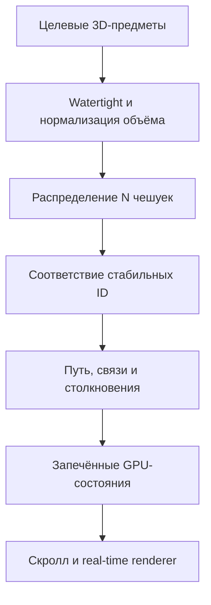

# Mimicry group — Photonic Skin

## PS‑03.M: архитектура вещества, кожи и предметной трансформации

Дата: 5 августа 2026 года  
Статус: технический исследовательский checkpoint перед новой геометрической веткой  
Область: Photonic Skin; семь компетенций остаются `контент`, `дизайн`, `event`, `игры`, `видео`, `digital`, `мерч`; обучение остаётся комплексным запросом.

---

## 1. Короткий ответ

Да, такую систему можно реализовать на сайте.

Но production-решение должно быть гибридным:

1. **Внутреннее вещество** задаётся как объём, способный соединяться и разделяться.
2. **Чешуйки** существуют как фиксированный набор самостоятельных GPU‑экземпляров со стабильными ID.
3. **Предметные формы** создаются и проверяются заранее как целевые поверхности.
4. **Тяжёлая математика** — нормализация объёма, распределение чешуек, поиск соответствий, устранение столкновений — считается вне браузера.
5. **Сайт** получает готовые состояния и траектории и плавно воспроизводит их от скролла.

Это не обман и не упрощение идеи. Это нормальное разделение между системой авторинга и real-time renderer: математический алгоритм остаётся общим и позволяет быстро подключать новые предметы, но посетитель сайта не оплачивает вычислительно полный пересчёт формы на каждом кадре.

---

## 2. Что в исходной гипотезе верно, а что требует уточнения

| Гипотеза | Вердикт | Уточнение |
|---|---|---|
| У мимика должна быть постоянная масса | Да | Массу следует формализовать как постоянный объём внутреннего вещества `V₀`, а не как размер bounding box или площадь поверхности. |
| Число чешуек можно сделать постоянным | Да | Каждая чешуйка должна иметь стабильный ID и существовать во всех состояниях, включая временно скрытое под поверхностью состояние. |
| Самая крупная предметная форма должна определить число чешуек | Не совсем | Нужно сравнивать не визуальный размер, а площадь поверхностей после нормализации объёма, экранный размер чешуек и сложность силуэта. |
| Один mesh можно деформировать изменением координат вершин | Да, для одинаковой топологии | Это основа morph targets, но она не создаёт честное расщепление, новые отверстия и разное число связных компонентов. |
| Нодовая система может управлять деформацией | Да, как authoring-tool | Blender Geometry Nodes может генерировать и симулировать состояния, но сайт не исполняет `.blend`‑ноды; результат экспортируется в данные, которые воспроизводит Three.js/WebGL/WebGPU. Blender Simulation Zones действительно позволяют строить нодовые симуляции, где результат кадра влияет на следующий ([Blender Manual](https://docs.blender.org/manual/en/latest/physics/simulation_nodes.html)). |
| Каждая вершина или каждый полигон должен быть чешуйкой | Нет | Вершины и полигоны — техническая сетка поверхности. Чешуйка должна быть отдельным instance с положением, ориентацией, размером, цветом и ID. |
| Связи между чешуйками должны разрываться и восстанавливаться | Да | Связь нужно хранить не как вечные mesh-рёбра, а как динамический граф соседства с условиями разрыва и повторного сцепления. |

---

## 3. Главное математическое ограничение

Постоянная масса и постоянная площадь кожи — разные ограничения.

- Объём вещества: `V₀`.
- Число чешуек: `N`.
- Средняя площадь одной чешуйки: `a₀`.
- Общая доступная площадь видимой кожи: приблизительно `N × a₀`.

Сфера при заданном объёме имеет минимальную возможную площадь поверхности. Любая вытянутая, плоская, складчатая или разделённая форма при том же объёме требует большей площади. Это прямое следствие трёхмерной изопериметрической задачи: среди тел одинакового объёма сферическая граница минимизирует площадь ([Robert Osserman, *The Isoperimetric Inequality*](https://sites.math.washington.edu/~toro/Courses/20-21/MSF/osserman.pdf)).

Простой пример при объёме `1`:

- площадь сферы примерно `4,84`;
- площадь куба равна `6` — примерно на 24% больше;
- тонкая форма пропорций `4 : 3 : 0,3` при том же объёме имеет площадь около `12`, то есть примерно в 2,5 раза больше поверхности сферы.

Поэтому нельзя для произвольных предметов одновременно потребовать:

1. строго постоянный объём;
2. строго постоянное количество чешуек;
3. строго постоянный размер каждой чешуйки;
4. отсутствие зазоров и наложений;
5. нахождение всех чешуек только на внешней поверхности.

Хотя бы один параметр должен иметь допуск.

### Рекомендуемый закон Photonic Skin

- `V₀` — сохраняется строго в authoring-проверке, целевой допуск не хуже ±1%;
- `N` — сохраняется строго, у каждой чешуйки постоянный ID;
- размер видимой чешуйки — меняется в небольшом диапазоне, исходно тестировать `0,85–1,15` от master-размера;
- часть чешуек может временно уходить в **подкожный резерв** или складываться в два слоя в невидимых областях;
- расстояние и зазор между чешуйками могут немного адаптироваться;
- предметные формы стилизуются так, чтобы не требовать недостижимой площади и микродеталей.

Это сохраняет ощущение одного живого существа, не превращая визуальную метафору в физически противоречивую модель.

---

## 4. Что является «чешуйкой» технически

Правильная единица — не vertex и не polygon, а **GPU instance**.

Для каждой чешуйки `i` хранятся:

```text
id_i          постоянный идентификатор
position_i    положение центра
normal_i      направление наружу
rotation_i    поворот вокруг нормали
scale_i       локальный размер/толщина
color_i       цветовое состояние
phase_i       фаза цветовой волны и idle
component_i   к какому предмету она относится в текущем состоянии
visibility_i  на поверхности, в переходе или в подкожном резерве
```

Одна маленькая геометрия чешуйки рисуется много раз с разными transforms. В Three.js для этого существует `InstancedMesh`: официальный API предназначен для большого числа объектов с общей геометрией и материалом, но разными матрицами и цветами, сокращая draw calls ([Three.js `InstancedMesh`](https://threejs.org/docs/pages/InstancedMesh.html)).

Следствия:

- чешуйки могут отделяться друг от друга без разрушения underlying mesh;
- их количество остаётся фиксированным;
- все отколовшиеся предметы остаются частями одного мимика благодаря общим ID, материалу и синхронной цветовой волне;
- LOD может заменять сложную чешуйку более простой, не меняя логику системы.

---

## 5. Три слоя production-архитектуры

### 5.1. Вещество — объём

Внутренняя чёрная или белая субстанция задаётся не одной вечной полигональной сеткой, а неявной поверхностью — например signed distance field (SDF), level set или системой частиц, покрытой iso-surface.

Такое представление естественно допускает слияние и разделение. Классическая работа Desbrun и Gascuel описывает гибрид «частицы + гладкая implicit surface» именно для мягкого вещества, способного к разделению и слиянию ([*Animating Soft Substances with Implicit Surfaces*](https://geometry.caltech.edu/pubs/DG_SIG95.pdf)). Для offline-обработки sparse volumes существует production-библиотека OpenVDB ([официальный проект](https://www.openvdb.org/)).

Важно: SDF — это не окончательный вид кожи. Это скрытый каркас массы и видимая субстанция в зазорах.

### 5.2. Кожа — фиксированные instances

Чешуйки располагаются на нулевой поверхности SDF или на целевом watertight mesh. Их transforms хранятся отдельно от underlying triangulation.

### 5.3. Предметы — целевые поверхности

Книга, палитра, камера, ноутбук и другие формы остаются авторскими 3D-моделями. Алгоритм не должен самостоятельно «понимать», что такое книга. Он должен уметь взять подготовленную целевую модель и автоматически:

- нормализовать её массу;
- распределить по поверхности чешуйки;
- сопоставить их с предыдущим состоянием;
- построить плавную траекторию;
- проверить качество и бюджет.

---

## 6. Алгоритм добавления новой предметной формы



### Шаг 1. Подготовить замкнутые объёмы

Каждый предмет должен быть замкнутым (`watertight`), без самопересечений и вырожденных граней. Даже открытая книга для расчёта массы должна быть стилизованным замкнутым телом: две толстые «страницы-крыла» и корешок, а не математически бесконечно тонкая плоскость.

Отверстия допустимы, но они увеличивают площадь кожи. Поэтому отверстие в палитре нужно либо честно учитывать, либо стилизовать как глубокую выемку.

### Шаг 2. Сохранить объём

Пусть суммарный исходный объём целевых компонентов равен

`V_target = Σ V_j`.

Если взаимные пропорции предметов сохраняются, ко всей композиции применяется один масштаб:

`s = (V₀ / V_target)^(1/3)`.

После масштабирования суммарный объём становится `V₀`.

Если нужно вручную определить, сколько массы получит каждый предмет, задаются доли `w_j`, где `Σw_j = 1`, и для компонента:

`s_j = (w_j × V₀ / V_j)^(1/3)`.

Для Photonic Skin предпочтителен **единый общий масштаб**, потому что он сохраняет авторские пропорции композиции. Индивидуальные доли нужны только как art-direction override, например чтобы шахматная фигура не стала нечитаемо маленькой рядом с геймпадом.

### Шаг 3. Распределить чешуйки

На поверхности создаётся `N` почти равномерных sample-точек. Простого случайного scatter недостаточно: он даёт комки и пустоты.

Подходящие методы:

- Poisson-disk / blue-noise sampling — обеспечивает минимальную дистанцию между sample-точками ([Wei, *Parallel Poisson Disk Sampling on Arbitrary Surfaces*](https://dl.acm.org/doi/10.1145/1882261.1866188));
- centroidal Voronoi tessellation — стремится разместить генераторы в центрах своих областей и используется для равномерного распределения ресурсов ([Du, Faber, Gunzburger](https://epubs.siam.org/doi/10.1137/S0036144599352836));
- weighted sampling — больше точек на силуэтных, изгибных и семантически важных участках. Three.js предоставляет базовый `MeshSurfaceSampler`, который один раз строится за `O(n)`, а затем берёт surface samples за `O(log n)` ([официальная документация](https://threejs.org/docs/pages/MeshSurfaceSampler.html)), но production-раскладку лучше дополнительно релаксировать.

Полезная плотность:

`ρ(x) = 1 + α·curvature(x) + β·silhouette(x) + γ·semanticMask(x)`.

Она означает: на изгибах, внешнем контуре и важных деталях — больше маленьких чешуек; на широких спокойных плоскостях — меньше и крупнее.

### Шаг 4. Сопоставить старые и новые позиции

Пусть у нас есть исходные позиции `p_i` и целевые позиции `q_j`. Нужно решить, какая чешуйка куда полетит.

Наивное сопоставление `i → i` даст хаос, а просто ближайшая точка создаст заторы. Нужна транспортная задача. Базовая стоимость:

`C_ij = wd·||p_i-q_j||² + wn·(1-n_i·n_j) + ws·semanticPenalty + wc·componentPenalty`.

Затем ищется назначение с минимальной суммарной стоимостью. Entropic optimal transport позволяет ускорять такую задачу итерациями Sinkhorn ([Cuturi, NIPS 2013](https://proceedings.neurips.cc/paper_files/paper/2013/hash/af21d0c97db2e27e13572cbf59eb343d-Abstract.html)). Для согласованного движения облаков точек можно использовать идеи Coherent Point Drift, где точки принуждаются двигаться как связная группа и сохранять структуру ([Myronenko & Song](https://arxiv.org/abs/0905.2635)).

Для `N ≈ 8 000` нельзя бездумно держать полный плотный `N×N` cost matrix в каждом интерактивном кадре. Но offline-решение практично: сначала назначаются крупные регионы/компоненты, затем соответствие решается внутри них.

### Шаг 5. Построить не прямые линии, а правдоподобный поток

Прямое `lerp(p_i,q_i,t)` вызывает взаимные проходы чешуек и визуальный «взрыв конфетти». Лучше использовать путь из фаз:

1. натяжение и обозначение будущих долей;
2. частичное погружение чешуек во внутреннее вещество;
3. перенос через согласованное векторное поле;
4. выход на целевую поверхность;
5. выравнивание по нормали;
6. стабилизация и idle.

Для сохранения локальной связности можно добавить ARAP-регуляризацию: она минимизирует отклонение локальных преобразований от жёстких и стремится сохранять локальные длины ([Sorkine & Alexa, 2007](https://igl.ethz.ch/projects/ARAP/arap_web.pdf)). Здесь ARAP — не вся физика мимика, а один член общей функции качества.

### Шаг 6. Решить связи, разрывы и столкновения

У каждой чешуйки есть текущие соседи. Граф пересчитывается по поверхности или хранится для каждого целевого состояния.

Стартовые исследовательские коэффициенты, а не финальная физическая истина:

- нормальная дистанция соседей: около `1,0ℓ`;
- жёсткое отталкивание при расстоянии меньше `0,8–0,85ℓ`;
- связь может ослабевать после `1,4–1,6ℓ`;
- повторное сцепление происходит на меньшем пороге, например `1,2–1,3ℓ`, чтобы связь не дрожала между состояниями.

Разные пороги разрыва и восстановления создают **гистерезис** — связь не переключается туда-сюда на каждом кадре.

Упрощённая энергия промежуточного состояния:

`E = λt·E_target + λb·E_bonds + λr·E_repulsion + λs·E_surface + λv·E_volume + λa·E_artDirection`.

Где:

- `E_target` ведёт чешуйки к целевым позициям;
- `E_bonds` сохраняет локальную согласованность;
- `E_repulsion` предотвращает пересечения;
- `E_surface` удерживает чешуйки на коже или внутри разрешённого переходного слоя;
- `E_volume` сохраняет объём вещества;
- `E_artDirection` обеспечивает нужные силуэт, направление движения и момент расщепления.

---

## 7. Как происходит настоящее расщепление

Пример: сфера превращается в геймпад и шахматного ферзя.

1. Алгоритм заранее выделяет две группы чешуек и две доли объёма.
2. Внутреннее SDF-вещество вытягивает два будущих объёма, сохраняя между ними шейку.
3. Рёбра динамического графа поперёк шейки постепенно ослабляются.
4. При толщине шейки меньше заданного визуального порога SDF разделяется на два компонента.
5. Чешуйки, относящиеся к разным компонентам, больше не считаются соседями.
6. Оба предмета продолжают использовать единый материал, общий временной clock и одну цветовую волну, поэтому воспринимаются частями одного мимика.

Обратное превращение выполняется в обратном порядке, но не обязано быть буквально reverse playback: сначала формируется мост вещества, затем восстанавливаются связи и только после этого чешуйки стягиваются в master-state.

Одна fixed-topology mesh не может честно выполнить этот момент. В glTF morph target — это набор дельт тех же vertex attributes; все morph accessors должны иметь тот же `count`, что и исходная primitive. Поэтому morph targets меняют координаты существующих вершин, но не саму схему соединения ([Khronos glTF 2.0, Morph Targets](https://registry.khronos.org/glTF/specs/2.0/glTF-2.0.html)).

---

## 8. Что вычисляется заранее, а что делает сайт

| Offline authoring / build step | В браузере |
|---|---|
| Проверка watertight, manifold, self-intersections | Загрузка готовых target-state данных |
| Расчёт объёма и площади | Привязка progress к вертикальному/горизонтальному скроллу |
| Нормализация массы | Интерполяция position/normal/scale/color |
| Weighted surface sampling | GPU-instanced rendering чешуек |
| Optimal transport / CPD correspondence | Показ внутренней субстанции в щелях |
| Расчёт связей, столкновений и промежуточных key states | Медленный idle, вращение и цветовая волна |
| Автоматические QA-метрики и рендеры | LOD, reduced motion, static fallback |

На сайте можно хранить для каждой чешуйки два или несколько состояний в `DataTexture`/buffer и интерполировать их в vertex shader. Three.js поддерживает raw-data textures ([`DataTexture`](https://threejs.org/docs/pages/DataTexture.html)), instanced attributes и compute-oriented storage attributes ([`StorageInstancedBufferAttribute`](https://threejs.org/docs/pages/StorageInstancedBufferAttribute.html)). `WebGPURenderer` может использовать WebGPU и официально имеет fallback на WebGL 2 ([Three.js docs](https://threejs.org/docs/pages/WebGPURenderer.html)).

Это делает систему технически реалистичной для сайта. Однако конкретные `N`, полигональность одной чешуйки, разрешение SDF и число key states должны быть подтверждены отдельным benchmark. Официальные Three.js examples демонстрируют GPU-compute сцены со 100–500 тысячами points, поэтому `4–12 тысяч` простых instances выглядит разумным диапазоном для прототипа, но это лишь инженерная оценка: чешуйка тяжелее точки, а material и post-processing тоже расходуют бюджет ([Three.js compute examples](https://threejs.org/examples/webgpu_compute_particles.html)).

---

## 9. Что делать с PS‑03 и D‑R3

### Что PS‑03 действительно доказал

- pipeline способен воспроизводимо строить и валидировать геометрию;
- 8 322 вершины / 8 480 граней можно использовать как первый scale-budget для benchmark;
- текущая mesh была связной, manifold, без loose vertices, degenerates и self-intersections;
- topology/UV/active-face hashes контролировались;
- были отработаны камера, bbox, рендерные доски, silhouette-review и дисциплина coordinate-only вариантов;
- найдена полезная пластическая ДНК: масса/премиальность C плюс ограниченная направленность A; переход `натяжение → morph → стабилизация → idle` остаётся релевантным.

### Что PS‑03 не доказал

- предметную узнаваемость семи состояний;
- сохранение массы как объёма;
- постоянство реального числа чешуек;
- настоящее разделение на несколько предметов;
- создание отверстий;
- универсальный алгоритм подключения новых форм.

### Решение

PS‑03 не нужно выбрасывать полностью, но его нельзя продолжать как production-ветку fixed topology.

| Сохранить | Перепроектировать | Архивировать как baseline |
|---|---|---|
| QA-пайплайн, рендеры, silhouette-review | Модель массы и объём | D‑R3 предметные кандидаты |
| Камеру, материал, свет, screen envelope | Чешуйку как independent instance | Замороженную ring-topology как универсальный закон |
| Neutral master-state как визуальную отправную точку | SDF/particle substrate | Shape keys как единственный механизм трансформации |
| Направленное натяжение и controlled idle | Dynamic neighbor graph и split/merge | Обязательный общий topology/UV hash между предметами |
| 8k как один из benchmark-уровней | Offline transport solver и browser data format | 34% active mask как универсальную маску |

Точный bbox `6.8 × 3.6 × 3.2` больше не должен быть геометрическим законом всех предметов. Его можно сохранить как исходный reference envelope, а новый pipeline должен отдельно проверять постоянство экранной композиции и объёма.

---

## 10. Рекомендуемый следующий этап

Не переходить сразу к моделированию всех семи компетенций. Ввести промежуточный этап:

### `PS‑03.M — Matter & Skin Architecture`

#### M‑01. Зафиксировать инварианты

1. Постоянный объём `V₀`.
2. Постоянное число ID `N`.
3. Допустимый диапазон размеров чешуек.
4. Допустимая доля подкожного резерва.
5. Правила split/merge и ограничения экранной композиции.

#### M‑02. Собрать минимальный тест из трёх состояний

- сфера — нейтральный master;
- открытая книга — одна связная, тонкая, сильно отличающаяся форма;
- геймпад + ферзь — настоящее расщепление на два компонента.

Эти три состояния проверяют почти всю архитектуру. Камеру, мерч и сцену рано включать до прохождения этого теста.

#### M‑03. Сравнить три бюджета кожи

- `N = 4 096`;
- `N = 8 192`;
- `N = 12 288`.

Выбор делается по силуэту на desktop/mobile, времени кадра, объёму данных и читаемости единицы кожи — не по самой крупной предметной модели.

#### M‑04. Реализовать offline solver

Blender/Python:

- импорт target mesh;
- repair/validation;
- volume normalization;
- weighted Poisson/CVT sampling;
- assignment стабильных ID;
- transition solve;
- экспорт binary textures/buffers и QA-отчёта.

Geometry Nodes можно использовать как визуальный интерфейс для art-direction и preview, но вычислительное ядро лучше держать воспроизводимым в скриптах.

#### M‑05. Реализовать browser spike

- Three.js / React Three Fiber;
- `InstancedMesh` для чешуек;
- WebGL 2 baseline;
- WebGPU compute enhancement, но не единственная обязательная ветка;
- управление `progress` от скролла;
- desktop/mobile/reduced-motion профили;
- профилирование GPU/CPU/memory/load size.

#### M‑06. Решение перед D‑R4

Только после просмотра реального morph sphere → book → gamepad+queen выбрать:

- сохраняется ли идея постоянного количества чешуек визуально;
- сколько резерва допустимо;
- должен ли внутренний объём быть видимым между чешуйками;
- насколько «жидкой» или «собранной» должна быть трансформация;
- утверждается ли hybrid SDF + instanced skin как production-архитектура.

---

## 11. Итоговое решение на текущем этапе

1. **Техническая возможность подтверждена.**
2. **Ваша гипотеза о едином количестве вещества и стабильных единицах кожи продуктивна**, если разделить объём и площадь кожи.
3. **Чешуйка должна быть отдельной сущностью, а не вершиной или полигоном underlying mesh.**
4. **Одна fixed-topology mesh подходит для непрерывных morphs, но не для настоящего split/merge.**
5. **Лучшее направление — hybrid:** объёмная SDF/particle-субстанция + fixed-ID GPU-instanced чешуйки + заранее рассчитанные target states.
6. **D‑R3 полезен как проверенный QA/render baseline и опыт ограничений, но не как production-топология нового курса.**
7. **Следующий рациональный шаг — не D‑R4 предметов, а PS‑03.M на трёх тестовых состояниях.**

